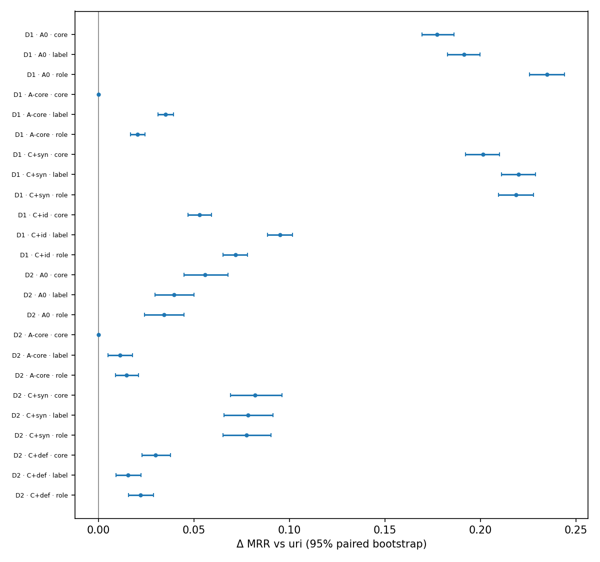

# #134 serialization order: test report

- Paired source-level bootstraps: 2,000 replicates, fresh seed 42 per contrast, 95% percentile intervals; datasets are never pooled. Two pairs (D1, D2) and one model (M2): no generalisation claim.
- Primary contrasts: frozen order − uri on D1/S/A0 and D2/S/A0 (MRR, Recall@1), with 95% and Bonferroni-adjusted 97.5% intervals (family: the two datasets of one metric). Every other table is secondary and unadjusted. Written only after `gate-ranks` passed.
- Rank gate: pass, 13 executions, 0 failed; code commit `6977bb4053200599251131f2813dc13cf00629bc` (`diagnostics/rank_gate.json`).
- Earlier gate attempt kept for audit, superseded: `diagnostics/gate_attempt_1_FAIL/` (FAIL, 13 of 13 failed; same report inputs). See the PR for its diagnosis.

## How the order was chosen (D2 validation)

`label` was frozen by the pre-specified tie-breaking rule, **not** because it had the highest D2 validation MRR: `core` had the highest (0.8291 vs 0.8257), but no candidate's `MRR(best) − MRR(candidate)` interval excluded 0, so E = {label, core, role} and the precedence label > core > role chose `label`. These validation intervals are descriptive and not adjusted for selection.

uri MRR 0.7899; n = 299 D2 validation reference sources; 10,000 shared replicates, seed 20261016.

| Candidate | D2 validation MRR | − uri [95%] | best − candidate [95%] | in E |
|---|---|---|---|---|
| label | 0.8257 | +0.0358 [+0.0173, +0.0548] | +0.0034 [-0.0095, +0.0166] | yes |
| core | 0.8291 | +0.0393 [+0.0196, +0.0604] | +0.0000 [+0.0000, +0.0000] | yes |
| role | 0.8221 | +0.0322 [+0.0152, +0.0505] | +0.0070 [-0.0093, +0.0241] | yes |

## Primary contrasts (pre-specified)

| Dataset | n | Metric | uri | label | Δ [95%] | Δ [Bonferroni 97.5%] |
|---|---|---|---|---|---|---|
| D1 | 4605 | MRR | 0.4525 | 0.6437 | +0.1912 [+0.1826, +0.1997] | +0.1912 [+0.1819, +0.2009] |
| D1 | 4605 | Recall@1 | 0.3349 | 0.5412 | +0.2063 [+0.1941, +0.2187] | +0.2063 [+0.1924, +0.2198] |
| D2 | 1198 | MRR | 0.7356 | 0.7752 | +0.0396 [+0.0295, +0.0501] | +0.0396 [+0.0284, +0.0519] |
| D2 | 1198 | Recall@1 | 0.6686 | 0.7245 | +0.0559 [+0.0401, +0.0718] | +0.0559 [+0.0384, +0.0743] |

## Cell metrics

| Logical condition | Execution | D1 MRR / R@1 (n) | D2 MRR / R@1 (n) |
|---|---|---|---|
| D1/S/A0/uri | `SO-all-uri-full` | 0.4525 / 0.3349 (4605) |  |
| D1/S/A0/core | `SO-all-core-full` | 0.6298 / 0.5179 (4605) |  |
| D1/S/A0/label | `SO-all-label-full` | 0.6437 / 0.5412 (4605) |  |
| D1/S/A0/role | `SO-all-role-full` | 0.6871 / 0.5926 (4605) |  |
| D1/S/A-core/uri | `SO-core-uri-full` | 0.7246 / 0.6432 (4605) |  |
| D1/S/A-core/core | `SO-core-uri-full` | 0.7246 / 0.6432 (4605) |  |
| D1/S/A-core/label | `SO-core-label-full` | 0.7597 / 0.6912 (4605) |  |
| D1/S/A-core/role | `SO-core-role-full` | 0.7450 / 0.6699 (4605) |  |
| D1/S/C+syn/uri | `SO-core-plus-syn-uri-full` | 0.4754 / 0.3579 (4605) |  |
| D1/S/C+syn/core | `SO-core-plus-syn-core-full` | 0.6766 / 0.5815 (4605) |  |
| D1/S/C+syn/label | `SO-core-plus-syn-label-full` | 0.6952 / 0.6046 (4605) |  |
| D1/S/C+syn/role | `SO-core-plus-syn-role-full` | 0.6940 / 0.6020 (4605) |  |
| D1/S/C+id/uri | `SO-core-plus-id-uri-full` | 0.6691 / 0.5729 (4605) |  |
| D1/S/C+id/core | `SO-core-plus-id-core-full` | 0.7221 / 0.6371 (4605) |  |
| D1/S/C+id/label | `SO-core-plus-id-label-full` | 0.7640 / 0.6975 (4605) |  |
| D1/S/C+id/role | `SO-core-plus-id-role-full` | 0.7409 / 0.6645 (4605) |  |
| D2/S/A0/uri | `SO-all-uri-full` |  | 0.7356 / 0.6686 (1198) |
| D2/S/A0/core | `SO-all-core-full` |  | 0.7913 / 0.7379 (1198) |
| D2/S/A0/label | `SO-all-label-full` |  | 0.7752 / 0.7245 (1198) |
| D2/S/A0/role | `SO-all-role-full` |  | 0.7700 / 0.7187 (1198) |
| D2/S/A-core/uri | `SO-core-uri-full` |  | 0.8713 / 0.8205 (1198) |
| D2/S/A-core/core | `SO-core-uri-full` |  | 0.8713 / 0.8205 (1198) |
| D2/S/A-core/label | `SO-core-label-full` |  | 0.8826 / 0.8372 (1198) |
| D2/S/A-core/role | `SO-core-role-full` |  | 0.8861 / 0.8422 (1198) |
| D2/S/C+syn/uri | `SO-core-plus-syn-uri-full` |  | 0.8117 / 0.7496 (1198) |
| D2/S/C+syn/core | `SO-core-plus-syn-core-full` |  | 0.8936 / 0.8548 (1198) |
| D2/S/C+syn/label | `SO-core-plus-syn-label-full` |  | 0.8898 / 0.8539 (1198) |
| D2/S/C+syn/role | `SO-core-plus-syn-role-full` |  | 0.8892 / 0.8506 (1198) |
| D2/S/C+def/uri | `SO-core-plus-def-uri-full` |  | 0.7425 / 0.6886 (1198) |
| D2/S/C+def/core | `SO-core-plus-def-core-full` |  | 0.7723 / 0.7137 (1198) |
| D2/S/C+def/label | `SO-core-plus-def-label-full` |  | 0.7579 / 0.7028 (1198) |
| D2/S/C+def/role | `SO-core-plus-def-role-full` |  | 0.7644 / 0.7104 (1198) |
| D1/B48/F-uri | `SO-all-sel_core-ren_uri-48` | 0.4855 / 0.3559 (4605) |  |
| D1/B48/F-core | `SO-all-sel_core-ren_core-48` | 0.6666 / 0.5646 (4605) |  |
| D1/B48/F-label | `SO-all-sel_core-ren_label-48` | 0.6668 / 0.5644 (4605) |  |
| D1/B48/F-role | `SO-all-sel_core-ren_role-48` | 0.6881 / 0.5889 (4605) |  |
| D1/B48/C-uri | `SO-all-sel_uri-ren_uri-48` | 0.3566 / 0.2584 (4605) |  |
| D1/B48/C-core | `SO-all-sel_core-ren_core-48` | 0.6666 / 0.5646 (4605) |  |
| D1/B48/C-label | `SO-all-sel_label-ren_label-48` | 0.5524 / 0.4426 (4605) |  |
| D1/B48/C-role | `SO-all-sel_role-ren_role-48` | 0.6811 / 0.5811 (4605) |  |
| D1/B48/X-label | `SO-all-sel_label-ren_uri-48` | 0.4256 / 0.3125 (4605) |  |
| D1/B48/X-role | `SO-all-sel_role-ren_uri-48` | 0.5114 / 0.3726 (4605) |  |
| D2/B24/F-uri | `SO-all-sel_core-ren_uri-24` |  | 0.7888 / 0.7179 (1198) |
| D2/B24/F-core | `SO-all-sel_core-ren_core-24` |  | 0.8473 / 0.7871 (1198) |
| D2/B24/F-label | `SO-all-sel_core-ren_label-24` |  | 0.8541 / 0.7972 (1198) |
| D2/B24/F-role | `SO-all-sel_core-ren_role-24` |  | 0.8542 / 0.7972 (1198) |
| D2/B24/C-uri | `SO-all-sel_uri-ren_uri-24` |  | 0.7348 / 0.6561 (1198) |
| D2/B24/C-core | `SO-all-sel_core-ren_core-24` |  | 0.8473 / 0.7871 (1198) |
| D2/B24/C-label | `SO-all-sel_label-ren_label-24` |  | 0.7971 / 0.7237 (1198) |
| D2/B24/C-role | `SO-all-sel_role-ren_role-24` |  | 0.7947 / 0.7145 (1198) |
| D2/B24/X-label | `SO-all-sel_label-ren_uri-24` |  | 0.6914 / 0.5902 (1198) |
| D2/B24/X-role | `SO-all-sel_role-ren_uri-24` |  | 0.7114 / 0.6160 (1198) |
| D2/B48/F-uri | `SO-all-sel_core-ren_uri-48` |  | 0.7772 / 0.7020 (1198) |
| D2/B48/F-core | `SO-all-sel_core-ren_core-48` |  | 0.8784 / 0.8372 (1198) |
| D2/B48/F-label | `SO-all-sel_core-ren_label-48` |  | 0.8660 / 0.8230 (1198) |
| D2/B48/F-role | `SO-all-sel_core-ren_role-48` |  | 0.8662 / 0.8222 (1198) |
| D2/B48/C-uri | `SO-all-sel_uri-ren_uri-48` |  | 0.7497 / 0.6895 (1198) |
| D2/B48/C-core | `SO-all-sel_core-ren_core-48` |  | 0.8784 / 0.8372 (1198) |
| D2/B48/C-label | `SO-all-sel_label-ren_label-48` |  | 0.8312 / 0.7863 (1198) |
| D2/B48/C-role | `SO-all-sel_role-ren_role-48` |  | 0.8510 / 0.8038 (1198) |
| D2/B48/X-label | `SO-all-sel_label-ren_uri-48` |  | 0.7676 / 0.7045 (1198) |
| D2/B48/X-role | `SO-all-sel_role-ren_uri-48` |  | 0.7829 / 0.7162 (1198) |

## Block S: each order − uri (selected set fixed)

| Subset | Row | Contrast | n (changed) | Δ MRR [95%] | Δ R@1 [95%] | Δ MRR, changed only |
|---|---|---|---|---|---|---|
| D1 | A0 | core − uri | 4605 (4568) | +0.1772 [+0.1693, +0.1862] | +0.1831 [+0.1713, +0.1952] | +0.1787 [+0.1702, +0.1874] |
| D1 | A0 | label − uri | 4605 (4605) | +0.1912 [+0.1826, +0.1997] | +0.2063 [+0.1941, +0.2187] | +0.1912 [+0.1826, +0.1997] |
| D1 | A0 | role − uri | 4605 (4605) | +0.2346 [+0.2257, +0.2440] | +0.2578 [+0.2452, +0.2708] | +0.2346 [+0.2257, +0.2440] |
| D1 | A-core | core − uri | 4605 (0) | +0.0000 [+0.0000, +0.0000] | +0.0000 [+0.0000, +0.0000] | – |
| D1 | A-core | label − uri | 4605 (4605) | +0.0351 [+0.0311, +0.0394] | +0.0480 [+0.0413, +0.0552] | +0.0351 [+0.0311, +0.0394] |
| D1 | A-core | role − uri | 4605 (4605) | +0.0204 [+0.0168, +0.0242] | +0.0267 [+0.0204, +0.0337] | +0.0204 [+0.0168, +0.0242] |
| D1 | C+syn | core − uri | 4605 (3301) | +0.2011 [+0.1920, +0.2100] | +0.2237 [+0.2115, +0.2360] | +0.2842 [+0.2727, +0.2962] |
| D1 | C+syn | label − uri | 4605 (4605) | +0.2198 [+0.2109, +0.2288] | +0.2467 [+0.2339, +0.2591] | +0.2198 [+0.2109, +0.2288] |
| D1 | C+syn | role − uri | 4605 (4605) | +0.2186 [+0.2094, +0.2278] | +0.2441 [+0.2315, +0.2569] | +0.2186 [+0.2094, +0.2278] |
| D1 | C+id | core − uri | 4605 (4568) | +0.0530 [+0.0469, +0.0591] | +0.0643 [+0.0541, +0.0740] | +0.0534 [+0.0468, +0.0596] |
| D1 | C+id | label − uri | 4605 (4605) | +0.0949 [+0.0885, +0.1015] | +0.1246 [+0.1144, +0.1355] | +0.0949 [+0.0885, +0.1015] |
| D1 | C+id | role − uri | 4605 (4605) | +0.0718 [+0.0653, +0.0781] | +0.0916 [+0.0810, +0.1016] | +0.0718 [+0.0653, +0.0781] |
| D2 | A0 | core − uri | 1198 (1188) | +0.0557 [+0.0448, +0.0677] | +0.0693 [+0.0526, +0.0868] | +0.0562 [+0.0448, +0.0681] |
| D2 | A0 | label − uri | 1198 (1198) | +0.0396 [+0.0295, +0.0501] | +0.0559 [+0.0401, +0.0718] | +0.0396 [+0.0295, +0.0501] |
| D2 | A0 | role − uri | 1198 (1198) | +0.0344 [+0.0241, +0.0449] | +0.0501 [+0.0351, +0.0659] | +0.0344 [+0.0241, +0.0449] |
| D2 | A-core | core − uri | 1198 (0) | +0.0000 [+0.0000, +0.0000] | +0.0000 [+0.0000, +0.0000] | – |
| D2 | A-core | label − uri | 1198 (1198) | +0.0113 [+0.0050, +0.0177] | +0.0167 [+0.0058, +0.0275] | +0.0113 [+0.0050, +0.0177] |
| D2 | A-core | role − uri | 1198 (1198) | +0.0148 [+0.0089, +0.0210] | +0.0217 [+0.0109, +0.0326] | +0.0148 [+0.0089, +0.0210] |
| D2 | C+syn | core − uri | 1198 (1188) | +0.0820 [+0.0690, +0.0961] | +0.1052 [+0.0860, +0.1260] | +0.0827 [+0.0691, +0.0965] |
| D2 | C+syn | label − uri | 1198 (1198) | +0.0781 [+0.0658, +0.0912] | +0.1043 [+0.0851, +0.1235] | +0.0781 [+0.0658, +0.0912] |
| D2 | C+syn | role − uri | 1198 (1198) | +0.0776 [+0.0652, +0.0903] | +0.1010 [+0.0818, +0.1202] | +0.0776 [+0.0652, +0.0903] |
| D2 | C+def | core − uri | 1198 (234) | +0.0298 [+0.0229, +0.0376] | +0.0250 [+0.0167, +0.0351] | +0.1533 [+0.1214, +0.1873] |
| D2 | C+def | label − uri | 1198 (1198) | +0.0154 [+0.0091, +0.0223] | +0.0142 [+0.0042, +0.0250] | +0.0154 [+0.0091, +0.0223] |
| D2 | C+def | role − uri | 1198 (1198) | +0.0219 [+0.0156, +0.0287] | +0.0217 [+0.0117, +0.0317] | +0.0219 [+0.0156, +0.0287] |

## Block S: representation contrasts within each order

| Subset | Contrast | uri: Δ MRR [95%] | core: Δ MRR [95%] | label: Δ MRR [95%] | role: Δ MRR [95%] |
|---|---|---|---|---|---|
| D1 | A-core − A0 | +0.2721 [+0.2604, +0.2841] | +0.0949 [+0.0851, +0.1049] | +0.1160 [+0.1067, +0.1262] | +0.0579 [+0.0486, +0.0668] |
| D1 | C+syn − A-core | -0.2492 [-0.2609, -0.2377] | -0.0481 [-0.0562, -0.0395] | -0.0645 [-0.0728, -0.0560] | -0.0510 [-0.0591, -0.0430] |
| D1 | C+id − A-core | -0.0556 [-0.0631, -0.0483] | -0.0026 [-0.0086, +0.0030] | +0.0043 [-0.0020, +0.0108] | -0.0041 [-0.0096, +0.0012] |
| D2 | A-core − A0 | +0.1357 [+0.1154, +0.1565] | +0.0800 [+0.0622, +0.0979] | +0.1074 [+0.0881, +0.1265] | +0.1161 [+0.0969, +0.1354] |
| D2 | C+syn − A-core | -0.0597 [-0.0764, -0.0432] | +0.0223 [+0.0124, +0.0322] | +0.0072 [-0.0041, +0.0177] | +0.0031 [-0.0072, +0.0137] |
| D2 | C+def − A-core | -0.1288 [-0.1474, -0.1103] | -0.0990 [-0.1153, -0.0827] | -0.1247 [-0.1433, -0.1061] | -0.1217 [-0.1398, -0.1039] |

## Block B: serialization, selection, combined and interaction

| Subset | Budget | Order | Effect | Δ MRR [95%] | Δ R@1 [95%] |
|---|---|---|---|---|---|
| D1 | 48 | uri | selection (uri rendering) = combined | -0.1289 [-0.1392, -0.1183] | -0.0975 [-0.1101, -0.0847] |
| D1 | 48 | core | serialization (reference set) = combined | +0.1811 [+0.1725, +0.1897] | +0.2087 [+0.1963, +0.2208] |
| D1 | 48 | core | serialization (reference set) − no-budget serialization | +0.0039 [-0.0053, +0.0130] | +0.0256 [+0.0115, +0.0395] |
| D1 | 48 | label | serialization, reference set | +0.1813 [+0.1734, +0.1895] | +0.2085 [+0.1967, +0.2206] |
| D1 | 48 | label | serialization, own set | +0.1268 [+0.1200, +0.1340] | +0.1301 [+0.1199, +0.1407] |
| D1 | 48 | label | selection, uri rendering | -0.0600 [-0.0700, -0.0498] | -0.0434 [-0.0560, -0.0304] |
| D1 | 48 | label | selection, own rendering | -0.1145 [-0.1248, -0.1040] | -0.1218 [-0.1362, -0.1079] |
| D1 | 48 | label | combined policy | +0.0668 [+0.0559, +0.0775] | +0.0866 [+0.0723, +0.1008] |
| D1 | 48 | label | interaction | -0.0545 [-0.0634, -0.0453] | -0.0784 [-0.0919, -0.0647] |
| D1 | 48 | label | serialization (reference set) − no-budget serialization | -0.0099 [-0.0187, -0.0012] | +0.0022 [-0.0115, +0.0163] |
| D1 | 48 | role | serialization, reference set | +0.2026 [+0.1938, +0.2115] | +0.2330 [+0.2202, +0.2463] |
| D1 | 48 | role | serialization, own set | +0.1697 [+0.1612, +0.1783] | +0.2085 [+0.1957, +0.2206] |
| D1 | 48 | role | selection, uri rendering | +0.0258 [+0.0148, +0.0367] | +0.0167 [+0.0026, +0.0315] |
| D1 | 48 | role | selection, own rendering | -0.0070 [-0.0170, +0.0025] | -0.0078 [-0.0228, +0.0065] |
| D1 | 48 | role | combined policy | +0.1956 [+0.1844, +0.2069] | +0.2252 [+0.2098, +0.2404] |
| D1 | 48 | role | interaction | -0.0328 [-0.0432, -0.0228] | -0.0245 [-0.0410, -0.0089] |
| D1 | 48 | role | serialization (reference set) − no-budget serialization | -0.0320 [-0.0416, -0.0227] | -0.0248 [-0.0395, -0.0096] |
| D2 | 24 | uri | selection (uri rendering) = combined | -0.0540 [-0.0764, -0.0326] | -0.0618 [-0.0927, -0.0326] |
| D2 | 24 | core | serialization (reference set) = combined | +0.0585 [+0.0478, +0.0690] | +0.0693 [+0.0543, +0.0843] |
| D2 | 24 | core | serialization (reference set) − no-budget serialization | +0.0027 [-0.0124, +0.0173] | +0.0000 [-0.0225, +0.0209] |
| D2 | 24 | label | serialization, reference set | +0.0652 [+0.0540, +0.0766] | +0.0793 [+0.0626, +0.0960] |
| D2 | 24 | label | serialization, own set | +0.1057 [+0.0929, +0.1193] | +0.1336 [+0.1135, +0.1536] |
| D2 | 24 | label | selection, uri rendering | -0.0974 [-0.1196, -0.0751] | -0.1277 [-0.1594, -0.0960] |
| D2 | 24 | label | selection, own rendering | -0.0569 [-0.0740, -0.0406] | -0.0735 [-0.0993, -0.0492] |
| D2 | 24 | label | combined policy | +0.0083 [-0.0123, +0.0273] | +0.0058 [-0.0242, +0.0334] |
| D2 | 24 | label | interaction | +0.0404 [+0.0241, +0.0574] | +0.0543 [+0.0284, +0.0801] |
| D2 | 24 | label | serialization (reference set) − no-budget serialization | +0.0256 [+0.0106, +0.0402] | +0.0234 [+0.0000, +0.0467] |
| D2 | 24 | role | serialization, reference set | +0.0654 [+0.0546, +0.0765] | +0.0793 [+0.0634, +0.0960] |
| D2 | 24 | role | serialization, own set | +0.0833 [+0.0718, +0.0952] | +0.0985 [+0.0810, +0.1169] |
| D2 | 24 | role | selection, uri rendering | -0.0774 [-0.0994, -0.0547] | -0.1018 [-0.1336, -0.0684] |
| D2 | 24 | role | selection, own rendering | -0.0595 [-0.0765, -0.0429] | -0.0826 [-0.1093, -0.0568] |
| D2 | 24 | role | combined policy | +0.0059 [-0.0141, +0.0250] | -0.0033 [-0.0334, +0.0259] |
| D2 | 24 | role | interaction | +0.0179 [+0.0029, +0.0331] | +0.0192 [-0.0042, +0.0434] |
| D2 | 24 | role | serialization (reference set) − no-budget serialization | +0.0310 [+0.0166, +0.0456] | +0.0292 [+0.0075, +0.0509] |
| D2 | 48 | uri | selection (uri rendering) = combined | -0.0275 [-0.0432, -0.0129] | -0.0125 [-0.0326, +0.0075] |
| D2 | 48 | core | serialization (reference set) = combined | +0.1011 [+0.0869, +0.1158] | +0.1352 [+0.1135, +0.1569] |
| D2 | 48 | core | serialization (reference set) − no-budget serialization | +0.0454 [+0.0321, +0.0585] | +0.0659 [+0.0467, +0.0868] |
| D2 | 48 | label | serialization, reference set | +0.0887 [+0.0765, +0.1020] | +0.1210 [+0.1027, +0.1411] |
| D2 | 48 | label | serialization, own set | +0.0636 [+0.0519, +0.0754] | +0.0818 [+0.0651, +0.1002] |
| D2 | 48 | label | selection, uri rendering | -0.0096 [-0.0234, +0.0037] | +0.0025 [-0.0159, +0.0217] |
| D2 | 48 | label | selection, own rendering | -0.0348 [-0.0481, -0.0223] | -0.0367 [-0.0551, -0.0184] |
| D2 | 48 | label | combined policy | +0.0540 [+0.0377, +0.0698] | +0.0843 [+0.0618, +0.1077] |
| D2 | 48 | label | interaction | -0.0251 [-0.0364, -0.0146] | -0.0392 [-0.0576, -0.0234] |
| D2 | 48 | label | serialization (reference set) − no-budget serialization | +0.0491 [+0.0374, +0.0612] | +0.0651 [+0.0467, +0.0843] |
| D2 | 48 | role | serialization, reference set | +0.0890 [+0.0761, +0.1027] | +0.1202 [+0.1010, +0.1402] |
| D2 | 48 | role | serialization, own set | +0.0681 [+0.0565, +0.0801] | +0.0876 [+0.0701, +0.1052] |
| D2 | 48 | role | selection, uri rendering | +0.0056 [-0.0067, +0.0179] | +0.0142 [-0.0042, +0.0326] |
| D2 | 48 | role | selection, own rendering | -0.0152 [-0.0268, -0.0042] | -0.0184 [-0.0351, -0.0025] |
| D2 | 48 | role | combined policy | +0.0738 [+0.0584, +0.0891] | +0.1018 [+0.0793, +0.1244] |
| D2 | 48 | role | interaction | -0.0208 [-0.0312, -0.0102] | -0.0326 [-0.0492, -0.0159] |
| D2 | 48 | role | serialization (reference set) − no-budget serialization | +0.0546 [+0.0426, +0.0665] | +0.0701 [+0.0534, +0.0885] |

## Label retention and position (tokenizer-only inventory)

| logical | side | n_with_label | label_retention | median_label_offset | share_label_first |
|---|---|---|---|---|---|
| D1/S/A0/uri | source | 24182 | 1.0 | 4.0 | 0.0 |
| D1/S/A0/uri | candidate | 50103 | 1.0 | 29.0 | 0.0 |
| D1/S/A0/core | source | 24182 | 1.0 | 4.0 | 0.0 |
| D1/S/A0/core | candidate | 50103 | 1.0 | 4.0 | 0.0 |
| D1/S/A0/label | source | 24182 | 1.0 | 0.0 | 1.0 |
| D1/S/A0/label | candidate | 50103 | 1.0 | 0.0 | 1.0 |
| D1/S/A0/role | source | 24182 | 1.0 | 0.0 | 1.0 |
| D1/S/A0/role | candidate | 50103 | 1.0 | 0.0 | 1.0 |
| D1/S/A-core/uri | source | 24182 | 1.0 | 4.0 | 0.0 |
| D1/S/A-core/uri | candidate | 50103 | 1.0 | 4.0 | 0.0 |
| D1/S/A-core/core | source | 24182 | 1.0 | 4.0 | 0.0 |
| D1/S/A-core/core | candidate | 50103 | 1.0 | 4.0 | 0.0 |
| D1/S/A-core/label | source | 24182 | 1.0 | 0.0 | 1.0 |
| D1/S/A-core/label | candidate | 50103 | 1.0 | 0.0 | 1.0 |
| D1/S/A-core/role | source | 24182 | 1.0 | 0.0 | 1.0 |
| D1/S/A-core/role | candidate | 50103 | 1.0 | 0.0 | 1.0 |
| D1/S/C+syn/uri | source | 24182 | 1.0 | 4.0 | 0.0 |
| D1/S/C+syn/uri | candidate | 50103 | 1.0 | 4.0 | 0.0 |
| D1/S/C+syn/core | source | 24182 | 1.0 | 4.0 | 0.0 |
| D1/S/C+syn/core | candidate | 50103 | 1.0 | 4.0 | 0.0 |
| D1/S/C+syn/label | source | 24182 | 1.0 | 0.0 | 1.0 |
| D1/S/C+syn/label | candidate | 50103 | 1.0 | 0.0 | 1.0 |
| D1/S/C+syn/role | source | 24182 | 1.0 | 0.0 | 1.0 |
| D1/S/C+syn/role | candidate | 50103 | 1.0 | 0.0 | 1.0 |
| D1/S/C+id/uri | source | 24182 | 1.0 | 4.0 | 0.0 |
| D1/S/C+id/uri | candidate | 50103 | 1.0 | 11.0 | 0.0 |
| D1/S/C+id/core | source | 24182 | 1.0 | 4.0 | 0.0 |
| D1/S/C+id/core | candidate | 50103 | 1.0 | 4.0 | 0.0 |
| D1/S/C+id/label | source | 24182 | 1.0 | 0.0 | 1.0 |
| D1/S/C+id/label | candidate | 50103 | 1.0 | 0.0 | 1.0 |
| D1/S/C+id/role | source | 24182 | 1.0 | 0.0 | 1.0 |
| D1/S/C+id/role | candidate | 50103 | 1.0 | 0.0 | 1.0 |
| D1/B48/F-uri | source | 24182 | 1.0 | 4.0 | 0.0 |
| D1/B48/F-uri | candidate | 50103 | 1.0 | 18.0 | 0.0 |
| D1/B48/F-core | source | 24182 | 1.0 | 4.0 | 0.0 |
| D1/B48/F-core | candidate | 50103 | 1.0 | 4.0 | 0.0 |
| D1/B48/F-label | source | 24182 | 1.0 | 0.0 | 1.0 |
| D1/B48/F-label | candidate | 50103 | 1.0 | 0.0 | 1.0 |
| D1/B48/F-role | source | 24182 | 1.0 | 0.0 | 1.0 |
| D1/B48/F-role | candidate | 50103 | 1.0 | 0.0 | 1.0 |
| D1/B48/C-uri | source | 24182 | 1.0 | 4.0 | 0.0 |
| D1/B48/C-uri | candidate | 50103 | 0.647786 | 25.0 | 0.0 |
| D1/B48/C-core | source | 24182 | 1.0 | 4.0 | 0.0 |
| D1/B48/C-core | candidate | 50103 | 1.0 | 4.0 | 0.0 |
| D1/B48/C-label | source | 24182 | 1.0 | 0.0 | 1.0 |
| D1/B48/C-label | candidate | 50103 | 1.0 | 0.0 | 1.0 |
| D1/B48/C-role | source | 24182 | 1.0 | 0.0 | 1.0 |
| D1/B48/C-role | candidate | 50103 | 1.0 | 0.0 | 1.0 |
| D1/B48/X-label | source | 24182 | 1.0 | 4.0 | 0.0 |
| D1/B48/X-label | candidate | 50103 | 1.0 | 27.0 | 0.0 |
| D1/B48/X-role | source | 24182 | 1.0 | 4.0 | 0.112108 |
| D1/B48/X-role | candidate | 50103 | 1.0 | 23.0 | 0.000299 |
| D2/S/A0/uri | source | 2737 | 1.0 | 4.0 | 0.0 |
| D2/S/A0/uri | candidate | 3212 | 1.0 | 16.0 | 0.0 |
| D2/S/A0/core | source | 2737 | 1.0 | 4.0 | 0.0 |
| D2/S/A0/core | candidate | 3212 | 1.0 | 4.0 | 0.0 |
| D2/S/A0/label | source | 2737 | 1.0 | 0.0 | 1.0 |
| D2/S/A0/label | candidate | 3212 | 1.0 | 0.0 | 1.0 |
| D2/S/A0/role | source | 2737 | 1.0 | 0.0 | 1.0 |
| D2/S/A0/role | candidate | 3212 | 1.0 | 0.0 | 1.0 |
| D2/S/A-core/uri | source | 2737 | 1.0 | 4.0 | 0.0 |
| D2/S/A-core/uri | candidate | 3212 | 1.0 | 4.0 | 0.0 |
| D2/S/A-core/core | source | 2737 | 1.0 | 4.0 | 0.0 |
| D2/S/A-core/core | candidate | 3212 | 1.0 | 4.0 | 0.0 |
| D2/S/A-core/label | source | 2737 | 1.0 | 0.0 | 1.0 |
| D2/S/A-core/label | candidate | 3212 | 1.0 | 0.0 | 1.0 |
| D2/S/A-core/role | source | 2737 | 1.0 | 0.0 | 1.0 |
| D2/S/A-core/role | candidate | 3212 | 1.0 | 0.0 | 1.0 |
| D2/S/C+syn/uri | source | 2737 | 1.0 | 4.0 | 0.0 |
| D2/S/C+syn/uri | candidate | 3212 | 1.0 | 15.0 | 0.0 |
| D2/S/C+syn/core | source | 2737 | 1.0 | 4.0 | 0.0 |
| D2/S/C+syn/core | candidate | 3212 | 1.0 | 4.0 | 0.0 |
| D2/S/C+syn/label | source | 2737 | 1.0 | 0.0 | 1.0 |
| D2/S/C+syn/label | candidate | 3212 | 1.0 | 0.0 | 1.0 |
| D2/S/C+syn/role | source | 2737 | 1.0 | 0.0 | 1.0 |
| D2/S/C+syn/role | candidate | 3212 | 1.0 | 0.0 | 1.0 |
| D2/S/C+def/uri | source | 2737 | 1.0 | 4.0 | 0.0 |
| D2/S/C+def/uri | candidate | 3212 | 1.0 | 4.0 | 0.0 |
| D2/S/C+def/core | source | 2737 | 1.0 | 4.0 | 0.0 |
| D2/S/C+def/core | candidate | 3212 | 1.0 | 4.0 | 0.0 |
| D2/S/C+def/label | source | 2737 | 1.0 | 0.0 | 1.0 |
| D2/S/C+def/label | candidate | 3212 | 1.0 | 0.0 | 1.0 |
| D2/S/C+def/role | source | 2737 | 1.0 | 0.0 | 1.0 |
| D2/S/C+def/role | candidate | 3212 | 1.0 | 0.0 | 1.0 |
| D2/B24/F-uri | source | 2737 | 1.0 | 4.0 | 0.0 |
| D2/B24/F-uri | candidate | 3212 | 0.987858 | 4.0 | 0.0 |
| D2/B24/F-core | source | 2737 | 1.0 | 4.0 | 0.0 |
| D2/B24/F-core | candidate | 3212 | 0.987858 | 4.0 | 0.0 |
| D2/B24/F-label | source | 2737 | 1.0 | 0.0 | 1.0 |
| D2/B24/F-label | candidate | 3212 | 0.987858 | 0.0 | 1.0 |
| D2/B24/F-role | source | 2737 | 1.0 | 0.0 | 1.0 |
| D2/B24/F-role | candidate | 3212 | 0.987858 | 0.0 | 1.0 |
| D2/B24/C-uri | source | 2737 | 0.958714 | 4.0 | 0.0 |
| D2/B24/C-uri | candidate | 3212 | 0.37391 | 13.0 | 0.0 |
| D2/B24/C-core | source | 2737 | 1.0 | 4.0 | 0.0 |
| D2/B24/C-core | candidate | 3212 | 0.987858 | 4.0 | 0.0 |
| D2/B24/C-label | source | 2737 | 1.0 | 0.0 | 1.0 |
| D2/B24/C-label | candidate | 3212 | 0.994085 | 0.0 | 1.0 |
| D2/B24/C-role | source | 2737 | 1.0 | 0.0 | 1.0 |
| D2/B24/C-role | candidate | 3212 | 0.994085 | 0.0 | 1.0 |
| D2/B24/X-label | source | 2737 | 1.0 | 4.0 | 0.0 |
| D2/B24/X-label | candidate | 3212 | 0.994085 | 12.0 | 0.006264 |
| D2/B24/X-role | source | 2737 | 1.0 | 4.0 | 0.089879 |
| D2/B24/X-role | candidate | 3212 | 0.994085 | 11.0 | 0.052302 |
| D2/B48/F-uri | source | 2737 | 1.0 | 4.0 | 0.0 |
| D2/B48/F-uri | candidate | 3212 | 1.0 | 14.0 | 0.0 |
| D2/B48/F-core | source | 2737 | 1.0 | 4.0 | 0.0 |
| D2/B48/F-core | candidate | 3212 | 1.0 | 4.0 | 0.0 |
| D2/B48/F-label | source | 2737 | 1.0 | 0.0 | 1.0 |
| D2/B48/F-label | candidate | 3212 | 1.0 | 0.0 | 1.0 |
| D2/B48/F-role | source | 2737 | 1.0 | 0.0 | 1.0 |
| D2/B48/F-role | candidate | 3212 | 1.0 | 0.0 | 1.0 |
| D2/B48/C-uri | source | 2737 | 1.0 | 4.0 | 0.0 |
| D2/B48/C-uri | candidate | 3212 | 0.82939 | 15.0 | 0.0 |
| D2/B48/C-core | source | 2737 | 1.0 | 4.0 | 0.0 |
| D2/B48/C-core | candidate | 3212 | 1.0 | 4.0 | 0.0 |
| D2/B48/C-label | source | 2737 | 1.0 | 0.0 | 1.0 |
| D2/B48/C-label | candidate | 3212 | 1.0 | 0.0 | 1.0 |
| D2/B48/C-role | source | 2737 | 1.0 | 0.0 | 1.0 |
| D2/B48/C-role | candidate | 3212 | 1.0 | 0.0 | 1.0 |
| D2/B48/X-label | source | 2737 | 1.0 | 4.0 | 0.0 |
| D2/B48/X-label | candidate | 3212 | 1.0 | 15.0 | 0.0 |
| D2/B48/X-role | source | 2737 | 1.0 | 4.0 | 0.0 |
| D2/B48/X-role | candidate | 3212 | 1.0 | 15.0 | 0.000934 |

## Selection changes against the fixed core-first set

| logical | side | n_set_differs | items_gained | items_lost | labels_lost | labels_gained |
|---|---|---|---|---|---|---|
| D1/B48/C-uri | source | 0 | {} | {} | 0 | 0 |
| D1/B48/C-uri | candidate | 37983 | {"definition": 409, "disjointness": 7, "identifier": 3385, "non_english": 5293, "other": 40, "preferred_name": 28004, "synonym": 17272} | {"core": 58087, "disjointness": 7, "non_english": 114, "other": 5, "preferred_name": 405, "synonym": 489} | 17647 | 0 |
| D1/B48/C-label | source | 0 | {} | {} | 0 | 0 |
| D1/B48/C-label | candidate | 37056 | {"definition": 252, "disjointness": 5, "identifier": 3352, "non_english": 4037, "other": 35, "preferred_name": 24977, "synonym": 10469} | {"core": 45854, "disjointness": 7, "identifier": 4, "non_english": 201, "preferred_name": 599, "synonym": 691} | 0 | 0 |
| D1/B48/C-role | source | 5843 | {"core": 2, "definition": 3, "preferred_name": 5846, "synonym": 300} | {"core": 5327, "definition": 11, "synonym": 1366} | 0 | 0 |
| D1/B48/C-role | candidate | 38400 | {"core": 15, "definition": 91, "disjointness": 1113, "identifier": 126, "non_english": 131, "other": 1, "preferred_name": 29246, "synonym": 19211} | {"core": 28206, "definition": 38, "disjointness": 7, "identifier": 30123, "non_english": 2745, "other": 40, "synonym": 210} | 0 | 0 |
| D1/B48/X-label | source | 0 | {} | {} | 0 | 0 |
| D1/B48/X-label | candidate | 37056 | {"definition": 252, "disjointness": 5, "identifier": 3352, "non_english": 4037, "other": 35, "preferred_name": 24977, "synonym": 10469} | {"core": 45854, "disjointness": 7, "identifier": 4, "non_english": 201, "preferred_name": 599, "synonym": 691} | 0 | 0 |
| D1/B48/X-role | source | 5843 | {"core": 2, "definition": 3, "preferred_name": 5846, "synonym": 300} | {"core": 5327, "definition": 11, "synonym": 1366} | 0 | 0 |
| D1/B48/X-role | candidate | 38400 | {"core": 15, "definition": 91, "disjointness": 1113, "identifier": 126, "non_english": 131, "other": 1, "preferred_name": 29246, "synonym": 19211} | {"core": 28206, "definition": 38, "disjointness": 7, "identifier": 30123, "non_english": 2745, "other": 40, "synonym": 210} | 0 | 0 |
| D2/B24/C-uri | source | 292 | {"core": 6, "identifier": 23, "synonym": 302} | {"core": 356, "synonym": 1} | 113 | 0 |
| D2/B24/C-uri | candidate | 2908 | {"core": 43, "definition": 151, "synonym": 3441} | {"core": 3991, "synonym": 25} | 1972 | 0 |
| D2/B24/C-label | source | 271 | {"identifier": 23, "synonym": 254} | {"core": 325, "synonym": 1} | 0 | 0 |
| D2/B24/C-label | candidate | 2292 | {"core": 21, "definition": 39, "synonym": 2414} | {"core": 2826, "synonym": 47} | 0 | 20 |
| D2/B24/C-role | source | 504 | {"core": 246, "synonym": 264} | {"core": 562} | 0 | 0 |
| D2/B24/C-role | candidate | 2436 | {"core": 171, "definition": 1, "synonym": 2459} | {"core": 2952, "definition": 4, "synonym": 40} | 0 | 20 |
| D2/B24/X-label | source | 271 | {"identifier": 23, "synonym": 254} | {"core": 325, "synonym": 1} | 0 | 0 |
| D2/B24/X-label | candidate | 2292 | {"core": 21, "definition": 39, "synonym": 2414} | {"core": 2826, "synonym": 47} | 0 | 20 |
| D2/B24/X-role | source | 504 | {"core": 246, "synonym": 264} | {"core": 562} | 0 | 0 |
| D2/B24/X-role | candidate | 2436 | {"core": 171, "definition": 1, "synonym": 2459} | {"core": 2952, "definition": 4, "synonym": 40} | 0 | 20 |
| D2/B48/C-uri | source | 10 | {"synonym": 10} | {"core": 10} | 0 | 0 |
| D2/B48/C-uri | candidate | 963 | {"core": 6, "definition": 331, "disjointness": 1, "synonym": 986} | {"core": 1784, "synonym": 223} | 548 | 0 |
| D2/B48/C-label | source | 10 | {"synonym": 10} | {"core": 10} | 0 | 0 |
| D2/B48/C-label | candidate | 885 | {"core": 2, "definition": 206, "disjointness": 1, "synonym": 859} | {"core": 1214, "synonym": 202} | 0 | 0 |
| D2/B48/C-role | source | 10 | {"synonym": 10} | {"core": 6, "identifier": 4} | 0 | 0 |
| D2/B48/C-role | candidate | 806 | {"core": 6, "definition": 41, "disjointness": 2, "synonym": 1046} | {"core": 1027, "definition": 61, "synonym": 9} | 0 | 0 |
| D2/B48/X-label | source | 10 | {"synonym": 10} | {"core": 10} | 0 | 0 |
| D2/B48/X-label | candidate | 885 | {"core": 2, "definition": 206, "disjointness": 1, "synonym": 859} | {"core": 1214, "synonym": 202} | 0 | 0 |
| D2/B48/X-role | source | 10 | {"synonym": 10} | {"core": 6, "identifier": 4} | 0 | 0 |
| D2/B48/X-role | candidate | 806 | {"core": 6, "definition": 41, "disjointness": 2, "synonym": 1046} | {"core": 1027, "definition": 61, "synonym": 9} | 0 | 0 |

## Ranking examples

Per dataset, the 5 largest gains and losses in reciprocal rank of the frozen order over uri on S/A0 (ties by source URI). Top candidates with scores are in `examples/test_examples.csv`; readable text is generated locally by `examples-local`.

| dataset | direction | source | gold_targets | rank_uri | rank_frozen |
|---|---|---|---|---|---|
| D1 | gain | http://snomed.info/id/244738002 | http://purl.org/sig/ont/fma/fma46802 | 20 | 1 |
| D1 | gain | http://snomed.info/id/420465006 | http://purl.org/sig/ont/fma/fma10787 | 20 | 1 |
| D1 | gain | http://snomed.info/id/45684006 | http://purl.org/sig/ont/fma/fma19035 | 20 | 1 |
| D1 | gain | http://snomed.info/id/61995003 | http://purl.org/sig/ont/fma/fma9240 | 19 | 1 |
| D1 | gain | http://snomed.info/id/10591007 | http://purl.org/sig/ont/fma/fma16511 | 18 | 1 |
| D1 | loss | http://snomed.info/id/128505009 | http://purl.org/sig/ont/fma/fma48219 | 1 | 3 |
| D1 | loss | http://snomed.info/id/64339002 | http://purl.org/sig/ont/fma/fma43009 | 1 | 3 |
| D1 | loss | http://snomed.info/id/68171009 | http://purl.org/sig/ont/fma/fma276805;http://purl.org/sig/ont/fma/fma71741 | 1 | 3 |
| D1 | loss | http://snomed.info/id/11052003 | http://purl.org/sig/ont/fma/fma42881 | 1 | 2 |
| D1 | loss | http://snomed.info/id/113206008 | http://purl.org/sig/ont/fma/fma24787 | 1 | 2 |
| D2 | gain | http://mouse.owl#MA_0000309 | http://human.owl#NCI_C12933 | 15 | 1 |
| D2 | gain | http://mouse.owl#MA_0000086 | http://human.owl#NCI_C12729 | 8 | 1 |
| D2 | gain | http://mouse.owl#MA_0000311 | http://human.owl#NCI_C12693 | 8 | 1 |
| D2 | gain | http://mouse.owl#MA_0000198 | http://human.owl#NCI_C12445 | 7 | 1 |
| D2 | gain | http://mouse.owl#MA_0000303 | http://human.owl#NCI_C12752 | 6 | 1 |
| D2 | loss | http://mouse.owl#MA_0002467 | http://human.owl#NCI_C33304 | 1 | 14 |
| D2 | loss | http://mouse.owl#MA_0000172 | http://human.owl#NCI_C12457 | 1 | 7 |
| D2 | loss | http://mouse.owl#MA_0000136 | http://human.owl#NCI_C12936 | 1 | 3 |
| D2 | loss | http://mouse.owl#MA_0000184 | http://human.owl#NCI_C12447 | 1 | 3 |
| D2 | loss | http://mouse.owl#MA_0000342 | http://human.owl#NCI_C32677 | 1 | 2 |

## Identity gates

| Gate | Checks passed | Failed |
|---|---|---|
| fixed_set_identity | 34 | 0 |
| reproduces_stored_texts | 26 | 0 |
| shared_execution_identity | 10 | 0 |
| within_budget | 60 | 0 |
