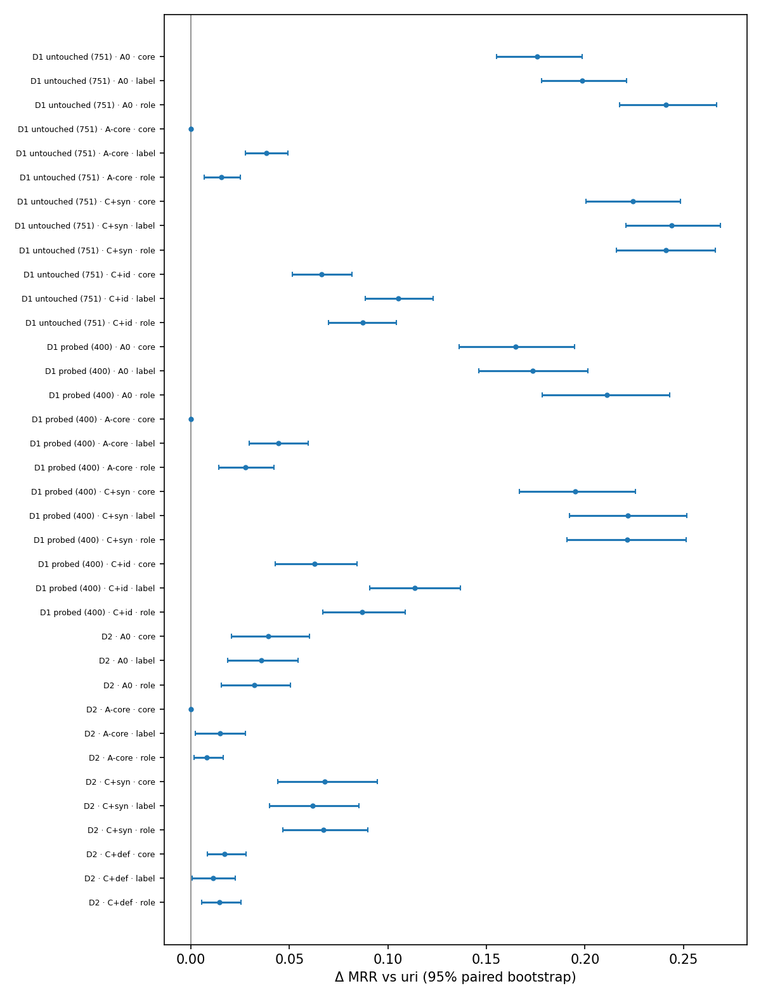

# #134 serialization order: validation report

- Paired source-level bootstraps: 2,000 replicates, fresh seed 42 per contrast, 95% percentile intervals; datasets are never pooled. Two pairs (D1, D2) and one model (M2): no generalisation claim.
- Validation stage: descriptive only. D1 validation is exploratory and split into the 400 sources the #131 probe used and the 751 it did not; the order is chosen on D2 validation by the rule in `serialization_freeze.json`, whose intervals are not adjusted for selection.

## Cell metrics

| Logical condition | Execution | D1 untouched (751) MRR / R@1 (n) | D1 probed (400) MRR / R@1 (n) | D2 MRR / R@1 (n) |
|---|---|---|---|---|
| D1/S/A0/uri | `SO-all-uri-full` | 0.4550 / 0.3422 (751) | 0.4777 / 0.3625 (400) |  |
| D1/S/A0/core | `SO-all-core-full` | 0.6307 / 0.5220 (751) | 0.6424 / 0.5350 (400) |  |
| D1/S/A0/label | `SO-all-label-full` | 0.6536 / 0.5619 (751) | 0.6513 / 0.5475 (400) |  |
| D1/S/A0/role | `SO-all-role-full` | 0.6962 / 0.6112 (751) | 0.6888 / 0.5950 (400) |  |
| D1/S/A-core/uri | `SO-core-uri-full` | 0.7454 / 0.6764 (751) | 0.7118 / 0.6175 (400) |  |
| D1/S/A-core/core | `SO-core-uri-full` | 0.7454 / 0.6764 (751) | 0.7118 / 0.6175 (400) |  |
| D1/S/A-core/label | `SO-core-label-full` | 0.7837 / 0.7284 (751) | 0.7562 / 0.6800 (400) |  |
| D1/S/A-core/role | `SO-core-role-full` | 0.7608 / 0.6911 (751) | 0.7395 / 0.6600 (400) |  |
| D1/S/C+syn/uri | `SO-core-plus-syn-uri-full` | 0.4774 / 0.3582 (751) | 0.4715 / 0.3475 (400) |  |
| D1/S/C+syn/core | `SO-core-plus-syn-core-full` | 0.7017 / 0.6138 (751) | 0.6666 / 0.5625 (400) |  |
| D1/S/C+syn/label | `SO-core-plus-syn-label-full` | 0.7215 / 0.6378 (751) | 0.6932 / 0.5975 (400) |  |
| D1/S/C+syn/role | `SO-core-plus-syn-role-full` | 0.7184 / 0.6365 (751) | 0.6930 / 0.6050 (400) |  |
| D1/S/C+id/uri | `SO-core-plus-id-uri-full` | 0.6691 / 0.5779 (751) | 0.6467 / 0.5400 (400) |  |
| D1/S/C+id/core | `SO-core-plus-id-core-full` | 0.7354 / 0.6578 (751) | 0.7094 / 0.6250 (400) |  |
| D1/S/C+id/label | `SO-core-plus-id-label-full` | 0.7743 / 0.7137 (751) | 0.7601 / 0.6975 (400) |  |
| D1/S/C+id/role | `SO-core-plus-id-role-full` | 0.7562 / 0.6884 (751) | 0.7336 / 0.6550 (400) |  |
| D2/S/A0/uri | `SO-all-uri-full` |  |  | 0.7899 / 0.7391 (299) |
| D2/S/A0/core | `SO-all-core-full` |  |  | 0.8291 / 0.7826 (299) |
| D2/S/A0/label | `SO-all-label-full` |  |  | 0.8257 / 0.7860 (299) |
| D2/S/A0/role | `SO-all-role-full` |  |  | 0.8221 / 0.7793 (299) |
| D2/S/A-core/uri | `SO-core-uri-full` |  |  | 0.8783 / 0.8328 (299) |
| D2/S/A-core/core | `SO-core-uri-full` |  |  | 0.8783 / 0.8328 (299) |
| D2/S/A-core/label | `SO-core-label-full` |  |  | 0.8929 / 0.8562 (299) |
| D2/S/A-core/role | `SO-core-role-full` |  |  | 0.8864 / 0.8462 (299) |
| D2/S/C+syn/uri | `SO-core-plus-syn-uri-full` |  |  | 0.8387 / 0.7926 (299) |
| D2/S/C+syn/core | `SO-core-plus-syn-core-full` |  |  | 0.9065 / 0.8729 (299) |
| D2/S/C+syn/label | `SO-core-plus-syn-label-full` |  |  | 0.9004 / 0.8629 (299) |
| D2/S/C+syn/role | `SO-core-plus-syn-role-full` |  |  | 0.9059 / 0.8696 (299) |
| D2/S/C+def/uri | `SO-core-plus-def-uri-full` |  |  | 0.7843 / 0.7391 (299) |
| D2/S/C+def/core | `SO-core-plus-def-core-full` |  |  | 0.8013 / 0.7492 (299) |
| D2/S/C+def/label | `SO-core-plus-def-label-full` |  |  | 0.7956 / 0.7492 (299) |
| D2/S/C+def/role | `SO-core-plus-def-role-full` |  |  | 0.7987 / 0.7525 (299) |
| D1/B48/F-uri | `SO-all-sel_core-ren_uri-48` | 0.4701 / 0.3382 (751) | 0.4642 / 0.3200 (400) |  |
| D1/B48/F-core | `SO-all-sel_core-ren_core-48` | 0.6737 / 0.5739 (751) | 0.6583 / 0.5425 (400) |  |
| D1/B48/F-label | `SO-all-sel_core-ren_label-48` | 0.6651 / 0.5619 (751) | 0.6460 / 0.5225 (400) |  |
| D1/B48/F-role | `SO-all-sel_core-ren_role-48` | 0.6828 / 0.5806 (751) | 0.6764 / 0.5675 (400) |  |
| D1/B48/C-uri | `SO-all-sel_uri-ren_uri-48` | 0.3454 / 0.2383 (751) | 0.3851 / 0.2850 (400) |  |
| D1/B48/C-core | `SO-all-sel_core-ren_core-48` | 0.6737 / 0.5739 (751) | 0.6583 / 0.5425 (400) |  |
| D1/B48/C-label | `SO-all-sel_label-ren_label-48` | 0.5683 / 0.4687 (751) | 0.5408 / 0.4400 (400) |  |
| D1/B48/C-role | `SO-all-sel_role-ren_role-48` | 0.7055 / 0.6138 (751) | 0.7050 / 0.6200 (400) |  |
| D1/B48/X-label | `SO-all-sel_label-ren_uri-48` | 0.4298 / 0.3182 (751) | 0.4410 / 0.3350 (400) |  |
| D1/B48/X-role | `SO-all-sel_role-ren_uri-48` | 0.5290 / 0.4035 (751) | 0.5455 / 0.4225 (400) |  |
| D2/B24/F-uri | `SO-all-sel_core-ren_uri-24` |  |  | 0.8218 / 0.7659 (299) |
| D2/B24/F-core | `SO-all-sel_core-ren_core-24` |  |  | 0.8726 / 0.8261 (299) |
| D2/B24/F-label | `SO-all-sel_core-ren_label-24` |  |  | 0.8721 / 0.8261 (299) |
| D2/B24/F-role | `SO-all-sel_core-ren_role-24` |  |  | 0.8693 / 0.8194 (299) |
| D2/B24/C-uri | `SO-all-sel_uri-ren_uri-24` |  |  | 0.7577 / 0.6756 (299) |
| D2/B24/C-core | `SO-all-sel_core-ren_core-24` |  |  | 0.8726 / 0.8261 (299) |
| D2/B24/C-label | `SO-all-sel_label-ren_label-24` |  |  | 0.8024 / 0.7358 (299) |
| D2/B24/C-role | `SO-all-sel_role-ren_role-24` |  |  | 0.7881 / 0.7090 (299) |
| D2/B24/X-label | `SO-all-sel_label-ren_uri-24` |  |  | 0.6856 / 0.5819 (299) |
| D2/B24/X-role | `SO-all-sel_role-ren_uri-24` |  |  | 0.6939 / 0.5920 (299) |
| D2/B48/F-uri | `SO-all-sel_core-ren_uri-48` |  |  | 0.8068 / 0.7458 (299) |
| D2/B48/F-core | `SO-all-sel_core-ren_core-48` |  |  | 0.9083 / 0.8763 (299) |
| D2/B48/F-label | `SO-all-sel_core-ren_label-48` |  |  | 0.8964 / 0.8595 (299) |
| D2/B48/F-role | `SO-all-sel_core-ren_role-48` |  |  | 0.9018 / 0.8696 (299) |
| D2/B48/C-uri | `SO-all-sel_uri-ren_uri-48` |  |  | 0.7946 / 0.7492 (299) |
| D2/B48/C-core | `SO-all-sel_core-ren_core-48` |  |  | 0.9083 / 0.8763 (299) |
| D2/B48/C-label | `SO-all-sel_label-ren_label-48` |  |  | 0.8551 / 0.8127 (299) |
| D2/B48/C-role | `SO-all-sel_role-ren_role-48` |  |  | 0.8841 / 0.8462 (299) |
| D2/B48/X-label | `SO-all-sel_label-ren_uri-48` |  |  | 0.8086 / 0.7592 (299) |
| D2/B48/X-role | `SO-all-sel_role-ren_uri-48` |  |  | 0.8216 / 0.7659 (299) |

## Block S: each order − uri (selected set fixed)

| Subset | Row | Contrast | n (changed) | Δ MRR [95%] | Δ R@1 [95%] | Δ MRR, changed only |
|---|---|---|---|---|---|---|
| D1 untouched (751) | A0 | core − uri | 751 (730) | +0.1757 [+0.1552, +0.1985] | +0.1798 [+0.1505, +0.2130] | +0.1808 [+0.1592, +0.2034] |
| D1 untouched (751) | A0 | label − uri | 751 (751) | +0.1986 [+0.1779, +0.2211] | +0.2197 [+0.1904, +0.2530] | +0.1986 [+0.1779, +0.2211] |
| D1 untouched (751) | A0 | role − uri | 751 (751) | +0.2411 [+0.2176, +0.2669] | +0.2690 [+0.2370, +0.3036] | +0.2411 [+0.2176, +0.2669] |
| D1 untouched (751) | A-core | core − uri | 751 (0) | +0.0000 [+0.0000, +0.0000] | +0.0000 [+0.0000, +0.0000] | – |
| D1 untouched (751) | A-core | label − uri | 751 (751) | +0.0383 [+0.0275, +0.0493] | +0.0519 [+0.0346, +0.0706] | +0.0383 [+0.0275, +0.0493] |
| D1 untouched (751) | A-core | role − uri | 751 (751) | +0.0154 [+0.0067, +0.0252] | +0.0146 [+0.0000, +0.0293] | +0.0154 [+0.0067, +0.0252] |
| D1 untouched (751) | C+syn | core − uri | 751 (536) | +0.2244 [+0.2004, +0.2486] | +0.2557 [+0.2224, +0.2889] | +0.3157 [+0.2871, +0.3460] |
| D1 untouched (751) | C+syn | label − uri | 751 (751) | +0.2441 [+0.2208, +0.2687] | +0.2796 [+0.2477, +0.3129] | +0.2441 [+0.2208, +0.2687] |
| D1 untouched (751) | C+syn | role − uri | 751 (751) | +0.2410 [+0.2158, +0.2661] | +0.2783 [+0.2437, +0.3116] | +0.2410 [+0.2158, +0.2661] |
| D1 untouched (751) | C+id | core − uri | 751 (730) | +0.0662 [+0.0515, +0.0817] | +0.0799 [+0.0573, +0.1039] | +0.0682 [+0.0528, +0.0836] |
| D1 untouched (751) | C+id | label − uri | 751 (751) | +0.1052 [+0.0883, +0.1228] | +0.1358 [+0.1105, +0.1625] | +0.1052 [+0.0883, +0.1228] |
| D1 untouched (751) | C+id | role − uri | 751 (751) | +0.0871 [+0.0698, +0.1044] | +0.1105 [+0.0852, +0.1358] | +0.0871 [+0.0698, +0.1044] |
| D1 probed (400) | A0 | core − uri | 400 (388) | +0.1647 [+0.1362, +0.1947] | +0.1725 [+0.1325, +0.2150] | +0.1698 [+0.1397, +0.1994] |
| D1 probed (400) | A0 | label − uri | 400 (400) | +0.1736 [+0.1460, +0.2016] | +0.1850 [+0.1450, +0.2225] | +0.1736 [+0.1460, +0.2016] |
| D1 probed (400) | A0 | role − uri | 400 (400) | +0.2112 [+0.1783, +0.2429] | +0.2325 [+0.1875, +0.2775] | +0.2112 [+0.1783, +0.2429] |
| D1 probed (400) | A-core | core − uri | 400 (0) | +0.0000 [+0.0000, +0.0000] | +0.0000 [+0.0000, +0.0000] | – |
| D1 probed (400) | A-core | label − uri | 400 (400) | +0.0445 [+0.0296, +0.0596] | +0.0625 [+0.0375, +0.0875] | +0.0445 [+0.0296, +0.0596] |
| D1 probed (400) | A-core | role − uri | 400 (400) | +0.0277 [+0.0142, +0.0423] | +0.0425 [+0.0200, +0.0675] | +0.0277 [+0.0142, +0.0423] |
| D1 probed (400) | C+syn | core − uri | 400 (268) | +0.1951 [+0.1667, +0.2258] | +0.2150 [+0.1750, +0.2575] | +0.2989 [+0.2586, +0.3378] |
| D1 probed (400) | C+syn | label − uri | 400 (400) | +0.2216 [+0.1920, +0.2518] | +0.2500 [+0.2075, +0.2950] | +0.2216 [+0.1920, +0.2518] |
| D1 probed (400) | C+syn | role − uri | 400 (400) | +0.2215 [+0.1908, +0.2514] | +0.2575 [+0.2125, +0.3025] | +0.2215 [+0.1908, +0.2514] |
| D1 probed (400) | C+id | core − uri | 400 (388) | +0.0628 [+0.0427, +0.0843] | +0.0850 [+0.0525, +0.1200] | +0.0647 [+0.0437, +0.0875] |
| D1 probed (400) | C+id | label − uri | 400 (400) | +0.1135 [+0.0907, +0.1368] | +0.1575 [+0.1200, +0.1925] | +0.1135 [+0.0907, +0.1368] |
| D1 probed (400) | C+id | role − uri | 400 (400) | +0.0870 [+0.0669, +0.1089] | +0.1150 [+0.0825, +0.1500] | +0.0870 [+0.0669, +0.1089] |
| D2 | A0 | core − uri | 299 (292) | +0.0393 [+0.0205, +0.0601] | +0.0435 [+0.0134, +0.0736] | +0.0402 [+0.0207, +0.0615] |
| D2 | A0 | label − uri | 299 (299) | +0.0358 [+0.0185, +0.0542] | +0.0468 [+0.0201, +0.0769] | +0.0358 [+0.0185, +0.0542] |
| D2 | A0 | role − uri | 299 (299) | +0.0322 [+0.0155, +0.0506] | +0.0401 [+0.0166, +0.0702] | +0.0322 [+0.0155, +0.0506] |
| D2 | A-core | core − uri | 299 (0) | +0.0000 [+0.0000, +0.0000] | +0.0000 [+0.0000, +0.0000] | – |
| D2 | A-core | label − uri | 299 (299) | +0.0146 [+0.0021, +0.0277] | +0.0234 [+0.0033, +0.0468] | +0.0146 [+0.0021, +0.0277] |
| D2 | A-core | role − uri | 299 (299) | +0.0081 [+0.0017, +0.0162] | +0.0134 [+0.0033, +0.0268] | +0.0081 [+0.0017, +0.0162] |
| D2 | C+syn | core − uri | 299 (292) | +0.0678 [+0.0440, +0.0945] | +0.0803 [+0.0435, +0.1171] | +0.0694 [+0.0455, +0.0955] |
| D2 | C+syn | label − uri | 299 (299) | +0.0617 [+0.0398, +0.0854] | +0.0702 [+0.0368, +0.1037] | +0.0617 [+0.0398, +0.0854] |
| D2 | C+syn | role − uri | 299 (299) | +0.0671 [+0.0465, +0.0899] | +0.0769 [+0.0468, +0.1104] | +0.0671 [+0.0465, +0.0899] |
| D2 | C+def | core − uri | 299 (44) | +0.0170 [+0.0082, +0.0279] | +0.0100 [+0.0000, +0.0234] | +0.1158 [+0.0588, +0.1850] |
| D2 | C+def | label − uri | 299 (299) | +0.0113 [+0.0007, +0.0225] | +0.0100 [-0.0067, +0.0268] | +0.0113 [+0.0007, +0.0225] |
| D2 | C+def | role − uri | 299 (299) | +0.0144 [+0.0053, +0.0253] | +0.0134 [+0.0033, +0.0268] | +0.0144 [+0.0053, +0.0253] |

## Block S: representation contrasts within each order

| Subset | Contrast | uri: Δ MRR [95%] | core: Δ MRR [95%] | label: Δ MRR [95%] | role: Δ MRR [95%] |
|---|---|---|---|---|---|
| D1 untouched (751) | A-core − A0 | +0.2904 [+0.2619, +0.3211] | +0.1147 [+0.0907, +0.1378] | +0.1301 [+0.1061, +0.1542] | +0.0646 [+0.0424, +0.0867] |
| D1 untouched (751) | C+syn − A-core | -0.2681 [-0.2968, -0.2403] | -0.0437 [-0.0625, -0.0242] | -0.0623 [-0.0836, -0.0419] | -0.0424 [-0.0632, -0.0215] |
| D1 untouched (751) | C+id − A-core | -0.0763 [-0.0965, -0.0570] | -0.0100 [-0.0267, +0.0057] | -0.0094 [-0.0244, +0.0069] | -0.0045 [-0.0173, +0.0089] |
| D1 probed (400) | A-core − A0 | +0.2341 [+0.1946, +0.2754] | +0.0694 [+0.0378, +0.1026] | +0.1049 [+0.0720, +0.1402] | +0.0506 [+0.0214, +0.0829] |
| D1 probed (400) | C+syn − A-core | -0.2402 [-0.2794, -0.2041] | -0.0452 [-0.0741, -0.0172] | -0.0631 [-0.0941, -0.0332] | -0.0465 [-0.0760, -0.0197] |
| D1 probed (400) | C+id − A-core | -0.0651 [-0.0930, -0.0403] | -0.0023 [-0.0232, +0.0172] | +0.0039 [-0.0196, +0.0260] | -0.0058 [-0.0255, +0.0137] |
| D2 | A-core − A0 | +0.0884 [+0.0506, +0.1270] | +0.0492 [+0.0163, +0.0828] | +0.0672 [+0.0311, +0.1041] | +0.0643 [+0.0282, +0.1007] |
| D2 | C+syn − A-core | -0.0395 [-0.0712, -0.0075] | +0.0282 [+0.0072, +0.0521] | +0.0075 [-0.0156, +0.0308] | +0.0195 [-0.0032, +0.0444] |
| D2 | C+def − A-core | -0.0940 [-0.1273, -0.0618] | -0.0769 [-0.1074, -0.0465] | -0.0973 [-0.1307, -0.0656] | -0.0877 [-0.1189, -0.0569] |

## Block B: serialization, selection, combined and interaction

| Subset | Budget | Order | Effect | Δ MRR [95%] | Δ R@1 [95%] |
|---|---|---|---|---|---|
| D1 untouched (751) | 48 | uri | selection (uri rendering) = combined | -0.1247 [-0.1492, -0.0996] | -0.0999 [-0.1318, -0.0679] |
| D1 untouched (751) | 48 | core | serialization (reference set) = combined | +0.2036 [+0.1804, +0.2267] | +0.2357 [+0.2024, +0.2703] |
| D1 untouched (751) | 48 | core | serialization (reference set) − no-budget serialization | +0.0279 [+0.0025, +0.0524] | +0.0559 [+0.0160, +0.0959] |
| D1 untouched (751) | 48 | label | serialization, reference set | +0.1949 [+0.1749, +0.2160] | +0.2237 [+0.1931, +0.2557] |
| D1 untouched (751) | 48 | label | serialization, own set | +0.1385 [+0.1202, +0.1573] | +0.1505 [+0.1225, +0.1798] |
| D1 untouched (751) | 48 | label | selection, uri rendering | -0.0403 [-0.0654, -0.0158] | -0.0200 [-0.0519, +0.0146] |
| D1 untouched (751) | 48 | label | selection, own rendering | -0.0968 [-0.1218, -0.0711] | -0.0932 [-0.1278, -0.0573] |
| D1 untouched (751) | 48 | label | combined policy | +0.0982 [+0.0717, +0.1226] | +0.1305 [+0.0958, +0.1651] |
| D1 untouched (751) | 48 | label | interaction | -0.0565 [-0.0803, -0.0335] | -0.0732 [-0.1092, -0.0386] |
| D1 untouched (751) | 48 | label | serialization (reference set) − no-budget serialization | -0.0037 [-0.0269, +0.0203] | +0.0040 [-0.0333, +0.0400] |
| D1 untouched (751) | 48 | role | serialization, reference set | +0.2127 [+0.1897, +0.2365] | +0.2423 [+0.2091, +0.2756] |
| D1 untouched (751) | 48 | role | serialization, own set | +0.1765 [+0.1555, +0.1975] | +0.2104 [+0.1798, +0.2423] |
| D1 untouched (751) | 48 | role | selection, uri rendering | +0.0589 [+0.0310, +0.0877] | +0.0652 [+0.0280, +0.1039] |
| D1 untouched (751) | 48 | role | selection, own rendering | +0.0226 [-0.0019, +0.0458] | +0.0333 [-0.0040, +0.0679] |
| D1 untouched (751) | 48 | role | combined policy | +0.2353 [+0.2062, +0.2627] | +0.2756 [+0.2357, +0.3142] |
| D1 untouched (751) | 48 | role | interaction | -0.0362 [-0.0635, -0.0094] | -0.0320 [-0.0732, +0.0093] |
| D1 untouched (751) | 48 | role | serialization (reference set) − no-budget serialization | -0.0284 [-0.0548, -0.0020] | -0.0266 [-0.0666, +0.0120] |
| D1 probed (400) | 48 | uri | selection (uri rendering) = combined | -0.0791 [-0.1142, -0.0429] | -0.0350 [-0.0775, +0.0100] |
| D1 probed (400) | 48 | core | serialization (reference set) = combined | +0.1941 [+0.1666, +0.2240] | +0.2225 [+0.1800, +0.2650] |
| D1 probed (400) | 48 | core | serialization (reference set) − no-budget serialization | +0.0294 [-0.0017, +0.0619] | +0.0500 [+0.0000, +0.0976] |
| D1 probed (400) | 48 | label | serialization, reference set | +0.1818 [+0.1571, +0.2080] | +0.2025 [+0.1625, +0.2425] |
| D1 probed (400) | 48 | label | serialization, own set | +0.0998 [+0.0800, +0.1200] | +0.1050 [+0.0750, +0.1350] |
| D1 probed (400) | 48 | label | selection, uri rendering | -0.0232 [-0.0570, +0.0112] | +0.0150 [-0.0275, +0.0600] |
| D1 probed (400) | 48 | label | selection, own rendering | -0.1053 [-0.1394, -0.0702] | -0.0825 [-0.1276, -0.0350] |
| D1 probed (400) | 48 | label | combined policy | +0.0766 [+0.0428, +0.1118] | +0.1200 [+0.0750, +0.1675] |
| D1 probed (400) | 48 | label | interaction | -0.0820 [-0.1115, -0.0546] | -0.0975 [-0.1426, -0.0525] |
| D1 probed (400) | 48 | label | serialization (reference set) − no-budget serialization | +0.0082 [-0.0204, +0.0380] | +0.0175 [-0.0251, +0.0625] |
| D1 probed (400) | 48 | role | serialization, reference set | +0.2122 [+0.1833, +0.2425] | +0.2475 [+0.2050, +0.2901] |
| D1 probed (400) | 48 | role | serialization, own set | +0.1595 [+0.1315, +0.1884] | +0.1975 [+0.1550, +0.2400] |
| D1 probed (400) | 48 | role | selection, uri rendering | +0.0813 [+0.0474, +0.1182] | +0.1025 [+0.0550, +0.1500] |
| D1 probed (400) | 48 | role | selection, own rendering | +0.0286 [-0.0060, +0.0622] | +0.0525 [+0.0000, +0.1025] |
| D1 probed (400) | 48 | role | combined policy | +0.2408 [+0.2033, +0.2815] | +0.3000 [+0.2475, +0.3550] |
| D1 probed (400) | 48 | role | interaction | -0.0527 [-0.0873, -0.0190] | -0.0500 [-0.1050, +0.0050] |
| D1 probed (400) | 48 | role | serialization (reference set) − no-budget serialization | +0.0011 [-0.0328, +0.0357] | +0.0150 [-0.0350, +0.0675] |
| D2 | 24 | uri | selection (uri rendering) = combined | -0.0641 [-0.1093, -0.0208] | -0.0903 [-0.1505, -0.0334] |
| D2 | 24 | core | serialization (reference set) = combined | +0.0508 [+0.0298, +0.0720] | +0.0602 [+0.0334, +0.0903] |
| D2 | 24 | core | serialization (reference set) − no-budget serialization | +0.0116 [-0.0154, +0.0386] | +0.0167 [-0.0201, +0.0535] |
| D2 | 24 | label | serialization, reference set | +0.0503 [+0.0295, +0.0730] | +0.0602 [+0.0301, +0.0936] |
| D2 | 24 | label | serialization, own set | +0.1168 [+0.0918, +0.1447] | +0.1538 [+0.1137, +0.1973] |
| D2 | 24 | label | selection, uri rendering | -0.1361 [-0.1829, -0.0901] | -0.1839 [-0.2475, -0.1237] |
| D2 | 24 | label | selection, own rendering | -0.0697 [-0.1063, -0.0350] | -0.0903 [-0.1405, -0.0401] |
| D2 | 24 | label | combined policy | -0.0193 [-0.0608, +0.0196] | -0.0301 [-0.0870, +0.0234] |
| D2 | 24 | label | interaction | +0.0665 [+0.0346, +0.1001] | +0.0936 [+0.0435, +0.1439] |
| D2 | 24 | label | serialization (reference set) − no-budget serialization | +0.0145 [-0.0104, +0.0413] | +0.0134 [-0.0268, +0.0535] |
| D2 | 24 | role | serialization, reference set | +0.0475 [+0.0271, +0.0690] | +0.0535 [+0.0234, +0.0836] |
| D2 | 24 | role | serialization, own set | +0.0942 [+0.0738, +0.1180] | +0.1171 [+0.0836, +0.1538] |
| D2 | 24 | role | selection, uri rendering | -0.1279 [-0.1764, -0.0823] | -0.1739 [-0.2408, -0.1104] |
| D2 | 24 | role | selection, own rendering | -0.0812 [-0.1172, -0.0442] | -0.1104 [-0.1639, -0.0568] |
| D2 | 24 | role | combined policy | -0.0337 [-0.0756, +0.0057] | -0.0569 [-0.1171, +0.0000] |
| D2 | 24 | role | interaction | +0.0467 [+0.0167, +0.0774] | +0.0635 [+0.0201, +0.1104] |
| D2 | 24 | role | serialization (reference set) − no-budget serialization | +0.0153 [-0.0119, +0.0422] | +0.0134 [-0.0268, +0.0535] |
| D2 | 48 | uri | selection (uri rendering) = combined | -0.0122 [-0.0407, +0.0159] | +0.0033 [-0.0368, +0.0402] |
| D2 | 48 | core | serialization (reference set) = combined | +0.1016 [+0.0728, +0.1318] | +0.1304 [+0.0870, +0.1739] |
| D2 | 48 | core | serialization (reference set) − no-budget serialization | +0.0623 [+0.0371, +0.0886] | +0.0870 [+0.0468, +0.1272] |
| D2 | 48 | label | serialization, reference set | +0.0897 [+0.0657, +0.1156] | +0.1137 [+0.0769, +0.1505] |
| D2 | 48 | label | serialization, own set | +0.0465 [+0.0273, +0.0657] | +0.0535 [+0.0234, +0.0836] |
| D2 | 48 | label | selection, uri rendering | +0.0018 [-0.0237, +0.0265] | +0.0134 [-0.0268, +0.0502] |
| D2 | 48 | label | selection, own rendering | -0.0414 [-0.0657, -0.0174] | -0.0468 [-0.0804, -0.0134] |
| D2 | 48 | label | combined policy | +0.0483 [+0.0192, +0.0776] | +0.0669 [+0.0234, +0.1104] |
| D2 | 48 | label | interaction | -0.0432 [-0.0647, -0.0220] | -0.0602 [-0.0970, -0.0234] |
| D2 | 48 | label | serialization (reference set) − no-budget serialization | +0.0538 [+0.0313, +0.0777] | +0.0669 [+0.0301, +0.1070] |
| D2 | 48 | role | serialization, reference set | +0.0950 [+0.0704, +0.1227] | +0.1237 [+0.0870, +0.1639] |
| D2 | 48 | role | serialization, own set | +0.0625 [+0.0436, +0.0835] | +0.0803 [+0.0502, +0.1137] |
| D2 | 48 | role | selection, uri rendering | +0.0148 [-0.0088, +0.0380] | +0.0201 [-0.0167, +0.0569] |
| D2 | 48 | role | selection, own rendering | -0.0177 [-0.0376, +0.0020] | -0.0234 [-0.0503, +0.0033] |
| D2 | 48 | role | combined policy | +0.0774 [+0.0510, +0.1055] | +0.1003 [+0.0602, +0.1438] |
| D2 | 48 | role | interaction | -0.0325 [-0.0567, -0.0099] | -0.0435 [-0.0803, -0.0067] |
| D2 | 48 | role | serialization (reference set) − no-budget serialization | +0.0628 [+0.0390, +0.0869] | +0.0836 [+0.0468, +0.1237] |

## Label retention and position (tokenizer-only inventory)

| logical | side | n_with_label | label_retention | median_label_offset | share_label_first |
|---|---|---|---|---|---|
| D1/S/A0/uri | source | 24182 | 1.0 | 4.0 | 0.0 |
| D1/S/A0/uri | candidate | 50103 | 1.0 | 29.0 | 0.0 |
| D1/S/A0/core | source | 24182 | 1.0 | 4.0 | 0.0 |
| D1/S/A0/core | candidate | 50103 | 1.0 | 4.0 | 0.0 |
| D1/S/A0/label | source | 24182 | 1.0 | 0.0 | 1.0 |
| D1/S/A0/label | candidate | 50103 | 1.0 | 0.0 | 1.0 |
| D1/S/A0/role | source | 24182 | 1.0 | 0.0 | 1.0 |
| D1/S/A0/role | candidate | 50103 | 1.0 | 0.0 | 1.0 |
| D1/S/A-core/uri | source | 24182 | 1.0 | 4.0 | 0.0 |
| D1/S/A-core/uri | candidate | 50103 | 1.0 | 4.0 | 0.0 |
| D1/S/A-core/core | source | 24182 | 1.0 | 4.0 | 0.0 |
| D1/S/A-core/core | candidate | 50103 | 1.0 | 4.0 | 0.0 |
| D1/S/A-core/label | source | 24182 | 1.0 | 0.0 | 1.0 |
| D1/S/A-core/label | candidate | 50103 | 1.0 | 0.0 | 1.0 |
| D1/S/A-core/role | source | 24182 | 1.0 | 0.0 | 1.0 |
| D1/S/A-core/role | candidate | 50103 | 1.0 | 0.0 | 1.0 |
| D1/S/C+syn/uri | source | 24182 | 1.0 | 4.0 | 0.0 |
| D1/S/C+syn/uri | candidate | 50103 | 1.0 | 4.0 | 0.0 |
| D1/S/C+syn/core | source | 24182 | 1.0 | 4.0 | 0.0 |
| D1/S/C+syn/core | candidate | 50103 | 1.0 | 4.0 | 0.0 |
| D1/S/C+syn/label | source | 24182 | 1.0 | 0.0 | 1.0 |
| D1/S/C+syn/label | candidate | 50103 | 1.0 | 0.0 | 1.0 |
| D1/S/C+syn/role | source | 24182 | 1.0 | 0.0 | 1.0 |
| D1/S/C+syn/role | candidate | 50103 | 1.0 | 0.0 | 1.0 |
| D1/S/C+id/uri | source | 24182 | 1.0 | 4.0 | 0.0 |
| D1/S/C+id/uri | candidate | 50103 | 1.0 | 11.0 | 0.0 |
| D1/S/C+id/core | source | 24182 | 1.0 | 4.0 | 0.0 |
| D1/S/C+id/core | candidate | 50103 | 1.0 | 4.0 | 0.0 |
| D1/S/C+id/label | source | 24182 | 1.0 | 0.0 | 1.0 |
| D1/S/C+id/label | candidate | 50103 | 1.0 | 0.0 | 1.0 |
| D1/S/C+id/role | source | 24182 | 1.0 | 0.0 | 1.0 |
| D1/S/C+id/role | candidate | 50103 | 1.0 | 0.0 | 1.0 |
| D1/B48/F-uri | source | 24182 | 1.0 | 4.0 | 0.0 |
| D1/B48/F-uri | candidate | 50103 | 1.0 | 18.0 | 0.0 |
| D1/B48/F-core | source | 24182 | 1.0 | 4.0 | 0.0 |
| D1/B48/F-core | candidate | 50103 | 1.0 | 4.0 | 0.0 |
| D1/B48/F-label | source | 24182 | 1.0 | 0.0 | 1.0 |
| D1/B48/F-label | candidate | 50103 | 1.0 | 0.0 | 1.0 |
| D1/B48/F-role | source | 24182 | 1.0 | 0.0 | 1.0 |
| D1/B48/F-role | candidate | 50103 | 1.0 | 0.0 | 1.0 |
| D1/B48/C-uri | source | 24182 | 1.0 | 4.0 | 0.0 |
| D1/B48/C-uri | candidate | 50103 | 0.647786 | 25.0 | 0.0 |
| D1/B48/C-core | source | 24182 | 1.0 | 4.0 | 0.0 |
| D1/B48/C-core | candidate | 50103 | 1.0 | 4.0 | 0.0 |
| D1/B48/C-label | source | 24182 | 1.0 | 0.0 | 1.0 |
| D1/B48/C-label | candidate | 50103 | 1.0 | 0.0 | 1.0 |
| D1/B48/C-role | source | 24182 | 1.0 | 0.0 | 1.0 |
| D1/B48/C-role | candidate | 50103 | 1.0 | 0.0 | 1.0 |
| D1/B48/X-label | source | 24182 | 1.0 | 4.0 | 0.0 |
| D1/B48/X-label | candidate | 50103 | 1.0 | 27.0 | 0.0 |
| D1/B48/X-role | source | 24182 | 1.0 | 4.0 | 0.112108 |
| D1/B48/X-role | candidate | 50103 | 1.0 | 23.0 | 0.000299 |
| D2/S/A0/uri | source | 2737 | 1.0 | 4.0 | 0.0 |
| D2/S/A0/uri | candidate | 3212 | 1.0 | 16.0 | 0.0 |
| D2/S/A0/core | source | 2737 | 1.0 | 4.0 | 0.0 |
| D2/S/A0/core | candidate | 3212 | 1.0 | 4.0 | 0.0 |
| D2/S/A0/label | source | 2737 | 1.0 | 0.0 | 1.0 |
| D2/S/A0/label | candidate | 3212 | 1.0 | 0.0 | 1.0 |
| D2/S/A0/role | source | 2737 | 1.0 | 0.0 | 1.0 |
| D2/S/A0/role | candidate | 3212 | 1.0 | 0.0 | 1.0 |
| D2/S/A-core/uri | source | 2737 | 1.0 | 4.0 | 0.0 |
| D2/S/A-core/uri | candidate | 3212 | 1.0 | 4.0 | 0.0 |
| D2/S/A-core/core | source | 2737 | 1.0 | 4.0 | 0.0 |
| D2/S/A-core/core | candidate | 3212 | 1.0 | 4.0 | 0.0 |
| D2/S/A-core/label | source | 2737 | 1.0 | 0.0 | 1.0 |
| D2/S/A-core/label | candidate | 3212 | 1.0 | 0.0 | 1.0 |
| D2/S/A-core/role | source | 2737 | 1.0 | 0.0 | 1.0 |
| D2/S/A-core/role | candidate | 3212 | 1.0 | 0.0 | 1.0 |
| D2/S/C+syn/uri | source | 2737 | 1.0 | 4.0 | 0.0 |
| D2/S/C+syn/uri | candidate | 3212 | 1.0 | 15.0 | 0.0 |
| D2/S/C+syn/core | source | 2737 | 1.0 | 4.0 | 0.0 |
| D2/S/C+syn/core | candidate | 3212 | 1.0 | 4.0 | 0.0 |
| D2/S/C+syn/label | source | 2737 | 1.0 | 0.0 | 1.0 |
| D2/S/C+syn/label | candidate | 3212 | 1.0 | 0.0 | 1.0 |
| D2/S/C+syn/role | source | 2737 | 1.0 | 0.0 | 1.0 |
| D2/S/C+syn/role | candidate | 3212 | 1.0 | 0.0 | 1.0 |
| D2/S/C+def/uri | source | 2737 | 1.0 | 4.0 | 0.0 |
| D2/S/C+def/uri | candidate | 3212 | 1.0 | 4.0 | 0.0 |
| D2/S/C+def/core | source | 2737 | 1.0 | 4.0 | 0.0 |
| D2/S/C+def/core | candidate | 3212 | 1.0 | 4.0 | 0.0 |
| D2/S/C+def/label | source | 2737 | 1.0 | 0.0 | 1.0 |
| D2/S/C+def/label | candidate | 3212 | 1.0 | 0.0 | 1.0 |
| D2/S/C+def/role | source | 2737 | 1.0 | 0.0 | 1.0 |
| D2/S/C+def/role | candidate | 3212 | 1.0 | 0.0 | 1.0 |
| D2/B24/F-uri | source | 2737 | 1.0 | 4.0 | 0.0 |
| D2/B24/F-uri | candidate | 3212 | 0.987858 | 4.0 | 0.0 |
| D2/B24/F-core | source | 2737 | 1.0 | 4.0 | 0.0 |
| D2/B24/F-core | candidate | 3212 | 0.987858 | 4.0 | 0.0 |
| D2/B24/F-label | source | 2737 | 1.0 | 0.0 | 1.0 |
| D2/B24/F-label | candidate | 3212 | 0.987858 | 0.0 | 1.0 |
| D2/B24/F-role | source | 2737 | 1.0 | 0.0 | 1.0 |
| D2/B24/F-role | candidate | 3212 | 0.987858 | 0.0 | 1.0 |
| D2/B24/C-uri | source | 2737 | 0.958714 | 4.0 | 0.0 |
| D2/B24/C-uri | candidate | 3212 | 0.37391 | 13.0 | 0.0 |
| D2/B24/C-core | source | 2737 | 1.0 | 4.0 | 0.0 |
| D2/B24/C-core | candidate | 3212 | 0.987858 | 4.0 | 0.0 |
| D2/B24/C-label | source | 2737 | 1.0 | 0.0 | 1.0 |
| D2/B24/C-label | candidate | 3212 | 0.994085 | 0.0 | 1.0 |
| D2/B24/C-role | source | 2737 | 1.0 | 0.0 | 1.0 |
| D2/B24/C-role | candidate | 3212 | 0.994085 | 0.0 | 1.0 |
| D2/B24/X-label | source | 2737 | 1.0 | 4.0 | 0.0 |
| D2/B24/X-label | candidate | 3212 | 0.994085 | 12.0 | 0.006264 |
| D2/B24/X-role | source | 2737 | 1.0 | 4.0 | 0.089879 |
| D2/B24/X-role | candidate | 3212 | 0.994085 | 11.0 | 0.052302 |
| D2/B48/F-uri | source | 2737 | 1.0 | 4.0 | 0.0 |
| D2/B48/F-uri | candidate | 3212 | 1.0 | 14.0 | 0.0 |
| D2/B48/F-core | source | 2737 | 1.0 | 4.0 | 0.0 |
| D2/B48/F-core | candidate | 3212 | 1.0 | 4.0 | 0.0 |
| D2/B48/F-label | source | 2737 | 1.0 | 0.0 | 1.0 |
| D2/B48/F-label | candidate | 3212 | 1.0 | 0.0 | 1.0 |
| D2/B48/F-role | source | 2737 | 1.0 | 0.0 | 1.0 |
| D2/B48/F-role | candidate | 3212 | 1.0 | 0.0 | 1.0 |
| D2/B48/C-uri | source | 2737 | 1.0 | 4.0 | 0.0 |
| D2/B48/C-uri | candidate | 3212 | 0.82939 | 15.0 | 0.0 |
| D2/B48/C-core | source | 2737 | 1.0 | 4.0 | 0.0 |
| D2/B48/C-core | candidate | 3212 | 1.0 | 4.0 | 0.0 |
| D2/B48/C-label | source | 2737 | 1.0 | 0.0 | 1.0 |
| D2/B48/C-label | candidate | 3212 | 1.0 | 0.0 | 1.0 |
| D2/B48/C-role | source | 2737 | 1.0 | 0.0 | 1.0 |
| D2/B48/C-role | candidate | 3212 | 1.0 | 0.0 | 1.0 |
| D2/B48/X-label | source | 2737 | 1.0 | 4.0 | 0.0 |
| D2/B48/X-label | candidate | 3212 | 1.0 | 15.0 | 0.0 |
| D2/B48/X-role | source | 2737 | 1.0 | 4.0 | 0.0 |
| D2/B48/X-role | candidate | 3212 | 1.0 | 15.0 | 0.000934 |

## Selection changes against the fixed core-first set

| logical | side | n_set_differs | items_gained | items_lost | labels_lost | labels_gained |
|---|---|---|---|---|---|---|
| D1/B48/C-uri | source | 0 | {} | {} | 0 | 0 |
| D1/B48/C-uri | candidate | 37983 | {"definition": 409, "disjointness": 7, "identifier": 3385, "non_english": 5293, "other": 40, "preferred_name": 28004, "synonym": 17272} | {"core": 58087, "disjointness": 7, "non_english": 114, "other": 5, "preferred_name": 405, "synonym": 489} | 17647 | 0 |
| D1/B48/C-label | source | 0 | {} | {} | 0 | 0 |
| D1/B48/C-label | candidate | 37056 | {"definition": 252, "disjointness": 5, "identifier": 3352, "non_english": 4037, "other": 35, "preferred_name": 24977, "synonym": 10469} | {"core": 45854, "disjointness": 7, "identifier": 4, "non_english": 201, "preferred_name": 599, "synonym": 691} | 0 | 0 |
| D1/B48/C-role | source | 5843 | {"core": 2, "definition": 3, "preferred_name": 5846, "synonym": 300} | {"core": 5327, "definition": 11, "synonym": 1366} | 0 | 0 |
| D1/B48/C-role | candidate | 38400 | {"core": 15, "definition": 91, "disjointness": 1113, "identifier": 126, "non_english": 131, "other": 1, "preferred_name": 29246, "synonym": 19211} | {"core": 28206, "definition": 38, "disjointness": 7, "identifier": 30123, "non_english": 2745, "other": 40, "synonym": 210} | 0 | 0 |
| D1/B48/X-label | source | 0 | {} | {} | 0 | 0 |
| D1/B48/X-label | candidate | 37056 | {"definition": 252, "disjointness": 5, "identifier": 3352, "non_english": 4037, "other": 35, "preferred_name": 24977, "synonym": 10469} | {"core": 45854, "disjointness": 7, "identifier": 4, "non_english": 201, "preferred_name": 599, "synonym": 691} | 0 | 0 |
| D1/B48/X-role | source | 5843 | {"core": 2, "definition": 3, "preferred_name": 5846, "synonym": 300} | {"core": 5327, "definition": 11, "synonym": 1366} | 0 | 0 |
| D1/B48/X-role | candidate | 38400 | {"core": 15, "definition": 91, "disjointness": 1113, "identifier": 126, "non_english": 131, "other": 1, "preferred_name": 29246, "synonym": 19211} | {"core": 28206, "definition": 38, "disjointness": 7, "identifier": 30123, "non_english": 2745, "other": 40, "synonym": 210} | 0 | 0 |
| D2/B24/C-uri | source | 292 | {"core": 6, "identifier": 23, "synonym": 302} | {"core": 356, "synonym": 1} | 113 | 0 |
| D2/B24/C-uri | candidate | 2908 | {"core": 43, "definition": 151, "synonym": 3441} | {"core": 3991, "synonym": 25} | 1972 | 0 |
| D2/B24/C-label | source | 271 | {"identifier": 23, "synonym": 254} | {"core": 325, "synonym": 1} | 0 | 0 |
| D2/B24/C-label | candidate | 2292 | {"core": 21, "definition": 39, "synonym": 2414} | {"core": 2826, "synonym": 47} | 0 | 20 |
| D2/B24/C-role | source | 504 | {"core": 246, "synonym": 264} | {"core": 562} | 0 | 0 |
| D2/B24/C-role | candidate | 2436 | {"core": 171, "definition": 1, "synonym": 2459} | {"core": 2952, "definition": 4, "synonym": 40} | 0 | 20 |
| D2/B24/X-label | source | 271 | {"identifier": 23, "synonym": 254} | {"core": 325, "synonym": 1} | 0 | 0 |
| D2/B24/X-label | candidate | 2292 | {"core": 21, "definition": 39, "synonym": 2414} | {"core": 2826, "synonym": 47} | 0 | 20 |
| D2/B24/X-role | source | 504 | {"core": 246, "synonym": 264} | {"core": 562} | 0 | 0 |
| D2/B24/X-role | candidate | 2436 | {"core": 171, "definition": 1, "synonym": 2459} | {"core": 2952, "definition": 4, "synonym": 40} | 0 | 20 |
| D2/B48/C-uri | source | 10 | {"synonym": 10} | {"core": 10} | 0 | 0 |
| D2/B48/C-uri | candidate | 963 | {"core": 6, "definition": 331, "disjointness": 1, "synonym": 986} | {"core": 1784, "synonym": 223} | 548 | 0 |
| D2/B48/C-label | source | 10 | {"synonym": 10} | {"core": 10} | 0 | 0 |
| D2/B48/C-label | candidate | 885 | {"core": 2, "definition": 206, "disjointness": 1, "synonym": 859} | {"core": 1214, "synonym": 202} | 0 | 0 |
| D2/B48/C-role | source | 10 | {"synonym": 10} | {"core": 6, "identifier": 4} | 0 | 0 |
| D2/B48/C-role | candidate | 806 | {"core": 6, "definition": 41, "disjointness": 2, "synonym": 1046} | {"core": 1027, "definition": 61, "synonym": 9} | 0 | 0 |
| D2/B48/X-label | source | 10 | {"synonym": 10} | {"core": 10} | 0 | 0 |
| D2/B48/X-label | candidate | 885 | {"core": 2, "definition": 206, "disjointness": 1, "synonym": 859} | {"core": 1214, "synonym": 202} | 0 | 0 |
| D2/B48/X-role | source | 10 | {"synonym": 10} | {"core": 6, "identifier": 4} | 0 | 0 |
| D2/B48/X-role | candidate | 806 | {"core": 6, "definition": 41, "disjointness": 2, "synonym": 1046} | {"core": 1027, "definition": 61, "synonym": 9} | 0 | 0 |

## Identity gates

| Gate | Checks passed | Failed |
|---|---|---|
| fixed_set_identity | 34 | 0 |
| reproduces_stored_texts | 26 | 0 |
| shared_execution_identity | 10 | 0 |
| within_budget | 60 | 0 |
