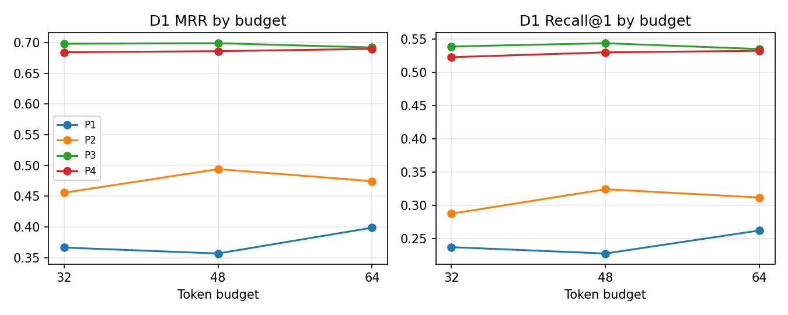
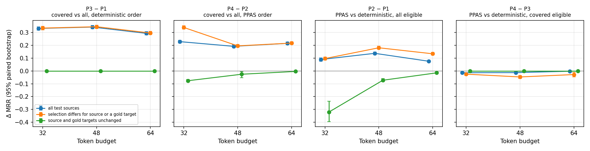
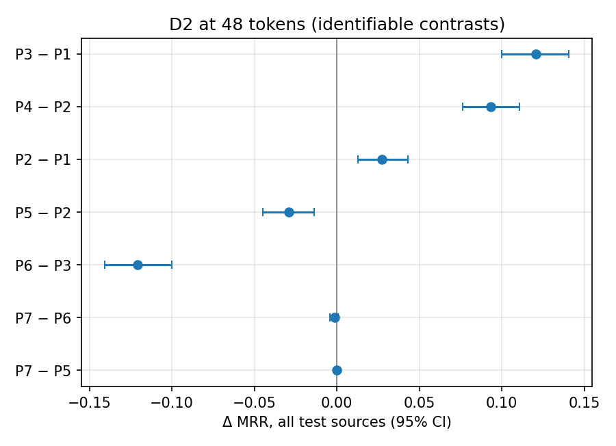

# Predicate-eligibility validation (#128 follow-up)

## Reading this report

- **Two analyses, never pooled.**  D1 budget sensitivity (P1-P4 at 32, 48,
  64) and the D2 replication (P1-P7 at 48) are separate.  Each bootstrap
  resamples the test sources of one pair at one budget: 2,000 resamples,
  seed 42 per contrast and stratum.  Intervals describe variation across test
  sources within that evaluation, not across KG pairs, and sources share
  candidate targets, so they are approximate.  No significance test is run.
- **Budgets share test sources.**  Differences between budgets are
  descriptive; no interval is given for them.
- **The 48-token D1 rows are the #128 reference**, read from
  `data/results_issue164/ppas_controlled/` and not rerun.
- **Ranking metrics first.**  MRR and Recall@k do not depend on the
  validation-tuned threshold; F1, precision and recall do, and are tabulated
  separately.
- **Strata.**  "Selection differs for source or a gold target" holds sources
  whose own text or a gold target's text changes; its complement ("source and
  gold targets unchanged") moves only because competing candidates change.
- **Not identifiable.**  A contrast whose policies select identical texts for
  every entity on both sides is reported as not identifiable: the data cannot
  distinguish the two policies, which is not evidence of no effect.
- **What "covered" means.**  Under `base`, covered predicates are exactly the
  PPAS tier predicates.  Its OBO synonym entries use
  `http://purl.obolibrary.org/obo/`, which neither D1 nor D2 uses, so covered
  eligibility keeps SNOMED's SKOS synonyms (D1 sources) but drops FMA and
  OBO-in-OWL synonyms (D1 candidates, both D2 sides).  `base` is unchanged
  from #128.  D2's P5-P7 use `obo_extended`, which adds the oboInOwl synonym
  family and definition to class tier 0 and IDs untiered.

## Execution record

Expected full-population runs: 19; complete: 19.
- None missing, failed or smoke-only.

| Dataset | Budget | Policy | Condition | Vocabulary | Results root | Commit | Dirty | Model rev | Tokenizer rev | Candidates | Dataset files | Protocol | Population | Status | Signature |
|---|---|---|---|---|---|---|---|---|---|---|---|---|---|---|---|
| D1 | 32 | P1 | `PA-all-base-det-32` | base `eb299c6ac2d9` | `data/results_issue164/ppas_validation` | `66aabc3b` | False | `d4aa6901` | `d4aa6901` | `a65eb2480a75` | `da8cc202f814` | 2 | full | completed | `58f641c000f2` |
| D1 | 32 | P2 | `PA-all-base-ppas-32` | base `eb299c6ac2d9` | `data/results_issue164/ppas_validation` | `66aabc3b` | False | `d4aa6901` | `d4aa6901` | `a65eb2480a75` | `da8cc202f814` | 2 | full | completed | `58f641c000f2` |
| D1 | 32 | P3 | `PA-cov-base-det-32` | base `eb299c6ac2d9` | `data/results_issue164/ppas_validation` | `66aabc3b` | False | `d4aa6901` | `d4aa6901` | `a65eb2480a75` | `da8cc202f814` | 2 | full | completed | `58f641c000f2` |
| D1 | 32 | P4 | `PA-cov-base-ppas-32` | base `eb299c6ac2d9` | `data/results_issue164/ppas_validation` | `66aabc3b` | False | `d4aa6901` | `d4aa6901` | `a65eb2480a75` | `da8cc202f814` | 2 | full | completed | `58f641c000f2` |
| D1 | 48 | P1 | `PA-all-base-det-48` | base `eb299c6ac2d9` | `data/results_issue164/ppas_controlled` | `66aabc3b` | False | `d4aa6901` | `d4aa6901` | `a65eb2480a75` | `da8cc202f814` | 2 | full | completed | `677f10b74daf` |
| D1 | 48 | P2 | `PA-all-base-ppas-48` | base `eb299c6ac2d9` | `data/results_issue164/ppas_controlled` | `66aabc3b` | False | `d4aa6901` | `d4aa6901` | `a65eb2480a75` | `da8cc202f814` | 2 | full | completed | `677f10b74daf` |
| D1 | 48 | P3 | `PA-cov-base-det-48` | base `eb299c6ac2d9` | `data/results_issue164/ppas_controlled` | `66aabc3b` | False | `d4aa6901` | `d4aa6901` | `a65eb2480a75` | `da8cc202f814` | 2 | full | completed | `677f10b74daf` |
| D1 | 48 | P4 | `PA-cov-base-ppas-48` | base `eb299c6ac2d9` | `data/results_issue164/ppas_controlled` | `66aabc3b` | False | `d4aa6901` | `d4aa6901` | `a65eb2480a75` | `da8cc202f814` | 2 | full | completed | `677f10b74daf` |
| D1 | 64 | P1 | `PA-all-base-det-64` | base `eb299c6ac2d9` | `data/results_issue164/ppas_validation` | `66aabc3b` | False | `d4aa6901` | `d4aa6901` | `a65eb2480a75` | `da8cc202f814` | 2 | full | completed | `44d0e0cbef88` |
| D1 | 64 | P2 | `PA-all-base-ppas-64` | base `eb299c6ac2d9` | `data/results_issue164/ppas_validation` | `66aabc3b` | False | `d4aa6901` | `d4aa6901` | `a65eb2480a75` | `da8cc202f814` | 2 | full | completed | `44d0e0cbef88` |
| D1 | 64 | P3 | `PA-cov-base-det-64` | base `eb299c6ac2d9` | `data/results_issue164/ppas_validation` | `66aabc3b` | False | `d4aa6901` | `d4aa6901` | `a65eb2480a75` | `da8cc202f814` | 2 | full | completed | `44d0e0cbef88` |
| D1 | 64 | P4 | `PA-cov-base-ppas-64` | base `eb299c6ac2d9` | `data/results_issue164/ppas_validation` | `66aabc3b` | False | `d4aa6901` | `d4aa6901` | `a65eb2480a75` | `da8cc202f814` | 2 | full | completed | `44d0e0cbef88` |
| D2 | 48 | P1 | `PA-all-base-det-48` | base `eb299c6ac2d9` | `data/results_issue164/ppas_validation` | `4a42227e` | False | `d4aa6901` | `d4aa6901` | `b4f1129bad0e` | `dcca13185424` | 2 | full | completed | `9c112b2cbe1a` |
| D2 | 48 | P2 | `PA-all-base-ppas-48` | base `eb299c6ac2d9` | `data/results_issue164/ppas_validation` | `4a42227e` | False | `d4aa6901` | `d4aa6901` | `b4f1129bad0e` | `dcca13185424` | 2 | full | completed | `9c112b2cbe1a` |
| D2 | 48 | P3 | `PA-cov-base-det-48` | base `eb299c6ac2d9` | `data/results_issue164/ppas_validation` | `4a42227e` | False | `d4aa6901` | `d4aa6901` | `b4f1129bad0e` | `dcca13185424` | 2 | full | completed | `9c112b2cbe1a` |
| D2 | 48 | P4 | `PA-cov-base-ppas-48` | base `eb299c6ac2d9` | `data/results_issue164/ppas_validation` | `4a42227e` | False | `d4aa6901` | `d4aa6901` | `b4f1129bad0e` | `dcca13185424` | 2 | full | completed | `9c112b2cbe1a` |
| D2 | 48 | P5 | `PA-all-obox-ppas-48` | obo_extended `55448ec69c98` | `data/results_issue164/ppas_validation` | `4a42227e` | False | `d4aa6901` | `d4aa6901` | `b4f1129bad0e` | `dcca13185424` | 2 | full | completed | `9c112b2cbe1a` |
| D2 | 48 | P6 | `PA-cov-obox-det-48` | obo_extended `55448ec69c98` | `data/results_issue164/ppas_validation` | `4a42227e` | False | `d4aa6901` | `d4aa6901` | `b4f1129bad0e` | `dcca13185424` | 2 | full | completed | `9c112b2cbe1a` |
| D2 | 48 | P7 | `PA-cov-obox-ppas-48` | obo_extended `55448ec69c98` | `data/results_issue164/ppas_validation` | `4a42227e` | False | `d4aa6901` | `d4aa6901` | `b4f1129bad0e` | `dcca13185424` | 2 | full | completed | `9c112b2cbe1a` |

### Dataset versions

- D1: 12 runs recorded file digests; all equal the files on disk: True.
  - `d1_snomed_fma/source.rdf` sha256 `a0fb689dde7b95bf…`, modified 2026-03-21T13:37:23Z
  - `d1_snomed_fma/target.rdf` sha256 `c1777ae5546dd78f…`, modified 2026-03-21T13:38:40Z
  - `d1_snomed_fma/reference.rdf` sha256 `de7358d1841fed49…`, modified 2026-03-21T13:38:41Z
- D2: 7 runs recorded file digests; all equal the files on disk: True.
  - `d2_anatomy/source.rdf` sha256 `93756393d6306c8f…`, modified 2026-03-03T04:02:14Z
  - `d2_anatomy/target.rdf` sha256 `5c1ca432d9845f1a…`, modified 2026-03-03T04:02:16Z
  - `d2_anatomy/reference.rdf` sha256 `b6a6b12f3e7a786e…`, modified 2026-03-03T04:02:17Z

### Budget audit

| Dataset | Budget | Policy | Src max tok | Src over | Src truncated | Src sampled | Cand max tok | Cand over | Cand truncated | Cand sampled |
|---|---|---|---|---|---|---|---|---|---|---|
| D1 | 32 | P1 | 32 | 0 | 0 | 73.4% | 32 | 0 | 0 | 99.3% |
| D1 | 32 | P2 | 32 | 0 | 0 | 73.4% | 32 | 0 | 0 | 99.3% |
| D1 | 32 | P3 | 32 | 0 | 0 | 73.4% | 32 | 0 | 0 | 31.1% |
| D1 | 32 | P4 | 32 | 0 | 0 | 73.4% | 32 | 0 | 0 | 31.1% |
| D1 | 48 | P1 | 48 | 0 | 0 | 24.6% | 48 | 0 | 0 | 81.3% |
| D1 | 48 | P2 | 48 | 0 | 0 | 24.6% | 48 | 0 | 0 | 81.3% |
| D1 | 48 | P3 | 48 | 0 | 0 | 24.6% | 48 | 0 | 0 | 1.3% |
| D1 | 48 | P4 | 48 | 0 | 0 | 24.6% | 48 | 0 | 0 | 1.3% |
| D1 | 64 | P1 | 64 | 0 | 0 | 6.0% | 64 | 0 | 0 | 43.5% |
| D1 | 64 | P2 | 64 | 0 | 0 | 6.0% | 64 | 0 | 0 | 43.5% |
| D1 | 64 | P3 | 64 | 0 | 0 | 6.0% | 64 | 0 | 0 | 0.1% |
| D1 | 64 | P4 | 64 | 0 | 0 | 6.0% | 64 | 0 | 0 | 0.1% |
| D2 | 48 | P1 | 48 | 0 | 0 | 0.4% | 48 | 0 | 0 | 35.5% |
| D2 | 48 | P2 | 48 | 0 | 0 | 0.4% | 48 | 0 | 0 | 35.5% |
| D2 | 48 | P3 | 45 | 0 | 0 | 0.1% | 48 | 0 | 0 | 0.9% |
| D2 | 48 | P4 | 45 | 0 | 0 | 0.1% | 48 | 0 | 0 | 0.9% |
| D2 | 48 | P5 | 48 | 0 | 0 | 0.4% | 48 | 0 | 0 | 35.5% |
| D2 | 48 | P6 | 48 | 0 | 0 | 0.4% | 48 | 0 | 0 | 35.5% |
| D2 | 48 | P7 | 48 | 0 | 0 | 0.4% | 48 | 0 | 0 | 35.5% |

## D1 budget sensitivity (P1-P4; 48 = #128 reference)

### Ranking metrics (threshold-independent)

| Budget | Policy | mrr | recall_at_1 | recall_at_5 | recall_at_10 |
|---|---|---|---|---|---|
| 32 | P1 | 0.3664 | 0.2373 | 0.3963 | 0.5448 |
| 32 | P2 | 0.4557 | 0.2876 | 0.5783 | 0.7516 |
| 32 | P3 | 0.6982 | 0.5390 | 0.7794 | 0.8285 |
| 32 | P4 | 0.6845 | 0.5230 | 0.7681 | 0.8251 |
| 48 | P1 | 0.3567 | 0.2277 | 0.3827 | 0.5119 |
| 48 | P2 | 0.4941 | 0.3243 | 0.6150 | 0.7491 |
| 48 | P3 | 0.6992 | 0.5440 | 0.7710 | 0.8243 |
| 48 | P4 | 0.6862 | 0.5302 | 0.7620 | 0.8209 |
| 64 | P1 | 0.3987 | 0.2623 | 0.4386 | 0.5519 |
| 64 | P2 | 0.4746 | 0.3119 | 0.5744 | 0.7036 |
| 64 | P3 | 0.6922 | 0.5352 | 0.7673 | 0.8230 |
| 64 | P4 | 0.6899 | 0.5325 | 0.7656 | 0.8215 |

### Threshold-dependent metrics (validation-tuned threshold)

| Budget | Policy | f1 | precision | recall | threshold |
|---|---|---|---|---|---|
| 32 | P1 | 0.1446 | 0.1621 | 0.1305 | 0.8300 |
| 32 | P2 | 0.1279 | 0.1640 | 0.1049 | 0.9100 |
| 32 | P3 | 0.2881 | 0.2765 | 0.3006 | 0.9300 |
| 32 | P4 | 0.2310 | 0.1501 | 0.5011 | 0.7900 |
| 48 | P1 | 0.1206 | 0.0931 | 0.1709 | 0.8100 |
| 48 | P2 | 0.1450 | 0.0953 | 0.3035 | 0.7700 |
| 48 | P3 | 0.2757 | 0.2088 | 0.4059 | 0.9000 |
| 48 | P4 | 0.2368 | 0.1592 | 0.4619 | 0.8600 |
| 64 | P1 | 0.1388 | 0.1129 | 0.1801 | 0.8200 |
| 64 | P2 | 0.1470 | 0.1043 | 0.2489 | 0.8000 |
| 64 | P3 | 0.2667 | 0.2044 | 0.3837 | 0.9000 |
| 64 | P4 | 0.2596 | 0.1806 | 0.4613 | 0.8800 |

### Primary contrasts (paired bootstrap per budget)

| Contrast | Effect | Budget | Test sources | n | Δ MRR [95% CI] | Δ R@1 [95% CI] |
|---|---|---|---|---|---|---|
| P3 − P1 | covered vs all, deterministic order | 32 | all test sources | 4605 | 0.3318 [0.3182, 0.3449] | 0.3425 [0.3259, 0.3581] |
| P3 − P1 | covered vs all, deterministic order | 32 | selection differs for source or a gold target | 4568 | 0.3345 [0.3212, 0.3482] | 0.3452 [0.3284, 0.3638] |
| P3 − P1 | covered vs all, deterministic order | 32 | source and gold targets unchanged | 37 | 0.0000 [0.0000, 0.0000] | 0.0000 [0.0000, 0.0000] |
| P3 − P1 | covered vs all, deterministic order | 48 | all test sources | 4605 | 0.3425 [0.3296, 0.3548] | 0.3590 [0.3429, 0.3750] |
| P3 − P1 | covered vs all, deterministic order | 48 | selection differs for source or a gold target | 4568 | 0.3453 [0.3315, 0.3578] | 0.3619 [0.3457, 0.3787] |
| P3 − P1 | covered vs all, deterministic order | 48 | source and gold targets unchanged | 37 | 0.0000 [0.0000, 0.0000] | 0.0000 [0.0000, 0.0000] |
| P3 − P1 | covered vs all, deterministic order | 64 | all test sources | 4605 | 0.2935 [0.2810, 0.3060] | 0.3097 [0.2947, 0.3253] |
| P3 − P1 | covered vs all, deterministic order | 64 | selection differs for source or a gold target | 4568 | 0.2959 [0.2828, 0.3083] | 0.3122 [0.2968, 0.3290] |
| P3 − P1 | covered vs all, deterministic order | 64 | source and gold targets unchanged | 37 | 0.0000 [0.0000, 0.0000] | 0.0000 [0.0000, 0.0000] |
| P4 − P2 | covered vs all, PPAS order | 32 | all test sources | 4605 | 0.2288 [0.2173, 0.2396] | 0.2671 [0.2519, 0.2819] |
| P4 − P2 | covered vs all, PPAS order | 32 | selection differs for source or a gold target | 3380 | 0.3394 [0.3268, 0.3520] | 0.4003 [0.3834, 0.4184] |
| P4 − P2 | covered vs all, PPAS order | 32 | source and gold targets unchanged | 1225 | -0.0764 [-0.0864, -0.0662] | -0.1004 [-0.1176, -0.0832] |
| P4 − P2 | covered vs all, PPAS order | 48 | all test sources | 4605 | 0.1921 [0.1814, 0.2035] | 0.2337 [0.2178, 0.2482] |
| P4 − P2 | covered vs all, PPAS order | 48 | selection differs for source or a gold target | 4530 | 0.1957 [0.1846, 0.2067] | 0.2377 [0.2232, 0.2530] |
| P4 − P2 | covered vs all, PPAS order | 48 | source and gold targets unchanged | 75 | -0.0257 [-0.0526, -0.0056] | -0.0133 [-0.0400, 0.0000] |
| P4 − P2 | covered vs all, PPAS order | 64 | all test sources | 4605 | 0.2154 [0.2043, 0.2265] | 0.2504 [0.2350, 0.2649] |
| P4 − P2 | covered vs all, PPAS order | 64 | selection differs for source or a gold target | 4562 | 0.2174 [0.2069, 0.2280] | 0.2527 [0.2378, 0.2676] |
| P4 − P2 | covered vs all, PPAS order | 64 | source and gold targets unchanged | 43 | -0.0038 [-0.0092, -0.0004] | 0.0000 [0.0000, 0.0000] |
| P2 − P1 | PPAS vs deterministic, all eligible | 32 | all test sources | 4605 | 0.0893 [0.0767, 0.1026] | 0.0571 [0.0406, 0.0732] |
| P2 − P1 | PPAS vs deterministic, all eligible | 32 | selection differs for source or a gold target | 4526 | 0.0964 [0.0837, 0.1095] | 0.0652 [0.0482, 0.0809] |
| P2 − P1 | PPAS vs deterministic, all eligible | 32 | source and gold targets unchanged | 79 | -0.3206 [-0.3964, -0.2365] | -0.4051 [-0.5190, -0.2911] |
| P2 − P1 | PPAS vs deterministic, all eligible | 48 | all test sources | 4605 | 0.1374 [0.1265, 0.1476] | 0.1097 [0.0966, 0.1233] |
| P2 − P1 | PPAS vs deterministic, all eligible | 48 | selection differs for source or a gold target | 3817 | 0.1807 [0.1692, 0.1931] | 0.1514 [0.1375, 0.1669] |
| P2 − P1 | PPAS vs deterministic, all eligible | 48 | source and gold targets unchanged | 788 | -0.0726 [-0.0845, -0.0602] | -0.0926 [-0.1130, -0.0736] |
| P2 − P1 | PPAS vs deterministic, all eligible | 64 | all test sources | 4605 | 0.0758 [0.0685, 0.0832] | 0.0562 [0.0478, 0.0651] |
| P2 − P1 | PPAS vs deterministic, all eligible | 64 | selection differs for source or a gold target | 2806 | 0.1339 [0.1235, 0.1447] | 0.1030 [0.0902, 0.1155] |
| P2 − P1 | PPAS vs deterministic, all eligible | 64 | source and gold targets unchanged | 1799 | -0.0148 [-0.0186, -0.0109] | -0.0167 [-0.0233, -0.0106] |
| P4 − P3 | PPAS vs deterministic, covered eligible | 32 | all test sources | 4605 | -0.0138 [-0.0194, -0.0079] | -0.0182 [-0.0274, -0.0096] |
| P4 − P3 | PPAS vs deterministic, covered eligible | 32 | selection differs for source or a gold target | 2526 | -0.0251 [-0.0358, -0.0142] | -0.0333 [-0.0491, -0.0162] |
| P4 − P3 | PPAS vs deterministic, covered eligible | 32 | source and gold targets unchanged | 2079 | 0.0000 [0.0000, 0.0000] | 0.0000 [0.0000, 0.0000] |
| P4 − P3 | PPAS vs deterministic, covered eligible | 48 | all test sources | 4605 | -0.0130 [-0.0166, -0.0098] | -0.0156 [-0.0213, -0.0100] |
| P4 − P3 | PPAS vs deterministic, covered eligible | 48 | selection differs for source or a gold target | 1276 | -0.0469 [-0.0589, -0.0345] | -0.0564 [-0.0760, -0.0376] |
| P4 − P3 | PPAS vs deterministic, covered eligible | 48 | source and gold targets unchanged | 3329 | 0.0000 [0.0000, 0.0000] | 0.0000 [0.0000, 0.0000] |
| P4 − P3 | PPAS vs deterministic, covered eligible | 64 | all test sources | 4605 | -0.0023 [-0.0037, -0.0009] | -0.0030 [-0.0052, -0.0009] |
| P4 − P3 | PPAS vs deterministic, covered eligible | 64 | selection differs for source or a gold target | 373 | -0.0283 [-0.0456, -0.0117] | -0.0375 [-0.0617, -0.0134] |
| P4 − P3 | PPAS vs deterministic, covered eligible | 64 | source and gold targets unchanged | 4232 | 0.0000 [0.0000, 0.0000] | 0.0000 [0.0000, 0.0000] |

### Selection changes

| Contrast | Effect | Budget | Sources changed | Candidates changed |
|---|---|---|---|---|
| P3 vs P1 | covered vs all, deterministic order | 32 | 0 / 24182 (0.0%) | 50103 / 50103 (100.0%) |
| P3 vs P1 | covered vs all, deterministic order | 48 | 0 / 24182 (0.0%) | 50103 / 50103 (100.0%) |
| P3 vs P1 | covered vs all, deterministic order | 64 | 0 / 24182 (0.0%) | 50103 / 50103 (100.0%) |
| P4 vs P2 | covered vs all, PPAS order | 32 | 0 / 24182 (0.0%) | 28167 / 50103 (56.2%) |
| P4 vs P2 | covered vs all, PPAS order | 48 | 0 / 24182 (0.0%) | 46975 / 50103 (93.8%) |
| P4 vs P2 | covered vs all, PPAS order | 64 | 0 / 24182 (0.0%) | 50069 / 50103 (99.9%) |
| P2 vs P1 | PPAS vs deterministic, all eligible | 32 | 12251 / 24182 (50.7%) | 49591 / 50103 (99.0%) |
| P2 vs P1 | PPAS vs deterministic, all eligible | 48 | 4785 / 24182 (19.8%) | 37985 / 50103 (75.8%) |
| P2 vs P1 | PPAS vs deterministic, all eligible | 64 | 1129 / 24182 (4.7%) | 16444 / 50103 (32.8%) |
| P4 vs P3 | PPAS vs deterministic, covered eligible | 32 | 12251 / 24182 (50.7%) | 21 / 50103 (0.0%) |
| P4 vs P3 | PPAS vs deterministic, covered eligible | 48 | 4785 / 24182 (19.8%) | 13 / 50103 (0.0%) |
| P4 vs P3 | PPAS vs deterministic, covered eligible | 64 | 1129 / 24182 (4.7%) | 1 / 50103 (0.0%) |

### Representation cost and item accounting

| Budget | Policy | Side | Mean tok | Median tok | Max tok | Utilisation | Sampled | Items | Filtered | Selected |
|---|---|---|---|---|---|---|---|---|---|---|
| 32 | P1 | source | 26.2 | 27 | 32 | 0.818 | 73.4% | 98880 | 0 | 71721 |
| 32 | P1 | candidate | 28.3 | 29 | 32 | 0.884 | 99.3% | 306359 | 0 | 159873 |
| 32 | P2 | source | 27.7 | 29 | 32 | 0.866 | 73.4% | 98880 | 0 | 70969 |
| 32 | P2 | candidate | 28.9 | 29 | 32 | 0.903 | 99.3% | 306359 | 0 | 163919 |
| 32 | P3 | source | 26.2 | 27 | 32 | 0.818 | 73.4% | 98880 | 0 | 71721 |
| 32 | P3 | candidate | 24.9 | 25 | 32 | 0.778 | 31.1% | 306359 | 156315 | 134436 |
| 32 | P4 | source | 27.7 | 29 | 32 | 0.866 | 73.4% | 98880 | 0 | 70969 |
| 32 | P4 | candidate | 24.9 | 25 | 32 | 0.779 | 31.1% | 306359 | 156315 | 134429 |
| 48 | P1 | source | 36.3 | 37 | 48 | 0.755 | 24.6% | 98880 | 0 | 90757 |
| 48 | P1 | candidate | 42.3 | 43 | 48 | 0.882 | 81.3% | 306359 | 0 | 221845 |
| 48 | P2 | source | 36.8 | 37 | 48 | 0.767 | 24.6% | 98880 | 0 | 90514 |
| 48 | P2 | candidate | 42.7 | 43 | 48 | 0.889 | 81.3% | 306359 | 0 | 226453 |
| 48 | P3 | source | 36.3 | 37 | 48 | 0.755 | 24.6% | 98880 | 0 | 90757 |
| 48 | P3 | candidate | 29.9 | 29 | 48 | 0.624 | 1.3% | 306359 | 156315 | 149392 |
| 48 | P4 | source | 36.8 | 37 | 48 | 0.767 | 24.6% | 98880 | 0 | 90514 |
| 48 | P4 | candidate | 29.9 | 29 | 48 | 0.624 | 1.3% | 306359 | 156315 | 149378 |
| 64 | P1 | source | 39.9 | 39 | 64 | 0.624 | 6.0% | 98880 | 0 | 96764 |
| 64 | P1 | candidate | 53.8 | 55 | 64 | 0.840 | 43.5% | 306359 | 0 | 266162 |
| 64 | P2 | source | 40.1 | 39 | 64 | 0.627 | 6.0% | 98880 | 0 | 96704 |
| 64 | P2 | candidate | 53.7 | 55 | 64 | 0.839 | 43.5% | 306359 | 0 | 268430 |
| 64 | P3 | source | 39.9 | 39 | 64 | 0.624 | 6.0% | 98880 | 0 | 96764 |
| 64 | P3 | candidate | 30.2 | 30 | 64 | 0.473 | 0.1% | 306359 | 156315 | 150012 |
| 64 | P4 | source | 40.1 | 39 | 64 | 0.627 | 6.0% | 98880 | 0 | 96704 |
| 64 | P4 | candidate | 30.2 | 30 | 64 | 0.473 | 0.1% | 306359 | 156315 | 150012 |

## D2 replication at 48 tokens (P1-P4 base, P5-P7 obo_extended)

### Ranking metrics (threshold-independent)

| Budget | Policy | mrr | recall_at_1 | recall_at_5 | recall_at_10 |
|---|---|---|---|---|---|
| 48 | P1 | 0.7497 | 0.6804 | 0.8072 | 0.8591 |
| 48 | P2 | 0.7772 | 0.6928 | 0.8715 | 0.9226 |
| 48 | P3 | 0.8705 | 0.8081 | 0.9316 | 0.9432 |
| 48 | P4 | 0.8705 | 0.8081 | 0.9316 | 0.9432 |
| 48 | P5 | 0.7482 | 0.6787 | 0.8072 | 0.8591 |
| 48 | P6 | 0.7497 | 0.6804 | 0.8072 | 0.8591 |
| 48 | P7 | 0.7482 | 0.6787 | 0.8072 | 0.8591 |

### Threshold-dependent metrics (validation-tuned threshold)

| Budget | Policy | f1 | precision | recall | threshold |
|---|---|---|---|---|---|
| 48 | P1 | 0.6155 | 0.6817 | 0.5610 | 0.8500 |
| 48 | P2 | 0.5894 | 0.5685 | 0.6120 | 0.8400 |
| 48 | P3 | 0.6831 | 0.6935 | 0.6730 | 0.9100 |
| 48 | P4 | 0.6831 | 0.6935 | 0.6730 | 0.9100 |
| 48 | P5 | 0.6134 | 0.6790 | 0.5593 | 0.8500 |
| 48 | P6 | 0.6155 | 0.6817 | 0.5610 | 0.8500 |
| 48 | P7 | 0.6134 | 0.6790 | 0.5593 | 0.8500 |

### Primary contrasts

| Contrast | Effect | Budget | Test sources | n | Δ MRR [95% CI] | Δ R@1 [95% CI] |
|---|---|---|---|---|---|---|
| P3 − P1 | covered vs all, deterministic order | 48 | all test sources | 1198 | 0.1207 [0.1000, 0.1407] | 0.1294 [0.1043, 0.1561] |
| P3 − P1 | covered vs all, deterministic order | 48 | selection differs for source or a gold target | 1188 | 0.1218 [0.1029, 0.1427] | 0.1305 [0.1035, 0.1574] |
| P3 − P1 | covered vs all, deterministic order | 48 | source and gold targets unchanged | 10 | 0.0000 [0.0000, 0.0000] | 0.0000 [0.0000, 0.0000] |
| P4 − P2 | covered vs all, PPAS order | 48 | all test sources | 1198 | 0.0932 [0.0763, 0.1106] | 0.1169 [0.0918, 0.1419] |
| P4 − P2 | covered vs all, PPAS order | 48 | selection differs for source or a gold target | 1132 | 0.1033 [0.0856, 0.1223] | 0.1325 [0.1069, 0.1599] |
| P4 − P2 | covered vs all, PPAS order | 48 | source and gold targets unchanged | 66 | -0.0794 [-0.1283, -0.0379] | -0.1515 [-0.2424, -0.0758] |
| P2 − P1 | PPAS vs deterministic, all eligible | 48 | all test sources | 1198 | 0.0275 [0.0129, 0.0432] | 0.0125 [-0.0067, 0.0317] |
| P2 − P1 | PPAS vs deterministic, all eligible | 48 | selection differs for source or a gold target | 322 | 0.2342 [0.1939, 0.2729] | 0.2391 [0.1894, 0.2888] |
| P2 − P1 | PPAS vs deterministic, all eligible | 48 | source and gold targets unchanged | 876 | -0.0485 [-0.0591, -0.0381] | -0.0708 [-0.0879, -0.0548] |
| P4 − P3 | PPAS vs deterministic, covered eligible | 48 | all test sources | - | not identifiable: identical selections on both sides | - |

### Vocabulary contrasts (obo_extended)

| Contrast | Effect | Budget | Test sources | n | Δ MRR [95% CI] | Δ R@1 [95% CI] |
|---|---|---|---|---|---|---|
| P5 − P2 | extended vs base vocabulary, PPAS order, all eligible | 48 | all test sources | 1198 | -0.0290 [-0.0447, -0.0138] | -0.0142 [-0.0342, 0.0050] |
| P5 − P2 | extended vs base vocabulary, PPAS order, all eligible | 48 | selection differs for source or a gold target | 322 | -0.2398 [-0.2795, -0.1999] | -0.2453 [-0.2950, -0.1957] |
| P5 − P2 | extended vs base vocabulary, PPAS order, all eligible | 48 | source and gold targets unchanged | 876 | 0.0485 [0.0381, 0.0591] | 0.0708 [0.0548, 0.0879] |
| P6 − P3 | extended vs base vocabulary, covered, deterministic | 48 | all test sources | 1198 | -0.1207 [-0.1407, -0.1000] | -0.1294 [-0.1561, -0.1043] |
| P6 − P3 | extended vs base vocabulary, covered, deterministic | 48 | selection differs for source or a gold target | 1188 | -0.1218 [-0.1427, -0.1029] | -0.1305 [-0.1574, -0.1035] |
| P6 − P3 | extended vs base vocabulary, covered, deterministic | 48 | source and gold targets unchanged | 10 | 0.0000 [0.0000, 0.0000] | 0.0000 [0.0000, 0.0000] |
| P7 − P6 | PPAS vs deterministic, extended covered | 48 | all test sources | 1198 | -0.0015 [-0.0041, 0.0008] | -0.0017 [-0.0058, 0.0025] |
| P7 − P6 | PPAS vs deterministic, extended covered | 48 | selection differs for source or a gold target | 39 | -0.0478 [-0.1274, 0.0263] | -0.0513 [-0.1795, 0.0519] |
| P7 − P6 | PPAS vs deterministic, extended covered | 48 | source and gold targets unchanged | 1159 | 0.0001 [0.0000, 0.0001] | 0.0000 [0.0000, 0.0000] |
| P7 − P5 | covered vs all, extended vocabulary, PPAS order | 48 | all test sources | 1198 | 0.0000 [0.0000, 0.0000] | 0.0000 [0.0000, 0.0000] |
| P7 − P5 | covered vs all, extended vocabulary, PPAS order | 48 | selection differs for source or a gold target | 0 | n/a [n/a, n/a] | n/a [n/a, n/a] |
| P7 − P5 | covered vs all, extended vocabulary, PPAS order | 48 | source and gold targets unchanged | 1198 | 0.0000 [0.0000, 0.0000] | 0.0000 [0.0000, 0.0000] |

### Selection changes

| Contrast | Effect | Budget | Sources changed | Candidates changed |
|---|---|---|---|---|
| P3 vs P1 | covered vs all, deterministic order | 48 | 316 / 2744 (11.5%) | 3205 / 3218 (99.6%) |
| P4 vs P2 | covered vs all, PPAS order | 48 | 313 / 2744 (11.4%) | 2970 / 3218 (92.3%) |
| P2 vs P1 | PPAS vs deterministic, all eligible | 48 | 10 / 2744 (0.4%) | 963 / 3218 (29.9%) |
| P4 vs P3 | PPAS vs deterministic, covered eligible | 48 | 0 / 2744 (0.0%) | 0 / 3218 (0.0%) |
| P5 vs P2 | extended vs base vocabulary, PPAS order, all eligible | 48 | 10 / 2744 (0.4%) | 963 / 3218 (29.9%) |
| P6 vs P3 | extended vs base vocabulary, covered, deterministic | 48 | 316 / 2744 (11.5%) | 3205 / 3218 (99.6%) |
| P7 vs P6 | PPAS vs deterministic, extended covered | 48 | 4 / 2744 (0.1%) | 109 / 3218 (3.4%) |
| P7 vs P5 | covered vs all, extended vocabulary, PPAS order | 48 | 0 / 2744 (0.0%) | 2 / 3218 (0.1%) |

### Representation cost and item accounting

| Budget | Policy | Side | Mean tok | Median tok | Max tok | Utilisation | Sampled | Items | Filtered | Selected |
|---|---|---|---|---|---|---|---|---|---|---|
| 48 | P1 | source | 21.9 | 20 | 48 | 0.456 | 0.4% | 8704 | 0 | 8692 |
| 48 | P1 | candidate | 37.9 | 38 | 48 | 0.791 | 35.5% | 15992 | 0 | 13147 |
| 48 | P2 | source | 21.9 | 20 | 48 | 0.456 | 0.4% | 8704 | 0 | 8692 |
| 48 | P2 | candidate | 37.3 | 38 | 48 | 0.778 | 35.5% | 15992 | 0 | 13830 |
| 48 | P3 | source | 20.6 | 20 | 45 | 0.430 | 0.1% | 8704 | 367 | 8335 |
| 48 | P3 | candidate | 25.8 | 25 | 48 | 0.537 | 0.9% | 15992 | 5899 | 10062 |
| 48 | P4 | source | 20.6 | 20 | 45 | 0.430 | 0.1% | 8704 | 367 | 8335 |
| 48 | P4 | candidate | 25.8 | 25 | 48 | 0.537 | 0.9% | 15992 | 5899 | 10062 |
| 48 | P5 | source | 21.9 | 20 | 48 | 0.456 | 0.4% | 8704 | 0 | 8692 |
| 48 | P5 | candidate | 38.1 | 38 | 48 | 0.793 | 35.5% | 15992 | 0 | 13123 |
| 48 | P6 | source | 21.9 | 20 | 48 | 0.456 | 0.4% | 8704 | 0 | 8692 |
| 48 | P6 | candidate | 37.9 | 38 | 48 | 0.790 | 35.5% | 15992 | 17 | 13145 |
| 48 | P7 | source | 21.9 | 20 | 48 | 0.456 | 0.4% | 8704 | 0 | 8692 |
| 48 | P7 | candidate | 38.1 | 38 | 48 | 0.793 | 35.5% | 15992 | 17 | 13121 |

## Per-group detail

### D1, budget 32

- Model `BAAI/bge-large-en-v1.5` revision `d4aa6901d3a41ba39fb536a557fa166f842b0e09`; tokenizer revision `d4aa6901d3a41ba39fb536a557fa166f842b0e09`
- Candidates sha256 `a65eb2480a75f9ec…`; evaluation protocol 2; budget 32
- Population: full; test-source set `b7e3e2233cf3cf77`; test references 5226; known pairs 726
- Git commits: ['66aabc3b6c']; dirty: ['False']
- Missing policies: none

#### Execution matrix

| Policy | Condition | Dataset | Budget | Filter | Vocabulary | Config hash | Order | Status |
|---|---|---|---|---|---|---|---|---|
| P1 | `PA-all-base-det-32` | D1 | 32 | all | base | `eb299c6ac2d9` | deterministic | completed |
| P2 | `PA-all-base-ppas-32` | D1 | 32 | all | base | `eb299c6ac2d9` | ppas | completed |
| P3 | `PA-cov-base-det-32` | D1 | 32 | covered | base | `eb299c6ac2d9` | deterministic | completed |
| P4 | `PA-cov-base-ppas-32` | D1 | 32 | covered | base | `eb299c6ac2d9` | ppas | completed |

#### Representation cost and item accounting

| Policy | Side | Mean tok | Median tok | Max tok | Over budget | Utilisation | Sampled | Items | Filtered | Eligible | Selected | Skipped | Tiered | Vocab coverage | Predicate coverage |
|---|---|---|---|---|---|---|---|---|---|---|---|---|---|---|---|
| P1 | source | 26.2 | 27 | 32 | 0 | 0.818 | 73.4% | 98880 | 0 | 98880 | 71721 | 27159 | 98880 | 100.0% | 1.000 |
| P1 | candidate | 28.3 | 29 | 32 | 0 | 0.884 | 99.3% | 306359 | 0 | 306359 | 159873 | 146486 | 150044 | 49.0% | 1.000 |
| P2 | source | 27.7 | 29 | 32 | 0 | 0.866 | 73.4% | 98880 | 0 | 98880 | 70969 | 27911 | 98880 | 100.0% | 1.000 |
| P2 | candidate | 28.9 | 29 | 32 | 0 | 0.903 | 99.3% | 306359 | 0 | 306359 | 163919 | 142440 | 150044 | 49.0% | 1.000 |
| P3 | source | 26.2 | 27 | 32 | 0 | 0.818 | 73.4% | 98880 | 0 | 98880 | 71721 | 27159 | 98880 | 100.0% | 1.000 |
| P3 | candidate | 24.9 | 25 | 32 | 0 | 0.778 | 31.1% | 306359 | 156315 | 150044 | 134436 | 15608 | 150044 | 49.0% | 0.527 |
| P4 | source | 27.7 | 29 | 32 | 0 | 0.866 | 73.4% | 98880 | 0 | 98880 | 70969 | 27911 | 98880 | 100.0% | 1.000 |
| P4 | candidate | 24.9 | 25 | 32 | 0 | 0.779 | 31.1% | 306359 | 156315 | 150044 | 134429 | 15615 | 150044 | 49.0% | 0.527 |

#### Paired contrasts

| Contrast | Effect | Test sources | n | Δ MRR [95% CI] | Δ R@1 [95% CI] |
|---|---|---|---|---|---|
| P3 − P1 | filtering, deterministic order | all test sources | 4605 | 0.3318 [0.3182, 0.3449] | 0.3425 [0.3259, 0.3581] |
| P3 − P1 | filtering, deterministic order | selection differs for source or a gold target | 4568 | 0.3345 [0.3212, 0.3482] | 0.3452 [0.3284, 0.3638] |
| P3 − P1 | filtering, deterministic order | source and gold targets unchanged | 37 | 0.0000 [0.0000, 0.0000] | 0.0000 [0.0000, 0.0000] |
| P4 − P2 | filtering, PPAS order | all test sources | 4605 | 0.2288 [0.2173, 0.2396] | 0.2671 [0.2519, 0.2819] |
| P4 − P2 | filtering, PPAS order | selection differs for source or a gold target | 3380 | 0.3394 [0.3268, 0.3520] | 0.4003 [0.3834, 0.4184] |
| P4 − P2 | filtering, PPAS order | source and gold targets unchanged | 1225 | -0.0764 [-0.0864, -0.0662] | -0.1004 [-0.1176, -0.0832] |
| P4 − P3 | ordering, eligibility fixed (base) | all test sources | 4605 | -0.0138 [-0.0194, -0.0079] | -0.0182 [-0.0274, -0.0096] |
| P4 − P3 | ordering, eligibility fixed (base) | selection differs for source or a gold target | 2526 | -0.0251 [-0.0358, -0.0142] | -0.0333 [-0.0491, -0.0162] |
| P4 − P3 | ordering, eligibility fixed (base) | source and gold targets unchanged | 2079 | 0.0000 [0.0000, 0.0000] | 0.0000 [0.0000, 0.0000] |
| P2 − P1 | ordering, all predicates eligible | all test sources | 4605 | 0.0893 [0.0767, 0.1026] | 0.0571 [0.0406, 0.0732] |
| P2 − P1 | ordering, all predicates eligible | selection differs for source or a gold target | 4526 | 0.0964 [0.0837, 0.1095] | 0.0652 [0.0482, 0.0809] |
| P2 − P1 | ordering, all predicates eligible | source and gold targets unchanged | 79 | -0.3206 [-0.3964, -0.2365] | -0.4051 [-0.5190, -0.2911] |

### D1, budget 48

- Model `BAAI/bge-large-en-v1.5` revision `d4aa6901d3a41ba39fb536a557fa166f842b0e09`; tokenizer revision `d4aa6901d3a41ba39fb536a557fa166f842b0e09`
- Candidates sha256 `a65eb2480a75f9ec…`; evaluation protocol 2; budget 48
- Population: full; test-source set `b7e3e2233cf3cf77`; test references 5226; known pairs 726
- Git commits: ['66aabc3b6c']; dirty: ['False']
- Missing policies: P5, P6, P7

#### Execution matrix

| Policy | Condition | Dataset | Budget | Filter | Vocabulary | Config hash | Order | Status |
|---|---|---|---|---|---|---|---|---|
| P1 | `PA-all-base-det-48` | D1 | 48 | all | base | `eb299c6ac2d9` | deterministic | completed |
| P2 | `PA-all-base-ppas-48` | D1 | 48 | all | base | `eb299c6ac2d9` | ppas | completed |
| P3 | `PA-cov-base-det-48` | D1 | 48 | covered | base | `eb299c6ac2d9` | deterministic | completed |
| P4 | `PA-cov-base-ppas-48` | D1 | 48 | covered | base | `eb299c6ac2d9` | ppas | completed |

#### Representation cost and item accounting

| Policy | Side | Mean tok | Median tok | Max tok | Over budget | Utilisation | Sampled | Items | Filtered | Eligible | Selected | Skipped | Tiered | Vocab coverage | Predicate coverage |
|---|---|---|---|---|---|---|---|---|---|---|---|---|---|---|---|
| P1 | source | 36.3 | 37 | 48 | 0 | 0.755 | 24.6% | 98880 | 0 | 98880 | 90757 | 8123 | 98880 | 100.0% | 1.000 |
| P1 | candidate | 42.3 | 43 | 48 | 0 | 0.882 | 81.3% | 306359 | 0 | 306359 | 221845 | 84514 | 150044 | 49.0% | 1.000 |
| P2 | source | 36.8 | 37 | 48 | 0 | 0.767 | 24.6% | 98880 | 0 | 98880 | 90514 | 8366 | 98880 | 100.0% | 1.000 |
| P2 | candidate | 42.7 | 43 | 48 | 0 | 0.889 | 81.3% | 306359 | 0 | 306359 | 226453 | 79906 | 150044 | 49.0% | 1.000 |
| P3 | source | 36.3 | 37 | 48 | 0 | 0.755 | 24.6% | 98880 | 0 | 98880 | 90757 | 8123 | 98880 | 100.0% | 1.000 |
| P3 | candidate | 29.9 | 29 | 48 | 0 | 0.624 | 1.3% | 306359 | 156315 | 150044 | 149392 | 652 | 150044 | 49.0% | 0.527 |
| P4 | source | 36.8 | 37 | 48 | 0 | 0.767 | 24.6% | 98880 | 0 | 98880 | 90514 | 8366 | 98880 | 100.0% | 1.000 |
| P4 | candidate | 29.9 | 29 | 48 | 0 | 0.624 | 1.3% | 306359 | 156315 | 150044 | 149378 | 666 | 150044 | 49.0% | 0.527 |

#### Paired contrasts

| Contrast | Effect | Test sources | n | Δ MRR [95% CI] | Δ R@1 [95% CI] |
|---|---|---|---|---|---|
| P3 − P1 | filtering, deterministic order | all test sources | 4605 | 0.3425 [0.3296, 0.3548] | 0.3590 [0.3429, 0.3750] |
| P3 − P1 | filtering, deterministic order | selection differs for source or a gold target | 4568 | 0.3453 [0.3315, 0.3578] | 0.3619 [0.3457, 0.3787] |
| P3 − P1 | filtering, deterministic order | source and gold targets unchanged | 37 | 0.0000 [0.0000, 0.0000] | 0.0000 [0.0000, 0.0000] |
| P4 − P2 | filtering, PPAS order | all test sources | 4605 | 0.1921 [0.1814, 0.2035] | 0.2337 [0.2178, 0.2482] |
| P4 − P2 | filtering, PPAS order | selection differs for source or a gold target | 4530 | 0.1957 [0.1846, 0.2067] | 0.2377 [0.2232, 0.2530] |
| P4 − P2 | filtering, PPAS order | source and gold targets unchanged | 75 | -0.0257 [-0.0526, -0.0056] | -0.0133 [-0.0400, 0.0000] |
| P4 − P3 | ordering, eligibility fixed (base) | all test sources | 4605 | -0.0130 [-0.0166, -0.0098] | -0.0156 [-0.0213, -0.0100] |
| P4 − P3 | ordering, eligibility fixed (base) | selection differs for source or a gold target | 1276 | -0.0469 [-0.0589, -0.0345] | -0.0564 [-0.0760, -0.0376] |
| P4 − P3 | ordering, eligibility fixed (base) | source and gold targets unchanged | 3329 | 0.0000 [0.0000, 0.0000] | 0.0000 [0.0000, 0.0000] |
| P2 − P1 | ordering, all predicates eligible | all test sources | 4605 | 0.1374 [0.1265, 0.1476] | 0.1097 [0.0966, 0.1233] |
| P2 − P1 | ordering, all predicates eligible | selection differs for source or a gold target | 3817 | 0.1807 [0.1692, 0.1931] | 0.1514 [0.1375, 0.1669] |
| P2 − P1 | ordering, all predicates eligible | source and gold targets unchanged | 788 | -0.0726 [-0.0845, -0.0602] | -0.0926 [-0.1130, -0.0736] |

### D1, budget 64

- Model `BAAI/bge-large-en-v1.5` revision `d4aa6901d3a41ba39fb536a557fa166f842b0e09`; tokenizer revision `d4aa6901d3a41ba39fb536a557fa166f842b0e09`
- Candidates sha256 `a65eb2480a75f9ec…`; evaluation protocol 2; budget 64
- Population: full; test-source set `b7e3e2233cf3cf77`; test references 5226; known pairs 726
- Git commits: ['66aabc3b6c']; dirty: ['False']
- Missing policies: none

#### Execution matrix

| Policy | Condition | Dataset | Budget | Filter | Vocabulary | Config hash | Order | Status |
|---|---|---|---|---|---|---|---|---|
| P1 | `PA-all-base-det-64` | D1 | 64 | all | base | `eb299c6ac2d9` | deterministic | completed |
| P2 | `PA-all-base-ppas-64` | D1 | 64 | all | base | `eb299c6ac2d9` | ppas | completed |
| P3 | `PA-cov-base-det-64` | D1 | 64 | covered | base | `eb299c6ac2d9` | deterministic | completed |
| P4 | `PA-cov-base-ppas-64` | D1 | 64 | covered | base | `eb299c6ac2d9` | ppas | completed |

#### Representation cost and item accounting

| Policy | Side | Mean tok | Median tok | Max tok | Over budget | Utilisation | Sampled | Items | Filtered | Eligible | Selected | Skipped | Tiered | Vocab coverage | Predicate coverage |
|---|---|---|---|---|---|---|---|---|---|---|---|---|---|---|---|
| P1 | source | 39.9 | 39 | 64 | 0 | 0.624 | 6.0% | 98880 | 0 | 98880 | 96764 | 2116 | 98880 | 100.0% | 1.000 |
| P1 | candidate | 53.8 | 55 | 64 | 0 | 0.840 | 43.5% | 306359 | 0 | 306359 | 266162 | 40197 | 150044 | 49.0% | 1.000 |
| P2 | source | 40.1 | 39 | 64 | 0 | 0.627 | 6.0% | 98880 | 0 | 98880 | 96704 | 2176 | 98880 | 100.0% | 1.000 |
| P2 | candidate | 53.7 | 55 | 64 | 0 | 0.839 | 43.5% | 306359 | 0 | 306359 | 268430 | 37929 | 150044 | 49.0% | 1.000 |
| P3 | source | 39.9 | 39 | 64 | 0 | 0.624 | 6.0% | 98880 | 0 | 98880 | 96764 | 2116 | 98880 | 100.0% | 1.000 |
| P3 | candidate | 30.2 | 30 | 64 | 0 | 0.473 | 0.1% | 306359 | 156315 | 150044 | 150012 | 32 | 150044 | 49.0% | 0.527 |
| P4 | source | 40.1 | 39 | 64 | 0 | 0.627 | 6.0% | 98880 | 0 | 98880 | 96704 | 2176 | 98880 | 100.0% | 1.000 |
| P4 | candidate | 30.2 | 30 | 64 | 0 | 0.473 | 0.1% | 306359 | 156315 | 150044 | 150012 | 32 | 150044 | 49.0% | 0.527 |

#### Paired contrasts

| Contrast | Effect | Test sources | n | Δ MRR [95% CI] | Δ R@1 [95% CI] |
|---|---|---|---|---|---|
| P3 − P1 | filtering, deterministic order | all test sources | 4605 | 0.2935 [0.2810, 0.3060] | 0.3097 [0.2947, 0.3253] |
| P3 − P1 | filtering, deterministic order | selection differs for source or a gold target | 4568 | 0.2959 [0.2828, 0.3083] | 0.3122 [0.2968, 0.3290] |
| P3 − P1 | filtering, deterministic order | source and gold targets unchanged | 37 | 0.0000 [0.0000, 0.0000] | 0.0000 [0.0000, 0.0000] |
| P4 − P2 | filtering, PPAS order | all test sources | 4605 | 0.2154 [0.2043, 0.2265] | 0.2504 [0.2350, 0.2649] |
| P4 − P2 | filtering, PPAS order | selection differs for source or a gold target | 4562 | 0.2174 [0.2069, 0.2280] | 0.2527 [0.2378, 0.2676] |
| P4 − P2 | filtering, PPAS order | source and gold targets unchanged | 43 | -0.0038 [-0.0092, -0.0004] | 0.0000 [0.0000, 0.0000] |
| P4 − P3 | ordering, eligibility fixed (base) | all test sources | 4605 | -0.0023 [-0.0037, -0.0009] | -0.0030 [-0.0052, -0.0009] |
| P4 − P3 | ordering, eligibility fixed (base) | selection differs for source or a gold target | 373 | -0.0283 [-0.0456, -0.0117] | -0.0375 [-0.0617, -0.0134] |
| P4 − P3 | ordering, eligibility fixed (base) | source and gold targets unchanged | 4232 | 0.0000 [0.0000, 0.0000] | 0.0000 [0.0000, 0.0000] |
| P2 − P1 | ordering, all predicates eligible | all test sources | 4605 | 0.0758 [0.0685, 0.0832] | 0.0562 [0.0478, 0.0651] |
| P2 − P1 | ordering, all predicates eligible | selection differs for source or a gold target | 2806 | 0.1339 [0.1235, 0.1447] | 0.1030 [0.0902, 0.1155] |
| P2 − P1 | ordering, all predicates eligible | source and gold targets unchanged | 1799 | -0.0148 [-0.0186, -0.0109] | -0.0167 [-0.0233, -0.0106] |

### D2, budget 48

- Model `BAAI/bge-large-en-v1.5` revision `d4aa6901d3a41ba39fb536a557fa166f842b0e09`; tokenizer revision `d4aa6901d3a41ba39fb536a557fa166f842b0e09`
- Candidates sha256 `b4f1129bad0e2f79…`; evaluation protocol 2; budget 48
- Population: full; test-source set `c11463dc623b873f`; test references 1214; known pairs 0
- Git commits: ['4a42227e43']; dirty: ['False']
- Missing policies: none

#### Execution matrix

| Policy | Condition | Dataset | Budget | Filter | Vocabulary | Config hash | Order | Status |
|---|---|---|---|---|---|---|---|---|
| P1 | `PA-all-base-det-48` | D2 | 48 | all | base | `eb299c6ac2d9` | deterministic | completed |
| P2 | `PA-all-base-ppas-48` | D2 | 48 | all | base | `eb299c6ac2d9` | ppas | completed |
| P3 | `PA-cov-base-det-48` | D2 | 48 | covered | base | `eb299c6ac2d9` | deterministic | completed |
| P4 | `PA-cov-base-ppas-48` | D2 | 48 | covered | base | `eb299c6ac2d9` | ppas | completed |
| P5 | `PA-all-obox-ppas-48` | D2 | 48 | all | obo_extended | `55448ec69c98` | ppas | completed |
| P6 | `PA-cov-obox-det-48` | D2 | 48 | covered | obo_extended | `55448ec69c98` | deterministic | completed |
| P7 | `PA-cov-obox-ppas-48` | D2 | 48 | covered | obo_extended | `55448ec69c98` | ppas | completed |

#### Representation cost and item accounting

| Policy | Side | Mean tok | Median tok | Max tok | Over budget | Utilisation | Sampled | Items | Filtered | Eligible | Selected | Skipped | Tiered | Vocab coverage | Predicate coverage |
|---|---|---|---|---|---|---|---|---|---|---|---|---|---|---|---|
| P1 | source | 21.9 | 20 | 48 | 0 | 0.456 | 0.4% | 8704 | 0 | 8704 | 8692 | 12 | 8337 | 95.8% | 1.000 |
| P1 | candidate | 37.9 | 38 | 48 | 0 | 0.791 | 35.5% | 15992 | 0 | 15992 | 13147 | 2845 | 10093 | 63.1% | 1.000 |
| P2 | source | 21.9 | 20 | 48 | 0 | 0.456 | 0.4% | 8704 | 0 | 8704 | 8692 | 12 | 8337 | 95.8% | 1.000 |
| P2 | candidate | 37.3 | 38 | 48 | 0 | 0.778 | 35.5% | 15992 | 0 | 15992 | 13830 | 2162 | 10093 | 63.1% | 1.000 |
| P3 | source | 20.6 | 20 | 45 | 0 | 0.430 | 0.1% | 8704 | 367 | 8337 | 8335 | 2 | 8337 | 95.8% | 0.971 |
| P3 | candidate | 25.8 | 25 | 48 | 0 | 0.537 | 0.9% | 15992 | 5899 | 10093 | 10062 | 31 | 10093 | 63.1% | 0.713 |
| P4 | source | 20.6 | 20 | 45 | 0 | 0.430 | 0.1% | 8704 | 367 | 8337 | 8335 | 2 | 8337 | 95.8% | 0.971 |
| P4 | candidate | 25.8 | 25 | 48 | 0 | 0.537 | 0.9% | 15992 | 5899 | 10093 | 10062 | 31 | 10093 | 63.1% | 0.713 |
| P5 | source | 21.9 | 20 | 48 | 0 | 0.456 | 0.4% | 8704 | 0 | 8704 | 8692 | 12 | 8681 | 100.0% | 1.000 |
| P5 | candidate | 38.1 | 38 | 48 | 0 | 0.793 | 35.5% | 15992 | 0 | 15992 | 13123 | 2869 | 15975 | 99.9% | 1.000 |
| P6 | source | 21.9 | 20 | 48 | 0 | 0.456 | 0.4% | 8704 | 0 | 8704 | 8692 | 12 | 8681 | 100.0% | 1.000 |
| P6 | candidate | 37.9 | 38 | 48 | 0 | 0.790 | 35.5% | 15992 | 17 | 15975 | 13145 | 2830 | 15975 | 99.9% | 1.000 |
| P7 | source | 21.9 | 20 | 48 | 0 | 0.456 | 0.4% | 8704 | 0 | 8704 | 8692 | 12 | 8681 | 100.0% | 1.000 |
| P7 | candidate | 38.1 | 38 | 48 | 0 | 0.793 | 35.5% | 15992 | 17 | 15975 | 13121 | 2854 | 15975 | 99.9% | 1.000 |

#### Paired contrasts

| Contrast | Effect | Test sources | n | Δ MRR [95% CI] | Δ R@1 [95% CI] |
|---|---|---|---|---|---|
| P3 − P1 | filtering, deterministic order | all test sources | 1198 | 0.1207 [0.1000, 0.1407] | 0.1294 [0.1043, 0.1561] |
| P3 − P1 | filtering, deterministic order | selection differs for source or a gold target | 1188 | 0.1218 [0.1029, 0.1427] | 0.1305 [0.1035, 0.1574] |
| P3 − P1 | filtering, deterministic order | source and gold targets unchanged | 10 | 0.0000 [0.0000, 0.0000] | 0.0000 [0.0000, 0.0000] |
| P4 − P2 | filtering, PPAS order | all test sources | 1198 | 0.0932 [0.0763, 0.1106] | 0.1169 [0.0918, 0.1419] |
| P4 − P2 | filtering, PPAS order | selection differs for source or a gold target | 1132 | 0.1033 [0.0856, 0.1223] | 0.1325 [0.1069, 0.1599] |
| P4 − P2 | filtering, PPAS order | source and gold targets unchanged | 66 | -0.0794 [-0.1283, -0.0379] | -0.1515 [-0.2424, -0.0758] |
| P4 − P3 | ordering, eligibility fixed (base) | all test sources | 1198 | 0.0000 [0.0000, 0.0000] | 0.0000 [0.0000, 0.0000] |
| P4 − P3 | ordering, eligibility fixed (base) | selection differs for source or a gold target | 0 | n/a [n/a, n/a] | n/a [n/a, n/a] |
| P4 − P3 | ordering, eligibility fixed (base) | source and gold targets unchanged | 1198 | 0.0000 [0.0000, 0.0000] | 0.0000 [0.0000, 0.0000] |
| P2 − P1 | ordering, all predicates eligible | all test sources | 1198 | 0.0275 [0.0129, 0.0432] | 0.0125 [-0.0067, 0.0317] |
| P2 − P1 | ordering, all predicates eligible | selection differs for source or a gold target | 322 | 0.2342 [0.1939, 0.2729] | 0.2391 [0.1894, 0.2888] |
| P2 − P1 | ordering, all predicates eligible | source and gold targets unchanged | 876 | -0.0485 [-0.0591, -0.0381] | -0.0708 [-0.0879, -0.0548] |
| P5 − P2 | vocabulary, PPAS order | all test sources | 1198 | -0.0290 [-0.0447, -0.0138] | -0.0142 [-0.0342, 0.0050] |
| P5 − P2 | vocabulary, PPAS order | selection differs for source or a gold target | 322 | -0.2398 [-0.2795, -0.1999] | -0.2453 [-0.2950, -0.1957] |
| P5 − P2 | vocabulary, PPAS order | source and gold targets unchanged | 876 | 0.0485 [0.0381, 0.0591] | 0.0708 [0.0548, 0.0879] |
| P6 − P3 | vocabulary, covered eligibility | all test sources | 1198 | -0.1207 [-0.1407, -0.1000] | -0.1294 [-0.1561, -0.1043] |
| P6 − P3 | vocabulary, covered eligibility | selection differs for source or a gold target | 1188 | -0.1218 [-0.1427, -0.1029] | -0.1305 [-0.1574, -0.1035] |
| P6 − P3 | vocabulary, covered eligibility | source and gold targets unchanged | 10 | 0.0000 [0.0000, 0.0000] | 0.0000 [0.0000, 0.0000] |
| P7 − P6 | ordering, eligibility fixed (obo_extended) | all test sources | 1198 | -0.0015 [-0.0041, 0.0008] | -0.0017 [-0.0058, 0.0025] |
| P7 − P6 | ordering, eligibility fixed (obo_extended) | selection differs for source or a gold target | 39 | -0.0478 [-0.1274, 0.0263] | -0.0513 [-0.1795, 0.0519] |
| P7 − P6 | ordering, eligibility fixed (obo_extended) | source and gold targets unchanged | 1159 | 0.0001 [0.0000, 0.0001] | 0.0000 [0.0000, 0.0000] |
| P7 − P5 | filtering, obo_extended PPAS | all test sources | 1198 | 0.0000 [0.0000, 0.0000] | 0.0000 [0.0000, 0.0000] |
| P7 − P5 | filtering, obo_extended PPAS | selection differs for source or a gold target | 0 | n/a [n/a, n/a] | n/a [n/a, n/a] |
| P7 − P5 | filtering, obo_extended PPAS | source and gold targets unchanged | 1198 | 0.0000 [0.0000, 0.0000] | 0.0000 [0.0000, 0.0000] |
