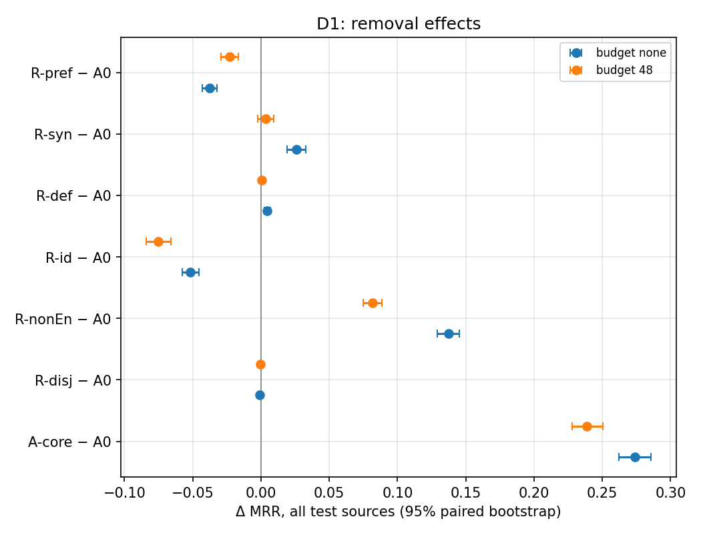
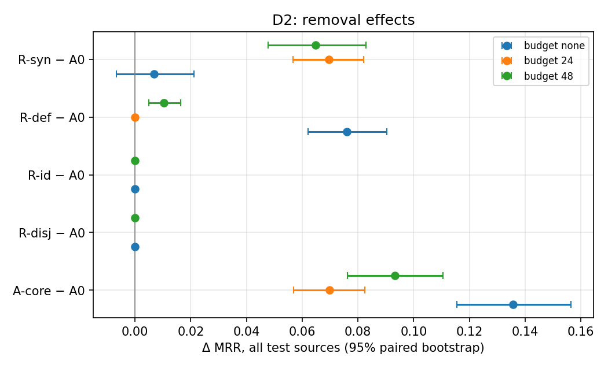

# Predicate-role ablation (#131)

## Reading this report

- **Arms.**  A0 keeps every item; R-x removes role x; A-core keeps only
  `rdfs:label`, `rdf:type` and `rdfs:subClassOf`; C+x keeps core plus role x.
  Removal applies to both sides.  Roles come from `roles_v1`, fixed from
  predicate declarations and values before any run.
- **Budgets.**  "none" is the `full` order: every remaining item, joined in
  canonical order, with only the model's 512-token input limit (truncated
  texts and tokens are in the audit).  Budgeted arms use core-first order, so
  a budget never drops `rdfs:label` for an annotation that sorts earlier.
- **Effects.**  `R − A0` without a budget is the removal effect with no
  budget involved.  The difference-in-differences `(R − A0)@b − (R − A0)@none`
  is the part of the removal effect that depends on the budget (freed tokens
  re-allocated, or annotations crowding out other items).  `arm@b − arm@none`
  is the cost of the budget itself.
- **Strata.**  "Selection differs for source or a gold target" holds sources
  whose own text or a gold target's text changes; the complement moves only
  through competing candidates.  An entity without the removed role keeps
  byte-identical text, which makes it a built-in negative control.
- **Not identifiable.**  Arms whose role is absent from a dataset select the
  same text as A0 and are reported as not identifiable, not as a null effect.
- **Uncertainty.**  Paired bootstrap over test sources of one pair, 2,000
  resamples, seed 42; budgets and datasets are never pooled.  Intervals are
  conditional on one evaluation per pair, approximate because sources share
  candidates, and carry no significance test.  F1, precision and recall depend
  on the validation-tuned threshold and are tabulated apart from ranking
  metrics.
- **Preferred names duplicate labels** for 99% of D1 entities (after case and
  underscore normalisation), so R-pref mostly removes a repeated name.

## Execution record

Expected full-population runs: 38; complete: 38.
- None missing, failed or smoke-only.

| Dataset | Budget | Arm | Condition | Order | Role map | Results root | Commit | Dirty | Model rev | Candidates | Dataset files | Protocol | Population | Status | Signature |
|---|---|---|---|---|---|---|---|---|---|---|---|---|---|---|---|
| D1 | none | A0 | `PR-all-full` | full | `d4c5bd86becb` | `data/results_issue164/predicate_roles` | `66aabc3b` | False | `d4aa6901` | `a65eb2480a75` | `da8cc202f814` | 2 | full | completed | `c9eb0fdec646` |
| D1 | none | A-core | `PR-core-full` | full | `d4c5bd86becb` | `data/results_issue164/predicate_roles` | `66aabc3b` | False | `d4aa6901` | `a65eb2480a75` | `da8cc202f814` | 2 | full | completed | `c9eb0fdec646` |
| D1 | none | C+def | `PR-core-plus-def-full` | full | `d4c5bd86becb` | `data/results_issue164/predicate_roles` | `66aabc3b` | False | `d4aa6901` | `a65eb2480a75` | `da8cc202f814` | 2 | full | completed | `c9eb0fdec646` |
| D1 | none | C+id | `PR-core-plus-id-full` | full | `d4c5bd86becb` | `data/results_issue164/predicate_roles` | `66aabc3b` | False | `d4aa6901` | `a65eb2480a75` | `da8cc202f814` | 2 | full | completed | `c9eb0fdec646` |
| D1 | none | C+pref | `PR-core-plus-pref-full` | full | `d4c5bd86becb` | `data/results_issue164/predicate_roles` | `66aabc3b` | False | `d4aa6901` | `a65eb2480a75` | `da8cc202f814` | 2 | full | completed | `c9eb0fdec646` |
| D1 | none | C+syn | `PR-core-plus-syn-full` | full | `d4c5bd86becb` | `data/results_issue164/predicate_roles` | `66aabc3b` | False | `d4aa6901` | `a65eb2480a75` | `da8cc202f814` | 2 | full | completed | `c9eb0fdec646` |
| D1 | none | R-def | `PR-no-def-full` | full | `d4c5bd86becb` | `data/results_issue164/predicate_roles` | `66aabc3b` | False | `d4aa6901` | `a65eb2480a75` | `da8cc202f814` | 2 | full | completed | `c9eb0fdec646` |
| D1 | none | R-disj | `PR-no-disj-full` | full | `d4c5bd86becb` | `data/results_issue164/predicate_roles` | `66aabc3b` | False | `d4aa6901` | `a65eb2480a75` | `da8cc202f814` | 2 | full | completed | `c9eb0fdec646` |
| D1 | none | R-id | `PR-no-id-full` | full | `d4c5bd86becb` | `data/results_issue164/predicate_roles` | `66aabc3b` | False | `d4aa6901` | `a65eb2480a75` | `da8cc202f814` | 2 | full | completed | `c9eb0fdec646` |
| D1 | none | R-nonEn | `PR-no-nonen-full` | full | `d4c5bd86becb` | `data/results_issue164/predicate_roles` | `66aabc3b` | False | `d4aa6901` | `a65eb2480a75` | `da8cc202f814` | 2 | full | completed | `c9eb0fdec646` |
| D1 | none | R-pref | `PR-no-pref-full` | full | `d4c5bd86becb` | `data/results_issue164/predicate_roles` | `66aabc3b` | False | `d4aa6901` | `a65eb2480a75` | `da8cc202f814` | 2 | full | completed | `c9eb0fdec646` |
| D1 | none | R-syn | `PR-no-syn-full` | full | `d4c5bd86becb` | `data/results_issue164/predicate_roles` | `66aabc3b` | False | `d4aa6901` | `a65eb2480a75` | `da8cc202f814` | 2 | full | completed | `c9eb0fdec646` |
| D1 | 48 | P1 (link) | `PA-all-base-det-48` | deterministic | `-` | `data/results_issue164/ppas_controlled` | `66aabc3b` | False | `d4aa6901` | `a65eb2480a75` | `da8cc202f814` | 2 | full | completed | `677f10b74daf` |
| D1 | 48 | A0 | `PR-all-48` | core_first | `d4c5bd86becb` | `data/results_issue164/predicate_roles` | `66aabc3b` | False | `d4aa6901` | `a65eb2480a75` | `da8cc202f814` | 2 | full | completed | `677f10b74daf` |
| D1 | 48 | A-core | `PR-core-48` | core_first | `d4c5bd86becb` | `data/results_issue164/predicate_roles` | `66aabc3b` | False | `d4aa6901` | `a65eb2480a75` | `da8cc202f814` | 2 | full | completed | `677f10b74daf` |
| D1 | 48 | R-def | `PR-no-def-48` | core_first | `d4c5bd86becb` | `data/results_issue164/predicate_roles` | `66aabc3b` | False | `d4aa6901` | `a65eb2480a75` | `da8cc202f814` | 2 | full | completed | `677f10b74daf` |
| D1 | 48 | R-disj | `PR-no-disj-48` | core_first | `d4c5bd86becb` | `data/results_issue164/predicate_roles` | `66aabc3b` | False | `d4aa6901` | `a65eb2480a75` | `da8cc202f814` | 2 | full | completed | `677f10b74daf` |
| D1 | 48 | R-id | `PR-no-id-48` | core_first | `d4c5bd86becb` | `data/results_issue164/predicate_roles` | `66aabc3b` | False | `d4aa6901` | `a65eb2480a75` | `da8cc202f814` | 2 | full | completed | `677f10b74daf` |
| D1 | 48 | R-nonEn | `PR-no-nonen-48` | core_first | `d4c5bd86becb` | `data/results_issue164/predicate_roles` | `66aabc3b` | False | `d4aa6901` | `a65eb2480a75` | `da8cc202f814` | 2 | full | completed | `677f10b74daf` |
| D1 | 48 | R-pref | `PR-no-pref-48` | core_first | `d4c5bd86becb` | `data/results_issue164/predicate_roles` | `66aabc3b` | False | `d4aa6901` | `a65eb2480a75` | `da8cc202f814` | 2 | full | completed | `677f10b74daf` |
| D1 | 48 | R-syn | `PR-no-syn-48` | core_first | `d4c5bd86becb` | `data/results_issue164/predicate_roles` | `66aabc3b` | False | `d4aa6901` | `a65eb2480a75` | `da8cc202f814` | 2 | full | completed | `677f10b74daf` |
| D2 | none | A0 | `PR-all-full` | full | `d4c5bd86becb` | `data/results_issue164/predicate_roles` | `3d5c4879` | False | `d4aa6901` | `b4f1129bad0e` | `dcca13185424` | 2 | full | completed | `c176c3526bb5` |
| D2 | none | A-core | `PR-core-full` | full | `d4c5bd86becb` | `data/results_issue164/predicate_roles` | `3d5c4879` | False | `d4aa6901` | `b4f1129bad0e` | `dcca13185424` | 2 | full | completed | `c176c3526bb5` |
| D2 | none | C+def | `PR-core-plus-def-full` | full | `d4c5bd86becb` | `data/results_issue164/predicate_roles` | `3d5c4879` | False | `d4aa6901` | `b4f1129bad0e` | `dcca13185424` | 2 | full | completed | `c176c3526bb5` |
| D2 | none | C+syn | `PR-core-plus-syn-full` | full | `d4c5bd86becb` | `data/results_issue164/predicate_roles` | `3d5c4879` | False | `d4aa6901` | `b4f1129bad0e` | `dcca13185424` | 2 | full | completed | `c176c3526bb5` |
| D2 | none | R-def | `PR-no-def-full` | full | `d4c5bd86becb` | `data/results_issue164/predicate_roles` | `3d5c4879` | False | `d4aa6901` | `b4f1129bad0e` | `dcca13185424` | 2 | full | completed | `c176c3526bb5` |
| D2 | none | R-disj | `PR-no-disj-full` | full | `d4c5bd86becb` | `data/results_issue164/predicate_roles` | `3d5c4879` | False | `d4aa6901` | `b4f1129bad0e` | `dcca13185424` | 2 | full | completed | `c176c3526bb5` |
| D2 | none | R-id | `PR-no-id-full` | full | `d4c5bd86becb` | `data/results_issue164/predicate_roles` | `3d5c4879` | False | `d4aa6901` | `b4f1129bad0e` | `dcca13185424` | 2 | full | completed | `c176c3526bb5` |
| D2 | none | R-syn | `PR-no-syn-full` | full | `d4c5bd86becb` | `data/results_issue164/predicate_roles` | `3d5c4879` | False | `d4aa6901` | `b4f1129bad0e` | `dcca13185424` | 2 | full | completed | `c176c3526bb5` |
| D2 | 24 | A0 | `PR-all-24` | core_first | `d4c5bd86becb` | `data/results_issue164/predicate_roles` | `3d5c4879` | False | `d4aa6901` | `b4f1129bad0e` | `dcca13185424` | 2 | full | completed | `dd76240dd591` |
| D2 | 24 | A-core | `PR-core-24` | core_first | `d4c5bd86becb` | `data/results_issue164/predicate_roles` | `3d5c4879` | False | `d4aa6901` | `b4f1129bad0e` | `dcca13185424` | 2 | full | completed | `dd76240dd591` |
| D2 | 24 | R-def | `PR-no-def-24` | core_first | `d4c5bd86becb` | `data/results_issue164/predicate_roles` | `3d5c4879` | False | `d4aa6901` | `b4f1129bad0e` | `dcca13185424` | 2 | full | completed | `dd76240dd591` |
| D2 | 24 | R-syn | `PR-no-syn-24` | core_first | `d4c5bd86becb` | `data/results_issue164/predicate_roles` | `3d5c4879` | False | `d4aa6901` | `b4f1129bad0e` | `dcca13185424` | 2 | full | completed | `dd76240dd591` |
| D2 | 48 | P1 (link) | `PA-all-base-det-48` | deterministic | `-` | `data/results_issue164/ppas_validation` | `4a42227e` | False | `d4aa6901` | `b4f1129bad0e` | `dcca13185424` | 2 | full | completed | `9c112b2cbe1a` |
| D2 | 48 | A0 | `PR-all-48` | core_first | `d4c5bd86becb` | `data/results_issue164/predicate_roles` | `3d5c4879` | False | `d4aa6901` | `b4f1129bad0e` | `dcca13185424` | 2 | full | completed | `9c112b2cbe1a` |
| D2 | 48 | A-core | `PR-core-48` | core_first | `d4c5bd86becb` | `data/results_issue164/predicate_roles` | `3d5c4879` | False | `d4aa6901` | `b4f1129bad0e` | `dcca13185424` | 2 | full | completed | `9c112b2cbe1a` |
| D2 | 48 | R-def | `PR-no-def-48` | core_first | `d4c5bd86becb` | `data/results_issue164/predicate_roles` | `3d5c4879` | False | `d4aa6901` | `b4f1129bad0e` | `dcca13185424` | 2 | full | completed | `9c112b2cbe1a` |
| D2 | 48 | R-disj | `PR-no-disj-48` | core_first | `d4c5bd86becb` | `data/results_issue164/predicate_roles` | `3d5c4879` | False | `d4aa6901` | `b4f1129bad0e` | `dcca13185424` | 2 | full | completed | `9c112b2cbe1a` |
| D2 | 48 | R-id | `PR-no-id-48` | core_first | `d4c5bd86becb` | `data/results_issue164/predicate_roles` | `3d5c4879` | False | `d4aa6901` | `b4f1129bad0e` | `dcca13185424` | 2 | full | completed | `9c112b2cbe1a` |
| D2 | 48 | R-syn | `PR-no-syn-48` | core_first | `d4c5bd86becb` | `data/results_issue164/predicate_roles` | `3d5c4879` | False | `d4aa6901` | `b4f1129bad0e` | `dcca13185424` | 2 | full | completed | `9c112b2cbe1a` |

### Dataset versions

- D1: 20 runs recorded file digests; all equal the files on disk: True.
  - `d1_snomed_fma/source.rdf` sha256 `a0fb689dde7b95bf…`, modified 2026-03-21T13:37:23Z
  - `d1_snomed_fma/target.rdf` sha256 `c1777ae5546dd78f…`, modified 2026-03-21T13:38:40Z
  - `d1_snomed_fma/reference.rdf` sha256 `de7358d1841fed49…`, modified 2026-03-21T13:38:41Z
- D2: 18 runs recorded file digests; all equal the files on disk: True.
  - `d2_anatomy/source.rdf` sha256 `93756393d6306c8f…`, modified 2026-03-03T04:02:14Z
  - `d2_anatomy/target.rdf` sha256 `5c1ca432d9845f1a…`, modified 2026-03-03T04:02:16Z
  - `d2_anatomy/reference.rdf` sha256 `b6a6b12f3e7a786e…`, modified 2026-03-03T04:02:17Z

### Budget and truncation audit

| Dataset | Budget | Arm | Src max tok | Src over budget | Src truncated texts | Src truncated tokens | Src sampled | Cand max tok | Cand over budget | Cand truncated texts | Cand truncated tokens | Cand sampled |
|---|---|---|---|---|---|---|---|---|---|---|---|---|
| D1 | none | A0 | 316 | n/a | 0 | 0 | 0.0% | 283 | n/a | 0 | 0 | 0.0% |
| D1 | none | A-core | 64 | n/a | 0 | 0 | 0.0% | 76 | n/a | 0 | 0 | 0.0% |
| D1 | none | C+def | 263 | n/a | 0 | 0 | 0.0% | 211 | n/a | 0 | 0 | 0.0% |
| D1 | none | C+id | 64 | n/a | 0 | 0 | 0.0% | 94 | n/a | 0 | 0 | 0.0% |
| D1 | none | C+pref | 110 | n/a | 0 | 0 | 0.0% | 113 | n/a | 0 | 0 | 0.0% |
| D1 | none | C+syn | 114 | n/a | 0 | 0 | 0.0% | 185 | n/a | 0 | 0 | 0.0% |
| D1 | none | R-def | 165 | n/a | 0 | 0 | 0.0% | 283 | n/a | 0 | 0 | 0.0% |
| D1 | none | R-disj | 316 | n/a | 0 | 0 | 0.0% | 283 | n/a | 0 | 0 | 0.0% |
| D1 | none | R-id | 316 | n/a | 0 | 0 | 0.0% | 271 | n/a | 0 | 0 | 0.0% |
| D1 | none | R-nonEn | 316 | n/a | 0 | 0 | 0.0% | 238 | n/a | 0 | 0 | 0.0% |
| D1 | none | R-pref | 308 | n/a | 0 | 0 | 0.0% | 267 | n/a | 0 | 0 | 0.0% |
| D1 | none | R-syn | 271 | n/a | 0 | 0 | 0.0% | 273 | n/a | 0 | 0 | 0.0% |
| D1 | 48 | A0 | 48 | 0 | 0 | 0 | 24.6% | 48 | 0 | 0 | 0 | 81.3% |
| D1 | 48 | A-core | 48 | 0 | 0 | 0 | 0.2% | 48 | 0 | 0 | 0 | 1.2% |
| D1 | 48 | R-def | 48 | 0 | 0 | 0 | 24.4% | 48 | 0 | 0 | 0 | 80.9% |
| D1 | 48 | R-disj | 48 | 0 | 0 | 0 | 24.6% | 48 | 0 | 0 | 0 | 75.9% |
| D1 | 48 | R-id | 48 | 0 | 0 | 0 | 24.6% | 48 | 0 | 0 | 0 | 64.1% |
| D1 | 48 | R-nonEn | 48 | 0 | 0 | 0 | 24.6% | 48 | 0 | 0 | 0 | 78.2% |
| D1 | 48 | R-pref | 48 | 0 | 0 | 0 | 5.8% | 48 | 0 | 0 | 0 | 47.0% |
| D1 | 48 | R-syn | 48 | 0 | 0 | 0 | 9.8% | 48 | 0 | 0 | 0 | 70.0% |
| D2 | none | A0 | 57 | n/a | 0 | 0 | 0.0% | 304 | n/a | 0 | 0 | 0.0% |
| D2 | none | A-core | 55 | n/a | 0 | 0 | 0.0% | 67 | n/a | 0 | 0 | 0.0% |
| D2 | none | C+def | 55 | n/a | 0 | 0 | 0.0% | 268 | n/a | 0 | 0 | 0.0% |
| D2 | none | C+syn | 57 | n/a | 0 | 0 | 0.0% | 202 | n/a | 0 | 0 | 0.0% |
| D2 | none | R-def | 57 | n/a | 0 | 0 | 0.0% | 202 | n/a | 0 | 0 | 0.0% |
| D2 | none | R-disj | 57 | n/a | 0 | 0 | 0.0% | 304 | n/a | 0 | 0 | 0.0% |
| D2 | none | R-id | 57 | n/a | 0 | 0 | 0.0% | 304 | n/a | 0 | 0 | 0.0% |
| D2 | none | R-syn | 55 | n/a | 0 | 0 | 0.0% | 268 | n/a | 0 | 0 | 0.0% |
| D2 | 24 | A0 | 24 | 0 | 0 | 0 | 22.6% | 24 | 0 | 0 | 0 | 98.0% |
| D2 | 24 | A-core | 24 | 0 | 0 | 0 | 13.4% | 24 | 0 | 0 | 0 | 51.3% |
| D2 | 24 | R-def | 24 | 0 | 0 | 0 | 22.6% | 24 | 0 | 0 | 0 | 97.6% |
| D2 | 24 | R-syn | 24 | 0 | 0 | 0 | 14.1% | 24 | 0 | 0 | 0 | 62.9% |
| D2 | 48 | A0 | 48 | 0 | 0 | 0 | 0.4% | 48 | 0 | 0 | 0 | 35.5% |
| D2 | 48 | A-core | 45 | 0 | 0 | 0 | 0.1% | 48 | 0 | 0 | 0 | 0.9% |
| D2 | 48 | R-def | 48 | 0 | 0 | 0 | 0.4% | 48 | 0 | 0 | 0 | 21.7% |
| D2 | 48 | R-disj | 48 | 0 | 0 | 0 | 0.4% | 48 | 0 | 0 | 0 | 35.5% |
| D2 | 48 | R-id | 48 | 0 | 0 | 0 | 0.3% | 48 | 0 | 0 | 0 | 35.5% |
| D2 | 48 | R-syn | 45 | 0 | 0 | 0 | 0.1% | 48 | 0 | 0 | 0 | 20.7% |

### Removed by role (no-budget arms)

| Dataset | Arm | Side | Role | Entities | Items | Item tokens |
|---|---|---|---|---|---|---|
| D1 | A-core | source | definition | 86 | 97 | 3106 |
| D1 | A-core | source | preferred_name | 24182 | 24502 | 292036 |
| D1 | A-core | source | synonym | 10003 | 14014 | 137342 |
| D1 | A-core | candidate | definition | 739 | 774 | 24859 |
| D1 | A-core | candidate | disjointness | 12030 | 12030 | 190375 |
| D1 | A-core | candidate | identifier | 50103 | 51353 | 302101 |
| D1 | A-core | candidate | non_english | 5527 | 10752 | 144951 |
| D1 | A-core | candidate | other | 78 | 104 | 1289 |
| D1 | A-core | candidate | preferred_name | 49844 | 49847 | 617345 |
| D1 | A-core | candidate | synonym | 20272 | 31494 | 320382 |
| D1 | C+def | source | preferred_name | 24182 | 24502 | 292036 |
| D1 | C+def | source | synonym | 10003 | 14014 | 137342 |
| D1 | C+def | candidate | disjointness | 12030 | 12030 | 190375 |
| D1 | C+def | candidate | identifier | 50103 | 51353 | 302101 |
| D1 | C+def | candidate | non_english | 5527 | 10752 | 144951 |
| D1 | C+def | candidate | other | 78 | 104 | 1289 |
| D1 | C+def | candidate | preferred_name | 49844 | 49847 | 617345 |
| D1 | C+def | candidate | synonym | 20272 | 31494 | 320382 |
| D1 | C+id | source | definition | 86 | 97 | 3106 |
| D1 | C+id | source | preferred_name | 24182 | 24502 | 292036 |
| D1 | C+id | source | synonym | 10003 | 14014 | 137342 |
| D1 | C+id | candidate | definition | 739 | 774 | 24859 |
| D1 | C+id | candidate | disjointness | 12030 | 12030 | 190375 |
| D1 | C+id | candidate | non_english | 5527 | 10752 | 144951 |
| D1 | C+id | candidate | other | 78 | 104 | 1289 |
| D1 | C+id | candidate | preferred_name | 49844 | 49847 | 617345 |
| D1 | C+id | candidate | synonym | 20272 | 31494 | 320382 |
| D1 | C+pref | source | definition | 86 | 97 | 3106 |
| D1 | C+pref | source | synonym | 10003 | 14014 | 137342 |
| D1 | C+pref | candidate | definition | 739 | 774 | 24859 |
| D1 | C+pref | candidate | disjointness | 12030 | 12030 | 190375 |
| D1 | C+pref | candidate | identifier | 50103 | 51353 | 302101 |
| D1 | C+pref | candidate | non_english | 5527 | 10752 | 144951 |
| D1 | C+pref | candidate | other | 78 | 104 | 1289 |
| D1 | C+pref | candidate | synonym | 20272 | 31494 | 320382 |
| D1 | C+syn | source | definition | 86 | 97 | 3106 |
| D1 | C+syn | source | preferred_name | 24182 | 24502 | 292036 |
| D1 | C+syn | candidate | definition | 739 | 774 | 24859 |
| D1 | C+syn | candidate | disjointness | 12030 | 12030 | 190375 |
| D1 | C+syn | candidate | identifier | 50103 | 51353 | 302101 |
| D1 | C+syn | candidate | non_english | 5527 | 10752 | 144951 |
| D1 | C+syn | candidate | other | 78 | 104 | 1289 |
| D1 | C+syn | candidate | preferred_name | 49844 | 49847 | 617345 |
| D1 | R-def | source | definition | 86 | 97 | 3106 |
| D1 | R-def | candidate | definition | 739 | 774 | 24859 |
| D1 | R-disj | candidate | disjointness | 12030 | 12030 | 190375 |
| D1 | R-id | candidate | identifier | 50103 | 51353 | 302101 |
| D1 | R-nonEn | candidate | non_english | 5527 | 10752 | 144951 |
| D1 | R-pref | source | preferred_name | 24182 | 24502 | 292036 |
| D1 | R-pref | candidate | preferred_name | 49844 | 49847 | 617345 |
| D1 | R-syn | source | synonym | 10003 | 14014 | 137342 |
| D1 | R-syn | candidate | synonym | 20272 | 31494 | 320382 |
| D2 | A-core | source | identifier | 23 | 23 | 218 |
| D2 | A-core | source | synonym | 305 | 344 | 2930 |
| D2 | A-core | candidate | definition | 802 | 802 | 37811 |
| D2 | A-core | candidate | disjointness | 6 | 17 | 150 |
| D2 | A-core | candidate | synonym | 3205 | 5080 | 45092 |
| D2 | C+def | source | identifier | 23 | 23 | 218 |
| D2 | C+def | source | synonym | 305 | 344 | 2930 |
| D2 | C+def | candidate | disjointness | 6 | 17 | 150 |
| D2 | C+def | candidate | synonym | 3205 | 5080 | 45092 |
| D2 | C+syn | source | identifier | 23 | 23 | 218 |
| D2 | C+syn | candidate | definition | 802 | 802 | 37811 |
| D2 | C+syn | candidate | disjointness | 6 | 17 | 150 |
| D2 | R-def | candidate | definition | 802 | 802 | 37811 |
| D2 | R-disj | candidate | disjointness | 6 | 17 | 150 |
| D2 | R-id | source | identifier | 23 | 23 | 218 |
| D2 | R-syn | source | synonym | 305 | 344 | 2930 |
| D2 | R-syn | candidate | synonym | 3205 | 5080 | 45092 |

## D1

### Ranking metrics (threshold-independent)

| Budget | Arm | mrr | recall_at_1 | recall_at_5 | recall_at_10 |
|---|---|---|---|---|---|
| none | A0 | 0.4529 | 0.2954 | 0.5364 | 0.6759 |
| none | A-core | 0.7267 | 0.5697 | 0.7945 | 0.8366 |
| none | C+def | 0.6997 | 0.5471 | 0.7610 | 0.8056 |
| none | C+id | 0.6707 | 0.5069 | 0.7539 | 0.8167 |
| none | C+pref | 0.7556 | 0.6043 | 0.8148 | 0.8460 |
| none | C+syn | 0.4761 | 0.3161 | 0.5656 | 0.7179 |
| none | R-def | 0.4575 | 0.2979 | 0.5446 | 0.6858 |
| none | R-disj | 0.4519 | 0.2954 | 0.5360 | 0.6732 |
| none | R-id | 0.4013 | 0.2535 | 0.4625 | 0.6064 |
| none | R-nonEn | 0.5905 | 0.4168 | 0.7015 | 0.7937 |
| none | R-pref | 0.4154 | 0.2600 | 0.4973 | 0.6517 |
| none | R-syn | 0.4789 | 0.3331 | 0.5356 | 0.6663 |
| 48 | A0 | 0.4869 | 0.3153 | 0.6104 | 0.7495 |
| 48 | A-core | 0.7254 | 0.5681 | 0.7941 | 0.8364 |
| 48 | R-def | 0.4874 | 0.3155 | 0.6116 | 0.7499 |
| 48 | R-disj | 0.4867 | 0.3150 | 0.6104 | 0.7495 |
| 48 | R-id | 0.4117 | 0.2509 | 0.5201 | 0.6692 |
| 48 | R-nonEn | 0.5684 | 0.3917 | 0.6935 | 0.7970 |
| 48 | R-pref | 0.4639 | 0.2935 | 0.5884 | 0.7369 |
| 48 | R-syn | 0.4904 | 0.3228 | 0.6056 | 0.7457 |

### Threshold-dependent metrics (validation-tuned threshold)

| Budget | Arm | f1 | precision | recall | threshold |
|---|---|---|---|---|---|
| none | A0 | 0.1432 | 0.1078 | 0.2134 | 0.8100 |
| none | A-core | 0.3343 | 0.2666 | 0.4481 | 0.9200 |
| none | C+def | 0.3224 | 0.3585 | 0.2930 | 0.9400 |
| none | C+id | 0.2841 | 0.2329 | 0.3641 | 0.8600 |
| none | C+pref | 0.3280 | 0.2945 | 0.3703 | 0.8900 |
| none | C+syn | 0.1515 | 0.1046 | 0.2744 | 0.8700 |
| none | R-def | 0.1447 | 0.1085 | 0.2170 | 0.8100 |
| none | R-disj | 0.1425 | 0.1070 | 0.2135 | 0.8100 |
| none | R-id | 0.1408 | 0.1120 | 0.1894 | 0.8600 |
| none | R-nonEn | 0.2031 | 0.1430 | 0.3502 | 0.8000 |
| none | R-pref | 0.1225 | 0.0856 | 0.2158 | 0.8100 |
| none | R-syn | 0.1851 | 0.1679 | 0.2063 | 0.8400 |
| 48 | A0 | 0.1463 | 0.1037 | 0.2480 | 0.8100 |
| 48 | A-core | 0.3352 | 0.2668 | 0.4508 | 0.9200 |
| 48 | R-def | 0.1464 | 0.1037 | 0.2484 | 0.8100 |
| 48 | R-disj | 0.1461 | 0.1036 | 0.2480 | 0.8100 |
| 48 | R-id | 0.1210 | 0.0855 | 0.2069 | 0.8500 |
| 48 | R-nonEn | 0.1826 | 0.1247 | 0.3414 | 0.8000 |
| 48 | R-pref | 0.1366 | 0.0935 | 0.2533 | 0.8100 |
| 48 | R-syn | 0.1586 | 0.1144 | 0.2585 | 0.8200 |

### Removal effects: arm − A0, per budget

| Contrast | Budget | Test sources | n | Δ MRR [95% CI] | Δ R@1 [95% CI] |
|---|---|---|---|---|---|
| R-pref − A0 | none | all test sources | 4605 | -0.0375 [-0.0428, -0.0320] | -0.0402 [-0.0489, -0.0315] |
| R-pref − A0 | none | selection differs for source or a gold target | 4605 | -0.0375 [-0.0428, -0.0320] | -0.0402 [-0.0489, -0.0315] |
| R-pref − A0 | none | source and gold targets unchanged | 0 | n/a [n/a, n/a] | n/a [n/a, n/a] |
| R-syn − A0 | none | all test sources | 4605 | 0.0260 [0.0190, 0.0327] | 0.0428 [0.0328, 0.0526] |
| R-syn − A0 | none | selection differs for source or a gold target | 4368 | 0.0284 [0.0213, 0.0359] | 0.0462 [0.0362, 0.0568] |
| R-syn − A0 | none | source and gold targets unchanged | 237 | -0.0192 [-0.0332, -0.0086] | -0.0211 [-0.0422, -0.0042] |
| R-def − A0 | none | all test sources | 4605 | 0.0046 [0.0024, 0.0072] | 0.0028 [-0.0002, 0.0059] |
| R-def − A0 | none | selection differs for source or a gold target | 305 | 0.0868 [0.0533, 0.1212] | 0.0656 [0.0262, 0.1082] |
| R-def − A0 | none | source and gold targets unchanged | 4300 | -0.0012 [-0.0020, -0.0006] | -0.0016 [-0.0030, -0.0005] |
| R-id − A0 | none | all test sources | 4605 | -0.0516 [-0.0578, -0.0452] | -0.0476 [-0.0569, -0.0382] |
| R-id − A0 | none | selection differs for source or a gold target | 4568 | -0.0520 [-0.0584, -0.0461] | -0.0479 [-0.0574, -0.0383] |
| R-id − A0 | none | source and gold targets unchanged | 37 | 0.0000 [0.0000, 0.0000] | 0.0000 [0.0000, 0.0000] |
| R-nonEn − A0 | none | all test sources | 4605 | 0.1376 [0.1290, 0.1455] | 0.1377 [0.1268, 0.1479] |
| R-nonEn − A0 | none | selection differs for source or a gold target | 2595 | 0.2513 [0.2391, 0.2642] | 0.2539 [0.2374, 0.2713] |
| R-nonEn − A0 | none | source and gold targets unchanged | 2010 | -0.0092 [-0.0120, -0.0066] | -0.0124 [-0.0179, -0.0080] |
| R-disj − A0 | none | all test sources | 4605 | -0.0010 [-0.0024, 0.0004] | 0.0000 [-0.0024, 0.0024] |
| R-disj − A0 | none | selection differs for source or a gold target | 375 | 0.0058 [-0.0042, 0.0160] | 0.0080 [-0.0080, 0.0267] |
| R-disj − A0 | none | source and gold targets unchanged | 4230 | -0.0016 [-0.0028, -0.0003] | -0.0007 [-0.0031, 0.0014] |
| A-core − A0 | none | all test sources | 4605 | 0.2738 [0.2621, 0.2858] | 0.3112 [0.2951, 0.3273] |
| A-core − A0 | none | selection differs for source or a gold target | 4605 | 0.2738 [0.2621, 0.2858] | 0.3112 [0.2951, 0.3273] |
| A-core − A0 | none | source and gold targets unchanged | 0 | n/a [n/a, n/a] | n/a [n/a, n/a] |
| R-pref − A0 | 48 | all test sources | 4605 | -0.0229 [-0.0294, -0.0164] | -0.0248 [-0.0339, -0.0148] |
| R-pref − A0 | 48 | selection differs for source or a gold target | 3603 | -0.0279 [-0.0363, -0.0193] | -0.0300 [-0.0425, -0.0178] |
| R-pref − A0 | 48 | source and gold targets unchanged | 1002 | -0.0050 [-0.0104, -0.0002] | -0.0060 [-0.0150, 0.0020] |
| R-syn − A0 | 48 | all test sources | 4605 | 0.0036 [-0.0024, 0.0095] | 0.0085 [-0.0004, 0.0176] |
| R-syn − A0 | 48 | selection differs for source or a gold target | 3900 | 0.0053 [-0.0018, 0.0126] | 0.0110 [0.0000, 0.0221] |
| R-syn − A0 | 48 | source and gold targets unchanged | 705 | -0.0059 [-0.0107, -0.0018] | -0.0057 [-0.0128, 0.0000] |
| R-def − A0 | 48 | all test sources | 4605 | 0.0005 [-0.0005, 0.0016] | 0.0002 [-0.0011, 0.0015] |
| R-def − A0 | 48 | selection differs for source or a gold target | 60 | 0.0620 [-0.0075, 0.1353] | 0.0500 [-0.0500, 0.1500] |
| R-def − A0 | 48 | source and gold targets unchanged | 4545 | -0.0003 [-0.0007, -0.0000] | -0.0004 [-0.0011, 0.0000] |
| R-id − A0 | 48 | all test sources | 4605 | -0.0752 [-0.0840, -0.0657] | -0.0732 [-0.0867, -0.0606] |
| R-id − A0 | 48 | selection differs for source or a gold target | 4543 | -0.0758 [-0.0853, -0.0659] | -0.0740 [-0.0878, -0.0599] |
| R-id − A0 | 48 | source and gold targets unchanged | 62 | -0.0313 [-0.0713, -0.0054] | -0.0161 [-0.0484, 0.0000] |
| R-nonEn − A0 | 48 | all test sources | 4605 | 0.0815 [0.0748, 0.0884] | 0.0866 [0.0773, 0.0958] |
| R-nonEn − A0 | 48 | selection differs for source or a gold target | 1818 | 0.2128 [0.1978, 0.2273] | 0.2261 [0.2057, 0.2475] |
| R-nonEn − A0 | 48 | source and gold targets unchanged | 2787 | -0.0041 [-0.0058, -0.0026] | -0.0043 [-0.0075, -0.0014] |
| R-disj − A0 | 48 | all test sources | 4605 | -0.0002 [-0.0006, 0.0001] | -0.0004 [-0.0011, 0.0000] |
| R-disj − A0 | 48 | selection differs for source or a gold target | 21 | -0.0336 [-0.1190, 0.0286] | -0.0952 [-0.2381, 0.0000] |
| R-disj − A0 | 48 | source and gold targets unchanged | 4584 | -0.0001 [-0.0002, 0.0000] | 0.0000 [0.0000, 0.0000] |
| A-core − A0 | 48 | all test sources | 4605 | 0.2385 [0.2277, 0.2504] | 0.2869 [0.2714, 0.3019] |
| A-core − A0 | 48 | selection differs for source or a gold target | 4604 | 0.2387 [0.2276, 0.2499] | 0.2871 [0.2717, 0.3030] |
| A-core − A0 | 48 | source and gold targets unchanged | 1 | -0.8750 [-0.8750, -0.8750] | -1.0000 [-1.0000, -1.0000] |

### Removal × budget: difference-in-differences

| Contrast | Budget | n | Δ MRR [95% CI] | Δ R@1 [95% CI] |
|---|---|---|---|---|
| (R-pref − A0)@48 − (R-pref − A0)@none | 48 | 4605 | 0.0146 [0.0078, 0.0212] | 0.0154 [0.0054, 0.0261] |
| (R-syn − A0)@48 − (R-syn − A0)@none | 48 | 4605 | -0.0224 [-0.0295, -0.0153] | -0.0343 [-0.0456, -0.0239] |
| (R-def − A0)@48 − (R-def − A0)@none | 48 | 4605 | -0.0041 [-0.0066, -0.0018] | -0.0026 [-0.0056, 0.0004] |
| (R-id − A0)@48 − (R-id − A0)@none | 48 | 4605 | -0.0236 [-0.0330, -0.0144] | -0.0256 [-0.0393, -0.0126] |
| (R-nonEn − A0)@48 − (R-nonEn − A0)@none | 48 | 4605 | -0.0561 [-0.0632, -0.0487] | -0.0510 [-0.0617, -0.0410] |
| (R-disj − A0)@48 − (R-disj − A0)@none | 48 | 4605 | 0.0008 [-0.0006, 0.0022] | -0.0004 [-0.0030, 0.0020] |
| (A-core − A0)@48 − (A-core − A0)@none | 48 | 4605 | -0.0353 [-0.0443, -0.0264] | -0.0243 [-0.0363, -0.0119] |

### Budget cost: arm@budget − arm@none

| Contrast | Budget | Test sources | n | Δ MRR [95% CI] | Δ R@1 [95% CI] |
|---|---|---|---|---|---|
| A0@48 − A0@none | 48 | all test sources | 4605 | 0.0340 [0.0251, 0.0429] | 0.0226 [0.0102, 0.0345] |
| A0@48 − A0@none | 48 | selection differs for source or a gold target | 3917 | 0.0513 [0.0409, 0.0615] | 0.0411 [0.0276, 0.0544] |
| A0@48 − A0@none | 48 | source and gold targets unchanged | 688 | -0.0648 [-0.0783, -0.0518] | -0.0828 [-0.1047, -0.0610] |
| A-core@48 − A-core@none | 48 | all test sources | 4605 | -0.0013 [-0.0023, -0.0005] | -0.0017 [-0.0030, -0.0007] |
| A-core@48 − A-core@none | 48 | selection differs for source or a gold target | 15 | 0.0000 [0.0000, 0.0000] | 0.0000 [0.0000, 0.0000] |
| A-core@48 − A-core@none | 48 | source and gold targets unchanged | 4590 | -0.0013 [-0.0023, -0.0005] | -0.0017 [-0.0031, -0.0007] |
| R-def@48 − R-def@none | 48 | all test sources | 4605 | 0.0298 [0.0211, 0.0385] | 0.0200 [0.0082, 0.0317] |
| R-def@48 − R-def@none | 48 | selection differs for source or a gold target | 3879 | 0.0470 [0.0367, 0.0575] | 0.0382 [0.0237, 0.0518] |
| R-def@48 − R-def@none | 48 | source and gold targets unchanged | 726 | -0.0620 [-0.0747, -0.0497] | -0.0771 [-0.0992, -0.0565] |
| R-disj@48 − R-disj@none | 48 | all test sources | 4605 | 0.0347 [0.0258, 0.0441] | 0.0221 [0.0100, 0.0341] |
| R-disj@48 − R-disj@none | 48 | selection differs for source or a gold target | 3861 | 0.0539 [0.0430, 0.0642] | 0.0430 [0.0293, 0.0570] |
| R-disj@48 − R-disj@none | 48 | source and gold targets unchanged | 744 | -0.0649 [-0.0772, -0.0533] | -0.0860 [-0.1062, -0.0659] |
| R-id@48 − R-id@none | 48 | all test sources | 4605 | 0.0103 [0.0031, 0.0173] | -0.0030 [-0.0130, 0.0063] |
| R-id@48 − R-id@none | 48 | selection differs for source or a gold target | 3636 | 0.0351 [0.0267, 0.0433] | 0.0217 [0.0105, 0.0330] |
| R-id@48 − R-id@none | 48 | source and gold targets unchanged | 969 | -0.0825 [-0.0953, -0.0705] | -0.0960 [-0.1156, -0.0774] |
| R-nonEn@48 − R-nonEn@none | 48 | all test sources | 4605 | -0.0221 [-0.0307, -0.0130] | -0.0284 [-0.0404, -0.0163] |
| R-nonEn@48 − R-nonEn@none | 48 | selection differs for source or a gold target | 3369 | -0.0085 [-0.0196, 0.0032] | -0.0134 [-0.0294, 0.0021] |
| R-nonEn@48 − R-nonEn@none | 48 | source and gold targets unchanged | 1236 | -0.0591 [-0.0689, -0.0495] | -0.0696 [-0.0850, -0.0542] |
| R-pref@48 − R-pref@none | 48 | all test sources | 4605 | 0.0485 [0.0406, 0.0564] | 0.0380 [0.0280, 0.0486] |
| R-pref@48 − R-pref@none | 48 | selection differs for source or a gold target | 3251 | 0.0860 [0.0758, 0.0968] | 0.0729 [0.0597, 0.0861] |
| R-pref@48 − R-pref@none | 48 | source and gold targets unchanged | 1354 | -0.0414 [-0.0497, -0.0335] | -0.0458 [-0.0569, -0.0355] |
| R-syn@48 − R-syn@none | 48 | all test sources | 4605 | 0.0116 [0.0028, 0.0204] | -0.0117 [-0.0232, -0.0002] |
| R-syn@48 − R-syn@none | 48 | selection differs for source or a gold target | 3184 | 0.0471 [0.0356, 0.0580] | 0.0229 [0.0075, 0.0380] |
| R-syn@48 − R-syn@none | 48 | source and gold targets unchanged | 1421 | -0.0680 [-0.0781, -0.0581] | -0.0894 [-0.1049, -0.0739] |

### Core plus one role: C+x − A-core (no budget)

| Contrast | Budget | Test sources | n | Δ MRR [95% CI] | Δ R@1 [95% CI] |
|---|---|---|---|---|---|
| C+pref − A-core | none | all test sources | 4605 | 0.0289 [0.0232, 0.0343] | 0.0393 [0.0298, 0.0486] |
| C+pref − A-core | none | selection differs for source or a gold target | 4605 | 0.0289 [0.0232, 0.0343] | 0.0393 [0.0298, 0.0486] |
| C+pref − A-core | none | source and gold targets unchanged | 0 | n/a [n/a, n/a] | n/a [n/a, n/a] |
| C+syn − A-core | none | all test sources | 4605 | -0.2506 [-0.2623, -0.2391] | -0.2877 [-0.3029, -0.2725] |
| C+syn − A-core | none | selection differs for source or a gold target | 4368 | -0.2658 [-0.2783, -0.2542] | -0.3056 [-0.3217, -0.2908] |
| C+syn − A-core | none | source and gold targets unchanged | 237 | 0.0304 [0.0150, 0.0492] | 0.0422 [0.0210, 0.0675] |
| C+def − A-core | none | all test sources | 4605 | -0.0270 [-0.0319, -0.0226] | -0.0256 [-0.0308, -0.0204] |
| C+def − A-core | none | selection differs for source or a gold target | 305 | -0.4358 [-0.4874, -0.3873] | -0.4295 [-0.4886, -0.3705] |
| C+def − A-core | none | source and gold targets unchanged | 4300 | 0.0020 [0.0011, 0.0030] | 0.0030 [0.0016, 0.0049] |
| C+id − A-core | none | all test sources | 4605 | -0.0560 [-0.0635, -0.0487] | -0.0712 [-0.0825, -0.0597] |
| C+id − A-core | none | selection differs for source or a gold target | 4568 | -0.0565 [-0.0640, -0.0486] | -0.0718 [-0.0841, -0.0598] |
| C+id − A-core | none | source and gold targets unchanged | 37 | 0.0000 [0.0000, 0.0000] | 0.0000 [0.0000, 0.0000] |

### Ordering artefact at 48 tokens

| Contrast | Budget | Test sources | n | Δ MRR [95% CI] | Δ R@1 [95% CI] |
|---|---|---|---|---|---|
| A0 core-first − P1 lexicographic | 48 | all test sources | 4605 | 0.1301 [0.1195, 0.1407] | 0.0995 [0.0864, 0.1131] |
| A0 core-first − P1 lexicographic | 48 | selection differs for source or a gold target | 3696 | 0.1825 [0.1697, 0.1947] | 0.1507 [0.1356, 0.1656] |
| A0 core-first − P1 lexicographic | 48 | source and gold targets unchanged | 909 | -0.0826 [-0.0963, -0.0703] | -0.1089 [-0.1298, -0.0891] |

## D2

### Ranking metrics (threshold-independent)

| Budget | Arm | mrr | recall_at_1 | recall_at_5 | recall_at_10 |
|---|---|---|---|---|---|
| none | A0 | 0.7356 | 0.6598 | 0.7998 | 0.8822 |
| none | A-core | 0.8713 | 0.8097 | 0.9316 | 0.9432 |
| none | C+def | 0.7425 | 0.6796 | 0.7858 | 0.8410 |
| none | C+syn | 0.8117 | 0.7397 | 0.8839 | 0.9267 |
| none | R-def | 0.8117 | 0.7397 | 0.8839 | 0.9267 |
| none | R-disj | 0.7356 | 0.6598 | 0.7998 | 0.8822 |
| none | R-id | 0.7356 | 0.6598 | 0.7998 | 0.8822 |
| none | R-syn | 0.7425 | 0.6796 | 0.7858 | 0.8410 |
| 24 | A0 | 0.7888 | 0.7084 | 0.8748 | 0.9176 |
| 24 | A-core | 0.8586 | 0.7957 | 0.9242 | 0.9374 |
| 24 | R-def | 0.7889 | 0.7084 | 0.8748 | 0.9185 |
| 24 | R-syn | 0.8583 | 0.7957 | 0.9234 | 0.9366 |
| 48 | A0 | 0.7772 | 0.6928 | 0.8715 | 0.9226 |
| 48 | A-core | 0.8705 | 0.8081 | 0.9316 | 0.9432 |
| 48 | R-def | 0.7876 | 0.7026 | 0.8814 | 0.9316 |
| 48 | R-disj | 0.7772 | 0.6928 | 0.8715 | 0.9226 |
| 48 | R-id | 0.7772 | 0.6928 | 0.8715 | 0.9226 |
| 48 | R-syn | 0.8420 | 0.7792 | 0.9012 | 0.9209 |

### Threshold-dependent metrics (validation-tuned threshold)

| Budget | Arm | f1 | precision | recall | threshold |
|---|---|---|---|---|---|
| none | A0 | 0.5890 | 0.7253 | 0.4959 | 0.8600 |
| none | A-core | 0.6848 | 0.6952 | 0.6746 | 0.9100 |
| none | C+def | 0.6042 | 0.7198 | 0.5206 | 0.9200 |
| none | C+syn | 0.6343 | 0.7503 | 0.5494 | 0.8600 |
| none | R-def | 0.6323 | 0.7508 | 0.5461 | 0.8600 |
| none | R-disj | 0.5890 | 0.7253 | 0.4959 | 0.8600 |
| none | R-id | 0.5912 | 0.7249 | 0.4992 | 0.8600 |
| none | R-syn | 0.6014 | 0.7199 | 0.5165 | 0.9200 |
| 24 | A0 | 0.5981 | 0.6721 | 0.5387 | 0.9100 |
| 24 | A-core | 0.6713 | 0.7067 | 0.6392 | 0.9100 |
| 24 | R-def | 0.5981 | 0.6721 | 0.5387 | 0.9100 |
| 24 | R-syn | 0.6713 | 0.7067 | 0.6392 | 0.9100 |
| 48 | A0 | 0.5894 | 0.5685 | 0.6120 | 0.8400 |
| 48 | A-core | 0.6831 | 0.6935 | 0.6730 | 0.9100 |
| 48 | R-def | 0.5986 | 0.5741 | 0.6252 | 0.8400 |
| 48 | R-disj | 0.5894 | 0.5685 | 0.6120 | 0.8400 |
| 48 | R-id | 0.5896 | 0.5674 | 0.6137 | 0.8400 |
| 48 | R-syn | 0.6636 | 0.7454 | 0.5980 | 0.9200 |

### Removal effects: arm − A0, per budget

| Contrast | Budget | Test sources | n | Δ MRR [95% CI] | Δ R@1 [95% CI] |
|---|---|---|---|---|---|
| R-syn − A0 | none | all test sources | 1198 | 0.0069 [-0.0068, 0.0212] | 0.0200 [-0.0017, 0.0401] |
| R-syn − A0 | none | selection differs for source or a gold target | 1188 | 0.0070 [-0.0070, 0.0214] | 0.0202 [0.0000, 0.0412] |
| R-syn − A0 | none | source and gold targets unchanged | 10 | 0.0000 [0.0000, 0.0000] | 0.0000 [0.0000, 0.0000] |
| R-def − A0 | none | all test sources | 1198 | 0.0761 [0.0621, 0.0904] | 0.0810 [0.0643, 0.0977] |
| R-def − A0 | none | selection differs for source or a gold target | 234 | 0.4157 [0.3654, 0.4645] | 0.4402 [0.3718, 0.5043] |
| R-def − A0 | none | source and gold targets unchanged | 964 | -0.0064 [-0.0095, -0.0035] | -0.0062 [-0.0114, -0.0021] |
| R-id − A0 | none | all test sources | 1198 | 0.0000 [0.0000, 0.0000] | 0.0000 [0.0000, 0.0000] |
| R-id − A0 | none | selection differs for source or a gold target | 11 | 0.0000 [0.0000, 0.0000] | 0.0000 [0.0000, 0.0000] |
| R-id − A0 | none | source and gold targets unchanged | 1187 | 0.0000 [0.0000, 0.0000] | 0.0000 [0.0000, 0.0000] |
| R-disj − A0 | none | all test sources | 1198 | 0.0000 [0.0000, 0.0000] | 0.0000 [0.0000, 0.0000] |
| R-disj − A0 | none | selection differs for source or a gold target | 0 | n/a [n/a, n/a] | n/a [n/a, n/a] |
| R-disj − A0 | none | source and gold targets unchanged | 1198 | 0.0000 [0.0000, 0.0000] | 0.0000 [0.0000, 0.0000] |
| A-core − A0 | none | all test sources | 1198 | 0.1357 [0.1154, 0.1565] | 0.1519 [0.1260, 0.1787] |
| A-core − A0 | none | selection differs for source or a gold target | 1188 | 0.1369 [0.1179, 0.1575] | 0.1532 [0.1263, 0.1810] |
| A-core − A0 | none | source and gold targets unchanged | 10 | 0.0000 [0.0000, 0.0000] | 0.0000 [0.0000, 0.0000] |
| R-syn − A0 | 24 | all test sources | 1198 | 0.0695 [0.0566, 0.0820] | 0.0885 [0.0710, 0.1060] |
| R-syn − A0 | 24 | selection differs for source or a gold target | 218 | 0.4217 [0.3732, 0.4683] | 0.5413 [0.4725, 0.6056] |
| R-syn − A0 | 24 | source and gold targets unchanged | 980 | -0.0088 [-0.0134, -0.0050] | -0.0122 [-0.0194, -0.0061] |
| R-def − A0 | 24 | all test sources | 1198 | 0.0000 [0.0000, 0.0001] | 0.0000 [0.0000, 0.0000] |
| R-def − A0 | 24 | selection differs for source or a gold target | 1 | 0.0583 [0.0583, 0.0583] | 0.0000 [0.0000, 0.0000] |
| R-def − A0 | 24 | source and gold targets unchanged | 1197 | 0.0000 [0.0000, 0.0000] | 0.0000 [0.0000, 0.0000] |
| A-core − A0 | 24 | all test sources | 1198 | 0.0698 [0.0569, 0.0825] | 0.0885 [0.0710, 0.1060] |
| A-core − A0 | 24 | selection differs for source or a gold target | 219 | 0.4218 [0.3715, 0.4712] | 0.5388 [0.4749, 0.6027] |
| A-core − A0 | 24 | source and gold targets unchanged | 979 | -0.0089 [-0.0134, -0.0051] | -0.0123 [-0.0194, -0.0061] |
| R-syn − A0 | 48 | all test sources | 1198 | 0.0648 [0.0477, 0.0829] | 0.0876 [0.0626, 0.1119] |
| R-syn − A0 | 48 | selection differs for source or a gold target | 1106 | 0.0818 [0.0640, 0.1002] | 0.1085 [0.0823, 0.1347] |
| R-syn − A0 | 48 | source and gold targets unchanged | 92 | -0.1405 [-0.1923, -0.0921] | -0.1630 [-0.2391, -0.0870] |
| R-def − A0 | 48 | all test sources | 1198 | 0.0104 [0.0049, 0.0165] | 0.0100 [0.0033, 0.0175] |
| R-def − A0 | 48 | selection differs for source or a gold target | 47 | 0.3084 [0.1985, 0.4237] | 0.2979 [0.1489, 0.4468] |
| R-def − A0 | 48 | source and gold targets unchanged | 1151 | -0.0018 [-0.0036, -0.0001] | -0.0017 [-0.0052, 0.0017] |
| R-id − A0 | 48 | all test sources | 1198 | 0.0000 [0.0000, 0.0000] | 0.0000 [0.0000, 0.0000] |
| R-id − A0 | 48 | selection differs for source or a gold target | 11 | 0.0000 [0.0000, 0.0000] | 0.0000 [0.0000, 0.0000] |
| R-id − A0 | 48 | source and gold targets unchanged | 1187 | 0.0000 [0.0000, 0.0000] | 0.0000 [0.0000, 0.0000] |
| R-disj − A0 | 48 | all test sources | 1198 | 0.0000 [0.0000, 0.0000] | 0.0000 [0.0000, 0.0000] |
| R-disj − A0 | 48 | selection differs for source or a gold target | 0 | n/a [n/a, n/a] | n/a [n/a, n/a] |
| R-disj − A0 | 48 | source and gold targets unchanged | 1198 | 0.0000 [0.0000, 0.0000] | 0.0000 [0.0000, 0.0000] |
| A-core − A0 | 48 | all test sources | 1198 | 0.0932 [0.0763, 0.1106] | 0.1169 [0.0918, 0.1419] |
| A-core − A0 | 48 | selection differs for source or a gold target | 1132 | 0.1033 [0.0856, 0.1223] | 0.1325 [0.1069, 0.1599] |
| A-core − A0 | 48 | source and gold targets unchanged | 66 | -0.0794 [-0.1283, -0.0379] | -0.1515 [-0.2424, -0.0758] |

### Removal × budget: difference-in-differences

| Contrast | Budget | n | Δ MRR [95% CI] | Δ R@1 [95% CI] |
|---|---|---|---|---|
| (R-syn − A0)@24 − (R-syn − A0)@none | 24 | 1198 | 0.0626 [0.0428, 0.0805] | 0.0684 [0.0417, 0.0960] |
| (R-def − A0)@24 − (R-def − A0)@none | 24 | 1198 | -0.0760 [-0.0903, -0.0621] | -0.0810 [-0.0977, -0.0643] |
| (A-core − A0)@24 − (A-core − A0)@none | 24 | 1198 | -0.0659 [-0.0886, -0.0442] | -0.0634 [-0.0943, -0.0334] |
| (R-syn − A0)@48 − (R-syn − A0)@none | 48 | 1198 | 0.0578 [0.0431, 0.0726] | 0.0676 [0.0476, 0.0885] |
| (R-def − A0)@48 − (R-def − A0)@none | 48 | 1198 | -0.0657 [-0.0790, -0.0525] | -0.0710 [-0.0876, -0.0543] |
| (R-id − A0)@48 − (R-id − A0)@none | 48 | 1198 | 0.0000 [0.0000, 0.0000] | 0.0000 [0.0000, 0.0000] |
| (R-disj − A0)@48 − (R-disj − A0)@none | 48 | 1198 | 0.0000 [0.0000, 0.0000] | 0.0000 [0.0000, 0.0000] |
| (A-core − A0)@48 − (A-core − A0)@none | 48 | 1198 | -0.0425 [-0.0591, -0.0271] | -0.0351 [-0.0559, -0.0150] |

### Budget cost: arm@budget − arm@none

| Contrast | Budget | Test sources | n | Δ MRR [95% CI] | Δ R@1 [95% CI] |
|---|---|---|---|---|---|
| A0@24 − A0@none | 24 | all test sources | 1198 | 0.0532 [0.0309, 0.0759] | 0.0492 [0.0209, 0.0785] |
| A0@24 − A0@none | 24 | selection differs for source or a gold target | 1158 | 0.0670 [0.0443, 0.0888] | 0.0665 [0.0363, 0.0950] |
| A0@24 − A0@none | 24 | source and gold targets unchanged | 40 | -0.3443 [-0.4567, -0.2318] | -0.4500 [-0.6000, -0.3000] |
| A-core@24 − A-core@none | 24 | all test sources | 1198 | -0.0127 [-0.0232, -0.0034] | -0.0142 [-0.0292, 0.0025] |
| A-core@24 − A-core@none | 24 | selection differs for source or a gold target | 561 | -0.0339 [-0.0543, -0.0141] | -0.0392 [-0.0713, -0.0071] |
| A-core@24 − A-core@none | 24 | source and gold targets unchanged | 637 | 0.0059 [0.0006, 0.0119] | 0.0078 [-0.0016, 0.0188] |
| R-def@24 − R-def@none | 24 | all test sources | 1198 | -0.0228 [-0.0415, -0.0031] | -0.0317 [-0.0585, -0.0042] |
| R-def@24 − R-def@none | 24 | selection differs for source or a gold target | 1154 | -0.0098 [-0.0293, 0.0091] | -0.0147 [-0.0425, 0.0121] |
| R-def@24 − R-def@none | 24 | source and gold targets unchanged | 44 | -0.3647 [-0.4795, -0.2542] | -0.4773 [-0.6136, -0.3182] |
| R-syn@24 − R-syn@none | 24 | all test sources | 1198 | 0.1158 [0.0957, 0.1370] | 0.1177 [0.0935, 0.1436] |
| R-syn@24 − R-syn@none | 24 | selection differs for source or a gold target | 692 | 0.2025 [0.1687, 0.2360] | 0.2066 [0.1662, 0.2500] |
| R-syn@24 − R-syn@none | 24 | source and gold targets unchanged | 506 | -0.0028 [-0.0096, 0.0038] | -0.0040 [-0.0158, 0.0059] |
| A0@48 − A0@none | 48 | all test sources | 1198 | 0.0417 [0.0262, 0.0584] | 0.0334 [0.0125, 0.0543] |
| A0@48 − A0@none | 48 | selection differs for source or a gold target | 383 | 0.2274 [0.1899, 0.2661] | 0.2480 [0.1984, 0.3003] |
| A0@48 − A0@none | 48 | source and gold targets unchanged | 815 | -0.0456 [-0.0565, -0.0360] | -0.0675 [-0.0847, -0.0503] |
| A-core@48 − A-core@none | 48 | all test sources | 1198 | -0.0008 [-0.0021, 0.0000] | -0.0017 [-0.0042, 0.0000] |
| A-core@48 − A-core@none | 48 | selection differs for source or a gold target | 14 | -0.0714 [-0.1786, 0.0000] | -0.1429 [-0.3571, 0.0000] |
| A-core@48 − A-core@none | 48 | source and gold targets unchanged | 1184 | 0.0000 [0.0000, 0.0000] | 0.0000 [0.0000, 0.0000] |
| R-def@48 − R-def@none | 48 | all test sources | 1198 | -0.0240 [-0.0341, -0.0138] | -0.0376 [-0.0526, -0.0225] |
| R-def@48 − R-def@none | 48 | selection differs for source or a gold target | 241 | 0.0623 [0.0321, 0.0934] | 0.0747 [0.0290, 0.1203] |
| R-def@48 − R-def@none | 48 | source and gold targets unchanged | 957 | -0.0458 [-0.0559, -0.0362] | -0.0658 [-0.0815, -0.0502] |
| R-disj@48 − R-disj@none | 48 | all test sources | 1198 | 0.0417 [0.0262, 0.0584] | 0.0334 [0.0125, 0.0543] |
| R-disj@48 − R-disj@none | 48 | selection differs for source or a gold target | 383 | 0.2274 [0.1899, 0.2661] | 0.2480 [0.1984, 0.3003] |
| R-disj@48 − R-disj@none | 48 | source and gold targets unchanged | 815 | -0.0456 [-0.0565, -0.0360] | -0.0675 [-0.0847, -0.0503] |
| R-id@48 − R-id@none | 48 | all test sources | 1198 | 0.0417 [0.0262, 0.0584] | 0.0334 [0.0125, 0.0543] |
| R-id@48 − R-id@none | 48 | selection differs for source or a gold target | 381 | 0.2286 [0.1915, 0.2674] | 0.2493 [0.2021, 0.3018] |
| R-id@48 − R-id@none | 48 | source and gold targets unchanged | 817 | -0.0455 [-0.0561, -0.0354] | -0.0673 [-0.0845, -0.0514] |
| R-syn@48 − R-syn@none | 48 | all test sources | 1198 | 0.0995 [0.0823, 0.1170] | 0.1010 [0.0818, 0.1210] |
| R-syn@48 − R-syn@none | 48 | selection differs for source or a gold target | 198 | 0.6659 [0.6137, 0.7174] | 0.7020 [0.6364, 0.7677] |
| R-syn@48 − R-syn@none | 48 | source and gold targets unchanged | 1000 | -0.0127 [-0.0174, -0.0083] | -0.0180 [-0.0270, -0.0100] |

### Core plus one role: C+x − A-core (no budget)

| Contrast | Budget | Test sources | n | Δ MRR [95% CI] | Δ R@1 [95% CI] |
|---|---|---|---|---|---|
| C+syn − A-core | none | all test sources | 1198 | -0.0597 [-0.0764, -0.0432] | -0.0710 [-0.0960, -0.0467] |
| C+syn − A-core | none | selection differs for source or a gold target | 1188 | -0.0602 [-0.0777, -0.0446] | -0.0715 [-0.0960, -0.0480] |
| C+syn − A-core | none | source and gold targets unchanged | 10 | 0.0000 [0.0000, 0.0000] | 0.0000 [0.0000, 0.0000] |
| C+def − A-core | none | all test sources | 1198 | -0.1288 [-0.1474, -0.1103] | -0.1319 [-0.1544, -0.1110] |
| C+def − A-core | none | selection differs for source or a gold target | 234 | -0.7118 [-0.7513, -0.6704] | -0.7564 [-0.8120, -0.7009] |
| C+def − A-core | none | source and gold targets unchanged | 964 | 0.0127 [0.0082, 0.0178] | 0.0197 [0.0114, 0.0280] |

### Ordering artefact at 48 tokens

| Contrast | Budget | Test sources | n | Δ MRR [95% CI] | Δ R@1 [95% CI] |
|---|---|---|---|---|---|
| A0 core-first − P1 lexicographic | 48 | all test sources | 1198 | 0.0275 [0.0129, 0.0432] | 0.0125 [-0.0067, 0.0317] |
| A0 core-first − P1 lexicographic | 48 | selection differs for source or a gold target | 322 | 0.2342 [0.1939, 0.2729] | 0.2391 [0.1894, 0.2888] |
| A0 core-first − P1 lexicographic | 48 | source and gold targets unchanged | 876 | -0.0485 [-0.0591, -0.0381] | -0.0708 [-0.0879, -0.0548] |
